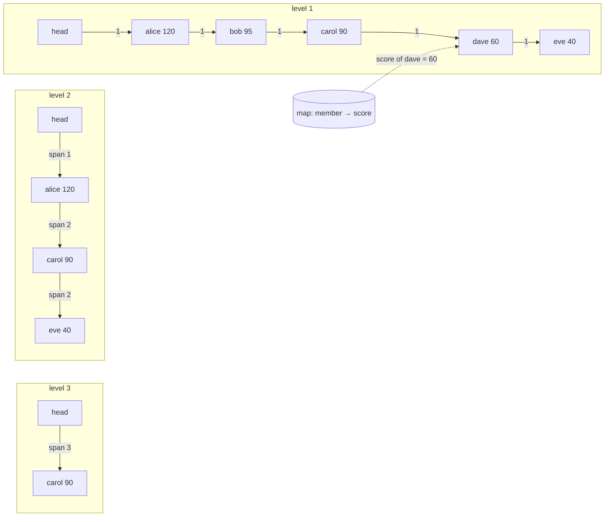

# Leaderboard and Top-K (Skip-List Sorted Set and Space-Saving Heavy Hitters)

## Problem

A game or contest leaderboard has millions of players and a steady stream of score updates, and almost every page view asks three things:

- **Top 100.** `SELECT ... ORDER BY score DESC LIMIT 100` is cheap with an index on `score`, but every score update rewrites that index entry, and at thousands of updates per second the index becomes the hot spot.
- **My rank.** `SELECT COUNT(*) WHERE score > :mine` has to count every row ahead of you. An index on score turns it into a range scan, but the range is still as long as your rank: a player at #800,000 costs 800,000 index entries per page view.
- **Players around me.** That needs the rank first, then an `OFFSET` query, which is another scan of the same length.

A related problem has no fixed key set at all: "trending hashtags" or "most-viewed products this hour" over an unbounded stream of `(item, +1)` events. Keeping an exact counter per item means memory that grows with every new hashtag anyone types, and most of those counters belong to items that appear once.

## Solution

**For ranks, use an order-statistics structure: a skip list with span counts plus a hash map**, which is exactly how a Redis sorted set (ZSET) is built.

- The skip list keeps members sorted by score. Each node has a random height; higher levels skip over many nodes, so a search drops down level by level and visits about `(1/p)·log_{1/p}(n)` nodes, O(log n) expected.
- Every forward pointer also stores its **span**: how many nodes it jumps over. Adding up the spans along the search path gives the member's rank, so "my rank" is O(log n), not O(rank).
- The same trick in reverse finds the node at a given rank in O(log n), so "top 100" and "around me" are O(log n + m) for m returned entries.
- A hash map from member to score finds a member's current score in O(1), which is what you need to locate (and unlink) its node on every update.

**For trending items with a bounded key set, keep exact counts and pick the top K with a size-K min-heap**: O(n log K) instead of sorting all n.

**For an unbounded stream, use Space-Saving** (Metwally, Agrawal and El Abbadi, 2005). Keep only k counters. A monitored item increments its counter. A new item, when all counters are taken, evicts the item with the smallest count `m` and takes over its counter at `m + 1`, recording `m` as its possible overestimate. For a stream of N events:

- every reported count is an upper bound, and the true count is at least `count − error`;
- the error is at most the smallest counter, which is at most `N/k`;
- any item that really occurred more than `N/k` times (more precisely, more than the smallest counter) is guaranteed to be monitored.

Misra-Gries is the close cousin: it decrements all counters instead of evicting the minimum, and gives underestimates with the same `N/k` bound.

## Diagram



Rank of dave: start at the top-left, take `head → carol` (span 3), drop a level, `carol → eve` would overshoot, drop again, `carol → dave` (span 1). Spans add to 4, so dave is #4 (rank 3, 0-based) after visiting 3 nodes instead of 4.

## How this implementation works

- `NewSortedSet(opts...)` builds the skip list with a sentinel head of `WithMaxLevel` levels (default 32) and promotion probability `WithP` (default 0.25), both the Redis defaults. Node heights come from a seeded `math/rand/v2` PCG (`WithSeed`), so the shape and every step count are reproducible.
- **Ordering.** Score descending; **ties are broken by member name ascending.** That makes the order total and deterministic, and Rank, Range and Around agree with an `ORDER BY score DESC, member ASC` oracle (the tests check exactly that). Redis' `ZREVRANK` breaks ties by *reverse* name instead. If "whoever got there first ranks higher" is the rule you want, fold the time into the score (for example `score·2^32 + (maxTime − achievedAt)`) rather than relying on update order.
- `Add(member, score)` and `IncrBy(member, delta)` (ZADD / ZINCRBY) update the map and move the node: it is unlinked and relinked at its new position, keeping its height so updates allocate nothing. `IncrBy` reports `ErrOverflow` rather than wrapping.
- `Rank` (ZREVRANK) walks the levels summing spans; `RankSteps` also returns how many nodes it examined, for the example's comparison. `Range(start, stop)` (ZREVRANGE) uses Redis index rules: inclusive, negative indexes count from the end, out-of-range bounds are clamped. `Top(n)` is `Range(0, n−1)`. `Around(member, n)` returns up to n members on each side, cut short at the top or bottom of the board instead of shifted. `Remove` (ZREM) unlinks the node and fixes the spans.
- `Leaderboard` wraps a `SortedSet` in a `sync.RWMutex`: reads share the lock, writes are serialised, and `IncrBy` is one atomic read-modify-write, like a single Redis command.
- `TopK(counts, k)` keeps a size-k min-heap whose root is the weakest item kept, then sorts the k survivors.
- `SpaceSaving` keeps its k counters in an indexed min-heap (`container/heap` plus a map from item to heap slot), so the minimum is at the root and every `Add` is O(log k). It accepts weighted increments (`Add(item, delta)` with `delta > 0`); the guarantees hold for positive weights. `Estimate`, `Top`, `MinCount` (the current error bound) and `N` expose what you need to reason about accuracy. It has its own mutex.

**Simplifications.** Scores are `int64` instead of Redis' `float64`, which avoids NaN and rounding questions. Redis also keeps a backward pointer per node (for reverse iteration) and updates a score in place when the node would not move; this version always unlinks and relinks. The paper's "stream summary" structure makes unit increments O(1); the heap is O(log k), which is fine for k in the hundreds. A real trending feature also needs time windows (decay or per-window summaries), which is a separate pattern.

## Trade-offs

| Pro | Con |
| --- | --- |
| Rank, top-N and around-me are O(log n): 31 nodes visited on average for 100,000 players in the example, against 100,000 rows for a `COUNT(*)` scan | The whole board lives in memory on one node; sharding it breaks exact global ranks |
| Skip lists are simple, need no rebalancing, and support range scans by walking level 0 | About 1.33 pointers + spans per node at p = 0.25, plus the map: several times the raw data size |
| Space-Saving finds heavy hitters in fixed memory (50 counters instead of 9,870 exact counts) with a provable error bound | Counts are approximate: low-frequency items are noise, and on a flat distribution the top 10 can be wrong (8/10 in the example at k=50) |
| Space-Saving summaries from different machines can be merged | Only answers "who is heavy", not exact counts for arbitrary items |

## When to use / when not to

**Use the sorted set** when you need exact ranks over a board that fits in memory: game and contest leaderboards, "rank by reputation", rate-limit buckets ordered by time, delayed-job queues ordered by run-at time (Redis users put all of these in ZSETs). **Use Space-Saving** when the key space is open-ended and only the heaviest items matter: trending topics, top talkers in network traffic, hot keys in a cache, most-frequent queries.

**Avoid** a single in-memory board when it would not fit or must survive node loss without a replica; avoid Space-Saving when you need exact counts for every item (billing, quotas), or when the distribution is flat enough that the heavy hitters are not much heavier than the tail (see step 6 of the example).

## Sharding and operating a leaderboard

- **Per-region or per-league boards.** Most products shard by something the user already understands: region, league, friend group, season. Each shard is an exact board, and "global top 100" is a scatter-gather of each shard's top 100 merged into one list.
- **Approximate global rank.** Exact global rank across shards needs every shard's count of players ahead of you. Each shard can keep a **histogram of score buckets** (players per 100-point band) and publish it; your global rank is roughly the number of players in higher buckets across all shards, plus an interpolated position inside your own bucket. Buckets are plain counters, so they are cheap to maintain and merge, and this is usually what a "you are in the top 3%" display uses.
- **Redis commands.** `ZADD board 1200 alice`, `ZINCRBY board 50 alice`, `ZREVRANK board alice`, `ZREVRANGE board 0 99 WITHSCORES`, and `ZREVRANK` followed by `ZREVRANGE board r−5 r+5` for "around me". A Redis Cluster puts a whole ZSET on one shard, so very large boards are split by key (`board:{region}`) by the application.
- **Weekly and seasonal boards.** Keep one key per period (`board:2026-W44`) and let the old ones expire, or write all-time scores and take **periodic snapshots** (for example a nightly dump to object storage or a database table) so last week's final standings stay queryable after the live board resets. Snapshots also give you a rebuild path if the in-memory board is lost.

## Real-world examples

- **Redis sorted sets** are a skip list with spans plus a dict from member to score, the structure here; they back leaderboards in many mobile and online games, and Redis' docs use leaderboards as the canonical ZSET example.
- **Twitter/X trends** and similar "trending" features find heavy hitters in the tweet stream over sliding windows, using counting with bounded memory rather than exact counts for every hashtag.
- **Stream processors and analytics databases** ship heavy-hitter sketches: ClickHouse's `topK` is documented as Filtered Space-Saving, and Apache DataSketches' frequent-items sketch (a Misra-Gries relative) is used from Druid, Spark and others for approximate top-K.
- **LevelDB and RocksDB memtables** are skip lists too, chosen for the same reason: sorted inserts and range scans without rebalancing.

## Run it

```sh
go run ./patterns/data/leaderboard-top-k/example
go test ./patterns/data/leaderboard-top-k/
```

The example loads 100,000 players and applies 200,000 score updates. Looking up the rank of `player-042424` (#81,826) visits 26 skip-list nodes; a `COUNT(*)` over the table touches 100,000 rows, and walking the sorted list from the top would take 81,826 steps. Over 1,000 random players the skip list averages 31.0 nodes (max 72). The players around `player-042424` all share its score of 2,313, so their order is the member-name tie-break. Around the leader, `Around(leader, 3)` returns only 4 entries.

The trending part streams 300,000 hashtag events over 20,000 possible tags (9,870 actually appear) through a 50-counter Space-Saving summary. On a Zipf stream with skew 1.3 it finds the true top 10 exactly (10/10, error 0 on each). The smallest counter, which is the error bound for everything it reports, is 2,918; the worst-case bound N/k is 6,000. The true #10 tag has 3,951 mentions, which is above that bound, so it could not have been missed. Step 6 repeats the experiment with a flatter tail (skew 1.1). There the bound rises to 4,528 while the true #10 has only 3,499 mentions, so the top 10 is no longer guaranteed: overlap drops to 8/10, and some reported counts are almost entirely error (4,525). Raising k to 200 brings the bound down to 866 and the overlap back to 10/10. In other words, k has to be chosen so that N/k sits comfortably below the counts you care about.

## Related patterns

- [Sharded counters](../../architecture/sharded-counters): the same "spread a hot write" problem for single counters, and how to sum them back
- [Sharding](../sharding): splitting a board by region or league, and why exact global ranks get expensive
- [Materialized view](../materialized-view): a leaderboard is a continuously maintained view over score events; snapshots are periodic views
- [Windowed stream aggregation](../../distributed/windowed-stream-aggregation): per-window counts for "trending in the last hour"

## Further reading

- Khyati Jha, [High Level System Design Day-9: Caching (Part 4)](https://medium.com/high-level-system-desgin-interview-prep/high-level-system-design-day-9-caching-part-4-ebec82ded648), which includes a leaderboard case study built on Redis sorted sets
- William Pugh, "Skip Lists: A Probabilistic Alternative to Balanced Trees", Communications of the ACM, 1990: the original skip list paper and its expected-cost analysis
- Ahmed Metwally, Divyakant Agrawal and Amr El Abbadi, "Efficient Computation of Frequent and Top-k Elements in Data Streams", ICDT 2005: the Space-Saving algorithm and its error bounds
