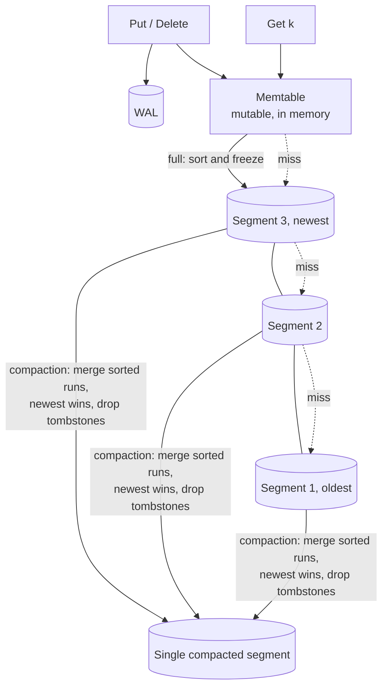

# LSM Tree (Log-Structured Merge Tree)

## Problem

B-trees update pages in place. Every random write becomes a random disk read-modify-write, which hurts badly for write-heavy workloads (time series, event logs, metrics, messaging). You want writes to be **sequential** and batched, while keeping reasonably fast point reads and range scans.

## Solution

Never modify data in place:

1. **Memtable.** Writes go into a sorted in-memory structure, protected by a [write-ahead log](../write-ahead-log).
2. **Flush.** When the memtable is full, write it out as an **immutable sorted segment** (SSTable). This is one sequential write.
3. **Deletes** write a **tombstone**, which shadows older values until compaction removes both.
4. **Reads** check the memtable, then segments from **newest to oldest**. The first version found wins.
5. **Compaction** merges segments in the background (a merge of sorted runs), keeping only the newest version of each key and dropping tombstones once nothing older remains. This bounds read amplification and reclaims space.

## Diagram



## How this implementation works

- `Tree.Put` and `Tree.Delete` write an `entry` (with a `tombstone` flag for deletes) into the `mem` map. Reaching `MemtableLimit` calls `flushLocked`, which sorts the memtable into a new immutable `segment` and **prepends** it, so segments stay newest-first.
- `Get` checks the memtable, then each segment. `segment.get` does a **fence check** (min/max key) and then a binary search. A tombstone ends the search with "not found". Each segment visited counts toward `Stats.SegmentProbes`, which is read amplification made visible.
- `merge(newer, older)` is the core of compaction: a linear merge of two sorted runs in which the newer entry wins on equal keys. `compactLocked` folds every segment from oldest to newest through it and then drops tombstones. That is safe only because a *full* compaction includes the oldest data. Partial or leveled compaction must keep tombstones until they reach the bottom level.
- `MaxSegments` triggers compaction automatically. `Scan(lo, hi)` merges the memtable and every segment's sub-range the same way, so range reads see a consistent, sorted, shadow-free view.
- A model-based test runs 5,000 random puts, deletes, and compactions against a plain map and checks that every read agrees.

## Trade-offs

| Pro | Con |
| --- | --- |
| Very high write throughput: sequential, batched I/O | **Read amplification**: a miss may check many segments (mitigated by Bloom filters and fence pointers) |
| Immutable files make caching, backups, and replication simple | **Write amplification**: compaction rewrites the same data many times |
| Good compression (sorted, immutable blocks) | **Space amplification**: stale versions and tombstones linger until compaction |
| Range scans stay ordered | Compaction competes with foreground I/O and can cause latency spikes |

## When to use / when not to

**Use it** for write-heavy or append-mostly workloads: time series, logs, messaging, metrics, key-value stores with large datasets, and wide-column stores.

**Avoid it** for read-heavy workloads dominated by random point reads with few writes (B-trees often win), or when predictable latency matters more than throughput and you can't tune compaction.

## Real-world examples

- **LevelDB** and its fork **RocksDB** (which in turn underlies storage engines in many systems, such as MyRocks and CockroachDB's earlier storage layer). CockroachDB now uses **Pebble**, a Go LSM engine.
- **Apache Cassandra**, **ScyllaDB**, **HBase**, and **Google Bigtable** use memtables flushed to SSTables, with compaction.
- The original design is O'Neil et al., "The Log-Structured Merge-Tree" (1996).

## Run it

```sh
go run ./patterns/data/lsm-tree/example
go test ./patterns/data/lsm-tree/
```

## Related patterns

- [Write-ahead log](../write-ahead-log): makes the memtable durable
- [Bloom filter](../bloom-filter): one per segment, to skip segments on point reads
- [Event sourcing](../event-sourcing): the same append-only idea at the application level
- [Sharding](../sharding): range-partitioned LSM engines split hot ranges
