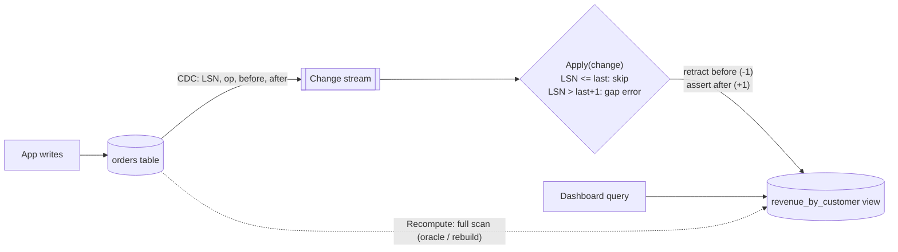

# Materialized View (Incremental Maintenance)

## Problem

A dashboard runs `SELECT customer, COUNT(*), SUM(amount) ... GROUP BY customer` over a large orders table on every page load. The query scans millions of rows to produce a few, and it competes with the transactional workload. Caching the result helps until it goes stale. Recomputing it on a schedule makes it stale *and* still expensive.

## Solution

Store the query result as its own table, a **materialized view**, and keep it current **incrementally** from the base table's change stream. Each insert, update, or delete arrives with its row images *before* and *after*, and the view applies a **delta**:

- **Insert:** add the new row's contribution.
- **Delete:** subtract the old row's contribution.
- **Update:** subtract the old, add the new. This handles moves between groups (a customer change) and filter changes (cancelling an order removes its revenue).

The cost per change is O(1), whatever the table size. Each change carries a log sequence number (LSN): duplicates are skipped, so at-least-once delivery is fine, and gaps are refused, because a silently missed change would corrupt the view forever.

## Diagram



## How this implementation works

- `Table` is the base table. `Insert`, `Update`, and `Delete` mutate rows and `emit` a `Change{LSN, Op, Before, After}` in the same critical section, so the change log is exactly the commit order. A failed mutation emits nothing. `ChangesSince(lsn)` is the CDC feed.
- `View.contribute(row, ±1)` is the whole aggregation logic: count every order, sum `Amount` for non-cancelled ones, and drop a group when its count reaches zero.
- `View.Apply` enforces LSN ordering (idempotent on duplicates, `ErrGap` on holes), then retracts `Before` and asserts `After`. `CatchUp` pulls and applies everything new. In production that would be a Debezium, Kafka, or logical-replication consumer.
- `Recompute(rows)` builds the same aggregate with a full scan. The key test runs 3,000 random inserts, updates (including customer moves and cancellations), and deletes, catches up at irregular points, and checks that the incremental view **equals** the recomputation.

## Trade-offs

| Pro | Con |
| --- | --- |
| Reads are a key lookup on a precomputed result | Extra storage, and every write now does extra work downstream |
| O(1) maintenance per change instead of an O(n) scan | Only *incrementally maintainable* aggregates are easy (SUM, COUNT, AVG via sum/count). MIN/MAX and DISTINCT need extra state on delete |
| The view can live in a different store, shaped for the query | Asynchronous views are eventually consistent, so readers see a lag |
| Can always be rebuilt from scratch as a safety net | The change stream must be complete and ordered. One lost event corrupts it, hence gap detection |

## When to use / when not to

**Use it** for expensive aggregates or joins that are read far more often than the underlying data changes: dashboards, leaderboards, per-tenant usage counters, search or denormalised read models in [CQRS](../cqrs).

**Avoid it** when the query is cheap already, when results must be exactly current within the writing transaction (compute them in the transaction, or use the database's synchronous indexed views), or for aggregates that can't be maintained incrementally without keeping all the underlying data.

## Real-world examples

- **PostgreSQL** `MATERIALIZED VIEW` (full refresh with `REFRESH MATERIALIZED VIEW [CONCURRENTLY]`). **Oracle** supports fast (incremental) refresh from materialized-view logs. **SQL Server** maintains *indexed views* synchronously.
- **Materialize** and **RisingWave** are streaming databases built around incrementally maintained views. **ClickHouse** materialized views transform each insert block into a target table.
- **Apache Kafka Streams** and **ksqlDB** tables are continuously maintained aggregates over change streams.

## Run it

```sh
go run ./patterns/data/materialized-view/example
go test ./patterns/data/materialized-view/
```

## Related patterns

- [CQRS](../cqrs): materialized views are its read models
- [Event sourcing](../event-sourcing): the event stream is a natural change feed
- [Transactional outbox](../../distributed/transactional-outbox): emit change events atomically with the write
- [Pub-sub](../../distributed/pub-sub): fan the change stream out to many views
- [Fan-out feed](../../architecture/fan-out-feed): a precomputed-per-user materialization
- [Sharded counters](../../architecture/sharded-counters): another way to keep hot aggregates cheap
