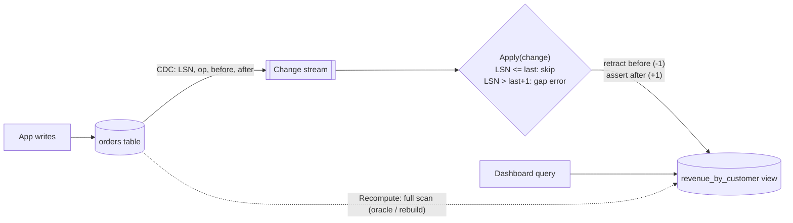
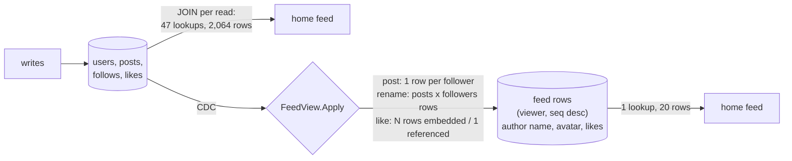

# Materialized View (Incremental Maintenance)

## Problem

A dashboard runs `SELECT customer, COUNT(*), SUM(amount) ... GROUP BY customer` over a large orders table on every page load. The query scans millions of rows to produce a few, and it competes with the transactional workload. Caching the result helps until it goes stale. Recomputing it on a schedule makes it stale *and* still expensive.

## Solution

Store the query result as its own table, a **materialized view**, and keep it current **incrementally** from the base table's change stream. Each insert, update, or delete arrives with its row images *before* and *after*, and the view applies a **delta**:

- **Insert:** add the new row's contribution.
- **Delete:** subtract the old row's contribution.
- **Update:** subtract the old, add the new. This handles moves between groups (a customer change) and filter changes (cancelling an order removes its revenue).

The cost per change is O(1), whatever the table size. Each change carries a log sequence number (LSN): duplicates are skipped, so at-least-once delivery is fine, and gaps are refused, because a silently missed change would corrupt the view forever.

### Denormalized feed rows: why no JOIN on the read path

The same idea applies to joins, not just aggregates. In a normalized social schema (users, posts, follows, likes), a home feed query joins all four tables. It finds who the viewer follows, reads their posts, and then, for every post it keeps, looks up the author row and counts the like rows. That is dozens of index probes and thousands of rows per page view, and the read path is the hot path.

A **feed-row view** stores one row per (viewer, post), keyed for a range scan by viewer and newest first, and *embeds* everything the page renders: the author's name and avatar and the like count. A read is one lookup and one row per item, with no join. Every cost moves to the write path:

- **A new post** is copied into each follower's partition, so one row per follower.
- **A profile change fans out.** An author rename is a one-row `UPDATE users` in the normalized model, but the view must rewrite every row that embedded the old name: *posts by the author x followers*. That is the write amplification you sign up for.
- **A follow or unfollow** backfills or removes the followee's posts in one partition.
- **Embed vs reference volatile fields.** Rarely changing data (name, avatar) is worth copying. A like count changes constantly. Embedding it rewrites a row per follower on every like. Referencing it (one counter row per post, looked up by key at read time) keeps a like at one write and adds one point lookup per row read. That is still no join, but no longer a single scan. The rule of thumb: embed what is read often and changes rarely, and reference what changes often.

## Diagram



The feed-row view: the join happens once per write, not once per read.



## How this implementation works

- `Table` is the base table. `Insert`, `Update`, and `Delete` mutate rows and `emit` a `Change{LSN, Op, Before, After}` in the same critical section, so the change log is exactly the commit order. A failed mutation emits nothing. `ChangesSince(lsn)` is the CDC feed.
- `View.contribute(row, ±1)` is the whole aggregation logic: count every order, sum `Amount` for non-cancelled ones, and drop a group when its count reaches zero.
- `View.Apply` enforces LSN ordering (idempotent on duplicates, `ErrGap` on holes), then retracts `Before` and asserts `After`. `CatchUp` pulls and applies everything new. In production that would be a Debezium, Kafka, or logical-replication consumer.
- **Feed rows** (`feed.go`). `SocialDB` is the normalized source with its own CDC log (`SocialChange`: `UserAdded`, `UserUpdated`, `PostCreated`, `PostDeleted`, `Followed`, `Unfollowed`, `Liked`, `Unliked`). `SocialDB.HomeFeedJoin(viewer, limit)` is the joined query, and `FeedView.HomeFeed(viewer, limit)` reads the view. Both return the same `[]FeedItem` plus a `Cost{Lookups, Rows}` that counts index probes and rows touched rather than time. `FeedView.Apply` returns the rows each change wrote, and `WithLikeMode(EmbedLikes | ReferenceLikes)` picks how like counts are stored. The view keeps the routing state a stream processor would hold locally (each author's followers and posts, plus a post -> rows index). The tests check that after 2,500 random changes, in both modes, every user's view feed equals the joined query. They also check that a rename rewrites exactly *posts x followers* rows.
- In the example (1,000 fans of one author with 30 posts, plus 5 of 20 smaller authors each), fan0's 20-item feed costs **47 lookups / 2,064 rows** through the JOIN. Most of those rows are like rows read by `COUNT(*)`. The view costs **1 lookup / 20 rows** embedded and **21 / 40** referenced. On the write side, each of these is a 1-row write in the normalized model. In the view, a new post inserts 1,000 rows and the rename rewrites **31,000** (31 posts x 1,000 followers). One like rewrites 1,000 rows embedded vs 1 referenced. Embedding likes made the initial load write 3,080,000 rows instead of 83,000.
- `Recompute(rows)` builds the same aggregate with a full scan. The key test runs 3,000 random inserts, updates (including customer moves and cancellations), and deletes, catches up at irregular points, and checks that the incremental view **equals** the recomputation.

**Simplification.** The feed view is in memory and applies changes synchronously when you call `CatchUp`. A real one is a wide-column table (Cassandra or similar) partitioned by viewer, fed by a CDC consumer, and during a big fan-out such as a rename readers see a mix of old and new names until it finishes. Costs are counted as an index-backed database would pay them: a range scan reads only the rows it returns. The in-memory structures underneath are not tuned to match. The model also skips what real feeds add: capping partitions at the newest N rows, pulling celebrity posts at read time instead of fanning them out, and ranking.

## Trade-offs

| Pro | Con |
| --- | --- |
| Reads are a key lookup on a precomputed result | Extra storage, and every write now does extra work downstream |
| O(1) maintenance per change instead of an O(n) scan | Only *incrementally maintainable* aggregates are easy (SUM, COUNT, AVG via sum/count). MIN/MAX and DISTINCT need extra state on delete |
| The view can live in a different store, shaped for the query | Asynchronous views are eventually consistent, so readers see a lag |
| Can always be rebuilt from scratch as a safety net | The change stream must be complete and ordered. One lost event corrupts it, hence gap detection |
| Denormalized feed rows make a feed read one range scan (1 lookup, 20 rows vs 47 lookups, 2,064 rows joined) | Writes fan out: a post is copied to every follower, and an author rename rewrites posts x followers rows (31,000 for one rename in the example). Volatile fields must be referenced, not embedded |

## When to use / when not to

**Use it** for expensive aggregates or joins that are read far more often than the underlying data changes: dashboards, leaderboards, per-tenant usage counters, search or denormalised read models in [CQRS](../cqrs).

**Avoid it** when the query is cheap already, when results must be exactly current within the writing transaction (compute them in the transaction, or use the database's synchronous indexed views), or for aggregates that can't be maintained incrementally without keeping all the underlying data.

For **denormalized feed rows** specifically: they pay off when reads vastly outnumber writes and the embedded fields rarely change. They hurt for accounts with huge follower counts (one post or rename turns into millions of row writes, so pull those at read time instead) and for fields that change constantly (reference them).

## Real-world examples

- **Instagram, Twitter/X, and LinkedIn feeds** serve timelines from precomputed per-user rows (Cassandra, Redis, or in-house stores) that carry denormalized post data. Profile changes are propagated asynchronously or resolved at read time from a cache keyed by user ID.

- **PostgreSQL** `MATERIALIZED VIEW` (full refresh with `REFRESH MATERIALIZED VIEW [CONCURRENTLY]`). **Oracle** supports fast (incremental) refresh from materialized-view logs. **SQL Server** maintains *indexed views* synchronously.
- **Materialize** and **RisingWave** are streaming databases built around incrementally maintained views. **ClickHouse** materialized views transform each insert block into a target table.
- **Apache Kafka Streams** and **ksqlDB** tables are continuously maintained aggregates over change streams.

## Run it

```sh
go run ./patterns/data/materialized-view/example
go test ./patterns/data/materialized-view/
```

## Related patterns

- [CQRS](../cqrs): materialized views are its read models
- [Event sourcing](../event-sourcing): the event stream is a natural change feed
- [Transactional outbox](../../distributed/transactional-outbox): emit change events atomically with the write
- [Pub-sub](../../distributed/pub-sub): fan the change stream out to many views
- [Fan-out feed](../../architecture/fan-out-feed): a precomputed-per-user materialization, including the push vs pull choice for celebrity accounts that the feed-row view here ignores
- [Sharded counters](../../architecture/sharded-counters): another way to keep hot aggregates cheap, such as the referenced like count

## Further reading

- Arvind Kumar, [Why Instagram Avoids JOINs at Scale](https://codefarm0.medium.com/why-instagram-avoids-joins-at-scale-system-design-deep-dive-on-denormalization-and-read-b66f4a9f2c91), a deep dive on denormalization and read-optimized feed storage
