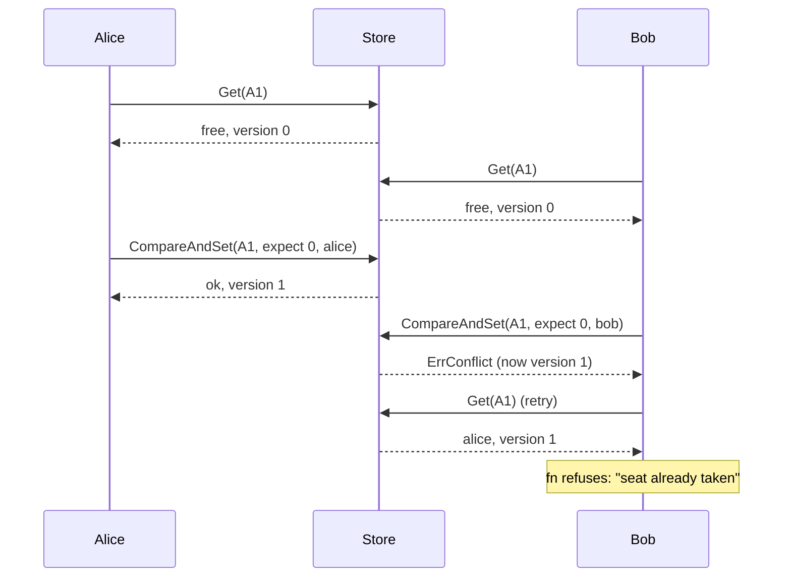

# Optimistic Locking (Versioned Compare-and-Set)

## Problem

Booking a seat looks like three harmless steps: read the seat, check that it is free, write "booked by me". Run two of those at once and they interleave:

1. Alice reads seat A1: free.
2. Bob reads seat A1: free.
3. Alice writes "A1 = alice". Success.
4. Bob writes "A1 = bob". Success.

Both writes succeeded, both buyers got a confirmation email, and the database says the seat is Bob's. Alice's booking was not rejected, it was silently overwritten. This is the **lost update**: each writer's decision was correct for the data it read, but that data was out of date by the time it wrote. No error is raised and nothing is logged, so the first sign is two people arguing over one seat.

Wrapping each step in its own transaction doesn't help: the read and the write are separate statements, and the default isolation level in most databases (read committed) lets the second writer through.

## Solution

Give every record a **version** that goes up by one on every write, and make the write conditional on it:

1. **Read** the value *and* its version.
2. **Decide** without holding any lock: compute the new value from what you read.
3. **Compare-and-set**: write the new value only if the version is still the one you read. The check and the write are a single atomic step in the store.
4. On a **conflict** someone else wrote first. Your decision is based on stale data, so re-read and decide again. The second look may say "seat already taken", which ends the attempt with a proper error instead of a double booking.
5. **Bound the retries.** If you keep losing races, stop with a "too many conflicts" error rather than spinning forever.

It is called *optimistic* because it assumes conflicts are rare and only pays for them when they happen. The *pessimistic* alternative locks the record before reading it and holds the lock until the write is done: no conflicts are possible, but every other writer waits, and a slow or crashed lock holder blocks the key.

## Diagram



## How this implementation works

- `NewStore[K, V]()` returns a concurrency-safe in-memory `Store`. `Get(key)` returns a `Versioned[V]{Value, Version}`; a missing key is the zero value at **version 0**, so `CompareAndSet(key, 0, v)` means "create, but only if nobody else has" (like `If-None-Match: *`).
- `CompareAndSet(key, expectedVersion, newValue) (uint64, error)` checks the version and writes under one mutex, returning the new version or an error matching `ErrConflict`.
- `Update(ctx, key, fn, maxAttempts) (Result[V], error)` is the retry loop: read, call `fn(current)`, compare-and-set at the version that was read, and on a conflict start again. `Result.Attempts` says how many tries it took. Three ways out besides success:
  - `fn` returns an error (for example "seat already taken"): returned unchanged, nothing is written.
  - the context ends between attempts: `ctx.Err()` is returned.
  - all `maxAttempts` lost a race: an error matching both `ErrTooManyConflicts` and `ErrConflict`.
- `fn` may be called once per attempt, so it must be a pure function of the value it is given (no sending emails or charging cards inside it; do that after `Update` succeeds).
- `Put(key, value)` is an unconditional, last-write-wins write. It exists only so the example can show the naive version.
- `Stats()` counts reads, successful writes and conflicts. The example uses the conflict count, which is deterministic in its lock-step simulation, instead of timings.

**Simplification.** This is one in-memory map behind one mutex, so "atomic compare-and-set" is trivially true. In a real system the store provides that atomicity: a single `UPDATE ... WHERE version = ?` statement, a conditional write, or a transaction. `Update` also retries immediately; against a real database you would add jittered backoff between attempts (see [retry with backoff](../../reliability/retry-backoff)) so that losers don't collide again in lock-step.

### Why a version and not the value (ABA)

It is tempting to skip the version column and write "set A1 = bob where A1 is still free". That compares the *value*, and values can come back. Bob reads A1: free. Carol books it, then cancels, so it is free again. Bob's check "is it still free?" passes, though the seat has had a whole history since he looked: a hold he never saw, maybe a price change, or another buyer's half-finished checkout that relied on it. This is the **ABA problem**: the value went A → B → A, and a value comparison can't tell. A version number only ever increases (0 → 1 → 2), so it never repeats, and Bob's write at version 0 is rejected at version 2. `TestABA` checks exactly this. The same reasoning is why lock-free data structures pair pointers with counters, and why fencing tokens are monotonic.

## Trade-offs

| Pro | Con |
| --- | --- |
| No locks held while the caller thinks, so a slow or crashed client can't block a key | Under contention most attempts are wasted: in the example, 100 buyers on one key with 5 attempts each sell only 5 tickets |
| Low contention costs nothing: every first attempt succeeds | Losers must re-read and recompute, so `fn` has to be safe to run more than once |
| Works across processes and over HTTP, needing only a version column or ETag | Unfair: a buyer can lose every race in a row; there is no queue |
| Conflicts are explicit errors, not silent overwrites | Needs a retry budget, and "gave up after N conflicts" is an error users can see |
| No deadlocks, since there are no locks to order | Only protects a single record; multi-record invariants need a transaction or a saga |

## When to use / when not to

**Use it** when the same record is rarely written by two people at once: editing a profile, a document, a config object, a cart, a booking for a specific seat or room, a Kubernetes resource. Also when writers can't hold a lock for long, such as a user who opens an edit form and submits it minutes later (the version travels with the form).

**Don't use it** for hot keys that everyone writes: a shared counter, the remaining-ticket pool of a general-admission sale, a rate-limit bucket. There, conflicts are the norm and retries multiply the load. Use a lock per key, an atomic increment in the store (`UPDATE ... SET n = n - 1 WHERE n > 0`), [sharded counters](../../architecture/sharded-counters), or a queue that applies the changes one at a time. For a seat that must be *held* for a few minutes while the buyer pays, combine it with a [reservation hold](../reservation-hold).

## Real-world examples

- **SQL**: a `version` column and `UPDATE seats SET owner = ?, version = version + 1 WHERE id = ? AND version = ?`; if rows affected is 0, someone else got there first. JPA/Hibernate (`@Version`), Rails (`lock_version`) and Entity Framework (concurrency tokens) generate this for you. The pessimistic counterpart is `SELECT ... FOR UPDATE`.
- **DynamoDB** conditional writes: `PutItem`/`UpdateItem` with `ConditionExpression: "version = :expected"`, failing with `ConditionalCheckFailedException`.
- **etcd and Kubernetes**: every object has a `resourceVersion`; an update carrying an old one gets `409 Conflict`, and controllers re-read and retry (client-go even ships a `RetryOnConflict` helper). etcd transactions compare `mod_revision` before writing.
- **HTTP**: `ETag` plus `If-Match` on `PUT`/`PATCH`, answered with `412 Precondition Failed` on a mismatch; see [conditional requests](../../architecture/conditional-requests).
- **CPUs and Go itself**: `sync/atomic`'s `CompareAndSwap` is the hardware version of the same idea.

## Run it

```sh
go run ./patterns/data/optimistic-locking/example
go test ./patterns/data/optimistic-locking/
```

## Related patterns

- [Reservation hold](../reservation-hold): hold a seat for a few minutes while the buyer pays; the hold itself is claimed with a conditional write like this one
- [Conditional requests](../../architecture/conditional-requests): the same check over HTTP, with ETags and `If-Match`
- [Distributed lock with fencing](../../distributed/distributed-lock-fencing): the pessimistic approach across machines; its fencing token is a monotonic version checked by the store, for the same ABA reason
- [Idempotency key](../../reliability/idempotency-key): stops the *same* buyer's retried request from booking twice; optimistic locking stops *different* buyers from overwriting each other
- [Retry with backoff](../../reliability/retry-backoff): spacing out conflict retries against a real database
- [Sharded counters](../../architecture/sharded-counters): one way out when a single hot key causes constant conflicts

## Further reading

- Arvind Kumar, [BookMyShow Sells the Same Seat Twice](https://codefarm0.medium.com/bookmyshow-sells-the-same-seat-twice-system-design-interview-deep-dive-on-race-conditions-and-64e798f34d21), the interview scenario on race conditions and pessimistic vs optimistic locking
