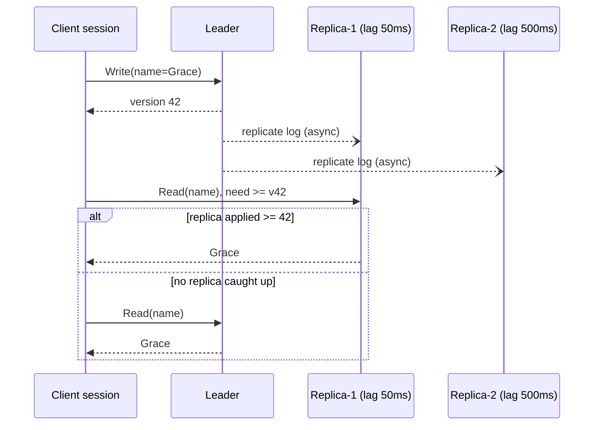

# Read Replicas (Leader-Follower Replication)

## Problem

Reads outnumber writes 10:1 or 100:1, and the primary database is saturated by read traffic. Sharding is overkill, since the data fits on one node, but one node can't serve all the reads.

## Solution

Keep one **leader** that accepts all writes, and several **followers** (read replicas) that copy the leader's replication log asynchronously. Spread reads across the followers.

Asynchronous replication means **replication lag**: a follower may be milliseconds or minutes behind. The most visible symptom is a user who saves a change and immediately sees the old value. The usual fix is **read-your-writes** consistency: remember the log position (version) of the client's last write, and read only from a replica that has applied at least that position. If none has, read from the leader.

Three extensions make this work in a real web tier:

- **Portable session tokens.** App servers behind a load balancer are stateless, so the next request may land on a server that never saw the write. The session's consistency state (last write version, highest version read, time of last write) is a few dozen bytes, so it goes into an opaque, HMAC-signed token in a cookie or header. Any server can resume the session from it.
- **Monotonic reads.** A user who never writes can still see time run backwards: one refresh hits a fresh replica, the next a stale one. The session also remembers the highest log version it has *read*, and only reads from replicas at least that far along.
- **Leader for a window after a write.** The simpler alternative needs no versions at all: for N ms after a write, send that user's reads to the leader. It is easy to bolt on, but it loads the leader even when replicas have caught up, and it quietly breaks if lag ever exceeds N.

## Diagram



## How this implementation works

- `New(lags, WithClock(...))` builds a leader and one follower per lag. Replication is simulated deterministically: every write is timestamped in the leader's `log`, and `catchUp` applies, **in log order**, the entries at least `lag` old. Followers therefore always hold a consistent *prefix* of the log, as real replicas do.
- `Write` returns a `Version`, the log position.
- `Read` is the plain eventually consistent path: round-robin over followers, possibly stale.
- `ReadAtLeast(key, v)` tries followers round-robin and uses the first one whose `applied >= v`. Otherwise it falls back to the leader. `Stats` counts leader fallbacks so you can see the cost.
- `Session` tracks its own `lastWrite` and uses `ReadAtLeast` for every read. `NewSession` takes optional `SessionOption`s, so existing callers are unchanged.
- `(*Session).Token()` encodes `lastWrite`, `lastRead` and the last write's timestamp as 25 bytes, appends a 32-byte HMAC-SHA256 when the cluster was built with `WithTokenKey(key)`, and base64url-encodes the result (76 characters signed). `(*Cluster).ResumeSession(token, opts...)` validates it and rebuilds the session on any app server. It returns `ErrInvalidToken` for bad base64, wrong length, an unknown format byte, a bad signature, or a version beyond the leader's head. Read policy options are passed by the resuming server, not carried in the token.
- `WithMonotonicReads()` makes every read require `applied >= max(lastWrite, lastRead)`, and records the answering node's applied version as the new `lastRead`. A leader fallback records the leader's head, which can briefly push later reads to the leader too.
- `WithLeaderAfterWrite(window)` replaces version tracking: reads go to the leader while `now - lastWriteAt < window`, then to any replica. The example shows it sending 4 of 12 reads to the leader and still serving 3 stale reads once the 200ms window expires on a 500ms-lag replica, while the version token sent 1 read to the leader and served none stale.

**Simplification.** Versions are positions in a single leader's log. After a failover the new leader has a different log, so real systems carry a term or epoch alongside the position (MongoDB's `clusterTime`, a Postgres timeline, a MySQL GTID's server UUID). The HMAC key here is one static secret; production would rotate keys and include a key id in the token. Tokens never expire here. Real tokens often carry an issue time so very old ones can be dropped.

**Why sign the token?** A client that forges a *low* version only hurts itself: it may read stale copies of its own writes. A forged *high* version is worse for everyone, because it can never be satisfied by a replica and pins every read to the leader. `ResumeSession` rejects versions beyond the leader head even without a key, and the HMAC stops a client from picking any value at all.

## Trade-offs

| Pro | Con |
| --- | --- |
| Read capacity scales with the number of replicas | Replicas are **stale** by the lag, with no bound under load |
| Replicas double as hot standbys for failover | Writes don't scale, because the leader is still a single node |
| Read-your-writes fixes the most visible anomaly cheaply | Read-your-writes adds routing logic and some leader load. Cross-user staleness remains, and monotonic reads need their own tracking |
| Analytics and backups can run on replicas | Async failover can **lose** writes the new leader never received |
| A signed session token lets stateless app servers keep read-your-writes and monotonic reads with no shared session store | The token is extra state on every request, needs a shared signing key, and loses meaning across a failover unless it carries an epoch |
| Leader-after-write windows need no version plumbing at all | They send reads to the leader regardless of replica state and break silently when lag exceeds the window |

### Consistency guarantees

| Guarantee | What the user sees | How this package provides it |
| --- | --- | --- |
| Read-your-writes | After I save, I see my save | Read only from nodes with `applied >= lastWrite` (default `Session`) |
| Monotonic reads | Refreshing never shows something older than I already saw | Read only from nodes with `applied >= lastRead` (`WithMonotonicReads`) |
| Causal consistency (per session) | Both of the above, plus writes I make after reading something are ordered after it | A single leader already orders every write after everything committed before it, so read-your-writes + monotonic reads on one session give causal consistency within that session. Across sessions, pass the token along (for example from the reader of a comment to the person replying) |

These are *session* guarantees: they hold for whoever carries the token. Other users can still see stale data until replicas catch up. Only reading from the leader, synchronous replication, or quorum reads give everyone the latest value.

## When to use / when not to

**Use it** for read-heavy workloads that tolerate slightly stale reads (feeds, catalogues, dashboards), when you can route the few read-after-write paths through a session or the leader.

**Avoid it** when every read must be linearizable (use the leader, synchronous replication, or [quorum](../../distributed/quorum) reads), or when writes are the bottleneck (see [sharding](../sharding)).

## Real-world examples

- **PostgreSQL** streaming replication and **MySQL** binlog replication with read replicas, including managed offerings such as **Amazon RDS read replicas** and **Aurora replicas**.
- **MongoDB** replica sets with `readPreference: secondary`, plus *causally consistent sessions* that provide read-your-writes on secondaries.
- **Redis** primary/replica replication.
- **MongoDB causally consistent sessions** return an `operationTime` and `$clusterTime` with every response. The driver sends them as `afterClusterTime` on the next read, and a secondary waits until it has applied that point. Drivers let you copy these between sessions with `advanceOperationTime` / `advanceClusterTime`, which is the token hop shown here.
- **PostgreSQL**: after a write, read `pg_current_wal_lsn()` on the primary and store it. Route the next read to a standby only if its `pg_last_wal_replay_lsn()` is at least that LSN, otherwise use the primary.
- **MySQL**: with GTIDs enabled, keep the GTID set of the write (from the session tracker or `@@gtid_executed`) and run `WAIT_FOR_EXECUTED_GTID_SET(gtids, timeout)` on a replica before reading, or pick a replica whose `gtid_executed` already contains it. ProxySQL can do this routing automatically.
- **Azure Cosmos DB** *session consistency* returns a session token in the `x-ms-session-token` header. The SDK sends it back so replicas serve only data at least that new, and you can pass the token between clients to share the session. **Amazon DynamoDB** takes the simpler route: a per-request `ConsistentRead=true` flag that reads from the leader, rather than a session token.
- Rails (since 6) has built-in multi-database support that automatically switches reads to replicas and keeps a recently-writing request on the primary for a short delay, a time-based form of read-your-writes.

## Run it

```sh
go run ./patterns/data/read-replicas/example
go test ./patterns/data/read-replicas/
```

## Related patterns

- [Cache-aside](../cache-aside): the other common way to scale reads
- [CQRS](../cqrs): replicas taken further, with a read model in a different shape
- [Sharding](../sharding): when writes, not reads, are the bottleneck
- [Leader election](../../distributed/leader-election): promoting a follower when the leader fails
- [Quorum](../../distributed/quorum): tunable consistency without a single leader
- [Lamport and vector clocks](../../distributed/lamport-vector-clocks): versions and causality tracking in general
- [Conditional requests](../../architecture/conditional-requests): ETags and `If-None-Match`, version tokens at the HTTP layer
- [Two-tier cache](../two-tier-cache): another place where a user can read their own stale data

## Further reading

- Khyati Jha, [High Level System Design Day-7: Caching (Part 2)](https://medium.com/high-level-system-desgin-interview-prep/high-level-system-design-day-7-caching-part-2-9b61df0289db), which covers read-your-writes and keeping caches consistent with the source of truth
