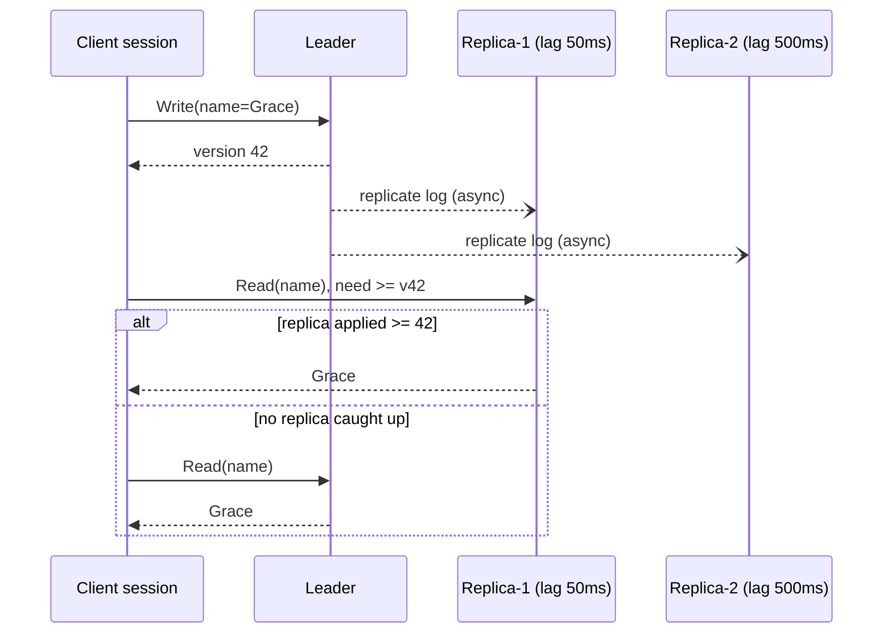

# Read Replicas (Leader-Follower Replication)

## Problem

Reads outnumber writes 10:1 or 100:1, and the primary database is saturated by read traffic. Sharding is overkill, since the data fits on one node, but one node can't serve all the reads.

## Solution

Keep one **leader** that accepts all writes, and several **followers** (read replicas) that copy the leader's replication log asynchronously. Spread reads across the followers.

Asynchronous replication means **replication lag**: a follower may be milliseconds or minutes behind. The most visible symptom is a user who saves a change and immediately sees the old value. The usual fix is **read-your-writes** consistency: remember the log position (version) of the client's last write, and read only from a replica that has applied at least that position. If none has, read from the leader.

## Diagram



## How this implementation works

- `New(lags, WithClock(...))` builds a leader and one follower per lag. Replication is simulated deterministically: every write is timestamped in the leader's `log`, and `catchUp` applies, **in log order**, the entries at least `lag` old. Followers therefore always hold a consistent *prefix* of the log, as real replicas do.
- `Write` returns a `Version`, the log position.
- `Read` is the plain eventually consistent path: round-robin over followers, possibly stale.
- `ReadAtLeast(key, v)` tries followers round-robin and uses the first one whose `applied >= v`. Otherwise it falls back to the leader. `Stats` counts leader fallbacks so you can see the cost.
- `Session` tracks its own `lastWrite` and uses `ReadAtLeast` for every read. In a web app this version would travel in a cookie or token (for example a Postgres LSN or MySQL GTID).

## Trade-offs

| Pro | Con |
| --- | --- |
| Read capacity scales with the number of replicas | Replicas are **stale** by the lag, with no bound under load |
| Replicas double as hot standbys for failover | Writes don't scale, because the leader is still a single node |
| Read-your-writes fixes the most visible anomaly cheaply | Read-your-writes adds routing logic and some leader load. Other anomalies remain: monotonic reads, cross-user staleness |
| Analytics and backups can run on replicas | Async failover can **lose** writes the new leader never received |

## When to use / when not to

**Use it** for read-heavy workloads that tolerate slightly stale reads (feeds, catalogues, dashboards), when you can route the few read-after-write paths through a session or the leader.

**Avoid it** when every read must be linearizable (use the leader, synchronous replication, or [quorum](../../distributed/quorum) reads), or when writes are the bottleneck (see [sharding](../sharding)).

## Real-world examples

- **PostgreSQL** streaming replication and **MySQL** binlog replication with read replicas, including managed offerings such as **Amazon RDS read replicas** and **Aurora replicas**.
- **MongoDB** replica sets with `readPreference: secondary`, plus *causally consistent sessions* that provide read-your-writes on secondaries.
- **Redis** primary/replica replication.
- Rails (since 6) has built-in multi-database support that automatically switches reads to replicas and keeps a recently-writing request on the primary for a short delay, a time-based form of read-your-writes.

## Run it

```sh
go run ./patterns/data/read-replicas/example
go test ./patterns/data/read-replicas/
```

## Related patterns

- [Cache-aside](../cache-aside): the other common way to scale reads
- [CQRS](../cqrs): replicas taken further, with a read model in a different shape
- [Sharding](../sharding): when writes, not reads, are the bottleneck
- [Leader election](../../distributed/leader-election): promoting a follower when the leader fails
- [Quorum](../../distributed/quorum): tunable consistency without a single leader
- [Lamport and vector clocks](../../distributed/lamport-vector-clocks): versions and causality tracking in general
