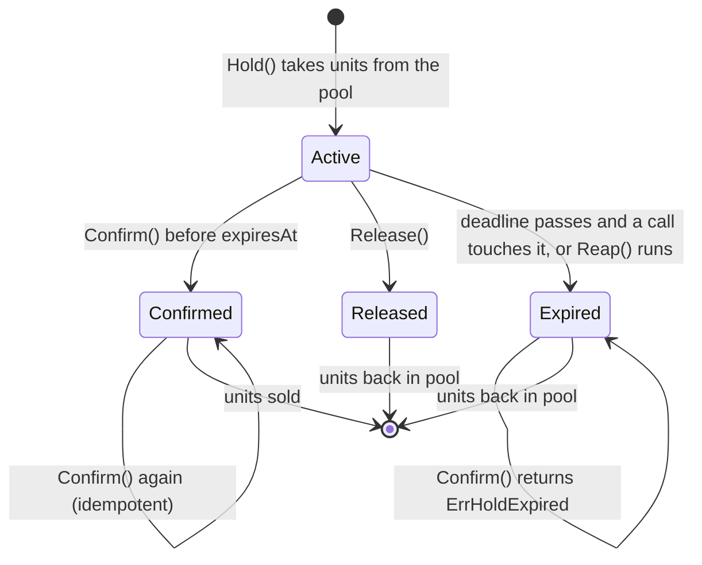

# Reservation Hold (TTL holds with a reaper)

## Problem

Checkout is not instant. Between "I want these two seats" and "payment succeeded" there are minutes of form filling, 3-D Secure prompts and slow payment providers. Something has to stop a second shopper from paying for the same seats in that gap, and every simple answer goes wrong in one of two directions:

- **Holds that never expire.** The seat is taken out of the pool when checkout starts and only comes back if the shopper cancels. Shoppers rarely cancel: they close the tab, lose signal or give up on a failed card. In a flash sale those dead carts lock a large share of the inventory, so the event shows "sold out", turns real buyers away and still ends with empty seats.
- **Holds that expire, but late payments still count.** The seat goes back to the pool on a timer and is sold to someone else, then the first shopper's payment arrives and is also turned into a sale. Two people now own one seat: an oversell, a refund and an angry customer at the gate.
- **No hold at all** (check stock only at payment time) means people fill in their card details and then lose the seat at the last step, and two concurrent payments can both pass a stale availability check.

## Solution

Give every hold a **deadline**, and let the deadline, not a background job, decide what a hold is worth:

1. **Hold(items, holder, ttl)** atomically takes the units out of the available pool and records `expiresAt = now + ttl`. Multi-item holds are **all-or-nothing**: if one item is short, nothing is held.
2. **Confirm(holdID)** turns the hold into a sale only if `now < expiresAt`. After the deadline it fails with `ErrHoldExpired` and the payment is refunded (or retried against seats that are still free). Confirm is **idempotent**: a confirmed hold confirms again with the same success, so retried payment webhooks can't double-sell.
3. **Release(holdID)** hands units back early when the shopper cancels.
4. **Expired holds return to the pool twice over**: *lazily*, whenever a call touches an item with an overdue hold, and *in bulk* by a **reaper** (`Reap()`) run on a ticker. Lazy expiry makes correctness independent of the reaper; the reaper keeps totals, dashboards and memory honest and is where "your seats were released" notifications come from.

## Diagram



## How this implementation works

- `New(stock, opts...)` creates an `Inventory` from `map[itemID]units`: 1 for a numbered seat, N for general admission or a product's stock level. `WithClock` injects time.
- `Hold(items []string, holder string, ttl)` takes one unit per entry (repeat an ID for several units). Under one mutex it first expires overdue holds on the requested items, then checks *every* item, then decrements them all, so a refusal (`ErrUnavailable`, `ErrUnknownItem`) never leaves a partial hold.
- Each item keeps an index of the active holds that include it, so lazy expiry only looks at holds on the items being touched. `Available(item)` also expires lazily; `Totals()` and `Get()` deliberately don't, which is what makes the reaper visible in tests.
- `Confirm` checks the deadline itself, even if nothing has reaped the hold. A hold exactly at `expiresAt` counts as expired.
- Finished holds (confirmed, released, expired) stay in the map so that repeat `Confirm` calls get a definite answer (`nil`, `ErrHoldReleased`, `ErrHoldExpired`) instead of `ErrHoldNotFound`.
- `Reap()` returns the holds it expired, ordered by expiry then ID. `Stats` separates `ExpiredLazy` from `ExpiredReaped`, and counts `Rejected` holds and `LateConfirms`.
- `Totals` always satisfies `Available + Held + Sold == stock`; the concurrency test checks it continuously while hundreds of goroutines hold, release, double-confirm and race a reaper.

In the example, lazy expiry returns most holds (35 vs 11 reaped) because a new shopper touches the single `seat` item every 6 seconds. With many items and sparse traffic, the reaper does most of the work.

**Simplification.** Everything lives in one process under one mutex, and finished holds are never pruned. A real system stores holds where every checkout server can see them: a database row with `held_until` and a conditional update (`UPDATE seats SET holder=?, held_until=? WHERE id=? AND (held_until IS NULL OR held_until < now())`), or Redis `SET seat:42 <holdID> NX PX 600000`. It also has to cope with clock skew between servers (one clock, usually the database's, should decide), keep finished holds only as long as payment retries can arrive, and run `Reap` on a ticker rather than from the caller. The example's "buy other free seats instead" for late payers is one policy; refund-only is another.

## Trade-offs

| Pro | Con |
| --- | --- |
| Abandoned carts return inventory on their own; no cleanup job is needed for correctness | Seats are still locked for up to one TTL per abandoned cart, so short TTLs sell more but rush real buyers |
| A payment that lands after the deadline can't oversell | Late payers must be refunded or re-seated, and they may lose seats they thought were theirs |
| Idempotent Confirm makes webhook and client retries safe | Finished holds must be remembered for the retry window, which costs storage |
| All-or-nothing holds keep groups together and leave no orphaned units | A group can be refused while single seats are still free |
| The deadline is data, so lazy expiry and the reaper can't disagree | Needs one authoritative clock; skew between servers shifts deadlines |

## When to use / when not to

**Use it** whenever something scarce must be set aside while a slower step completes: ticket and seat sales, airline and hotel inventory, limited-stock product drops, appointment and delivery slots, coupon codes with a redemption cap, and cloud capacity reservations.

**Don't use it** when inventory is effectively unlimited (digital goods), when the "slow step" is fast enough to do the stock check inside the payment transaction, or when overselling is acceptable and cheaper to fix afterwards (airlines deliberately overbook some fares). If checkout can take longer than any sensible TTL (B2B purchase orders), prefer explicit reservations with a human-managed release.

## Real-world examples

- **Ticketing sites** (Ticketmaster, BookMyShow, Eventbrite) show a countdown, often around 10 minutes, while seats are held; when it runs out, the seats return to the map for other buyers.
- **Airline seat and fare holds**: booking engines hold inventory for the length of the checkout, and some carriers sell a paid "hold this fare for 72 hours" option, a TTL hold with a price.
- **E-commerce cart reservations**: many flash-sale and limited-drop shops reserve stock when an item is added to the cart or when checkout starts, and release it after a timeout.
- **Redis `SET key value NX PX <ms>`** is the common building block: the key exists only for the TTL, `NX` makes the hold exclusive, and Redis expires it lazily on access plus with a background sampling sweep, the same two paths as here.
- **Database rows with `held_until`**: a conditional `UPDATE ... WHERE held_until < now()` claims a seat, a scheduled job clears overdue rows, and the payment step re-checks `held_until` before marking the row sold.

## Run it

```sh
go run ./patterns/data/reservation-hold/example
go test ./patterns/data/reservation-hold/
```

The example sells 100 seats to the same 300 shoppers twice. Holds with no expiry sell 60 seats and turn away 248 shoppers, ending with 40 seats locked by dead carts. Ten-minute TTL holds with a reaper sell 90 seats and turn away 209; the 10 unsold seats were held by carts abandoned in the last ten minutes, which expired after the final shopper had arrived. Seven payments arrive after their timer: 5 buy other free seats, 2 are refunded, and accepting those two would have double-booked 2 seats.

## Related patterns

- [Optimistic locking](../optimistic-locking): the version-check alternative for claiming a seat row in a database without holding a lock
- [Idempotency key](../../reliability/idempotency-key): makes the payment call itself safe to retry; idempotent Confirm is the inventory-side half
- [Distributed lock with fencing](../../distributed/distributed-lock-fencing): a TTL lease on a resource, where fencing tokens play the role of "reject the late writer"
- [Saga orchestration](../../distributed/saga-orchestration): checkout as hold, charge, confirm, with Release and refund as compensations

## Further reading

- Arvind Kumar, [BookMyShow Sells the Same Seat Twice](https://codefarm0.medium.com/bookmyshow-sells-the-same-seat-twice-system-design-interview-deep-dive-on-race-conditions-and-64e798f34d21), a system-design walkthrough of seat-booking race conditions and how holds prevent double booking
