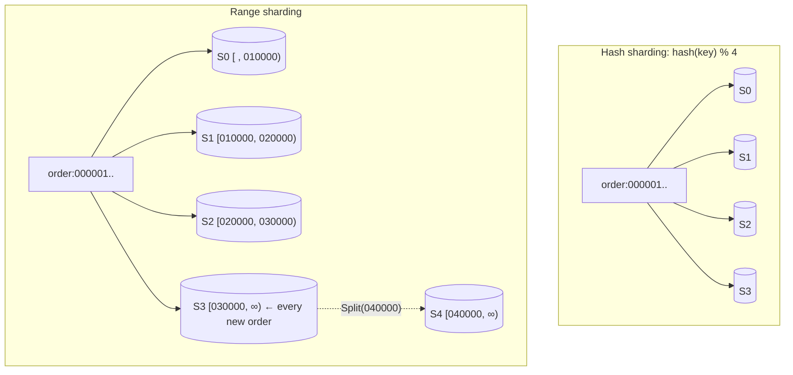

# Sharding (Hash vs Range Partitioning)

## Problem

One database node can no longer hold the data or absorb the write rate. Read replicas don't help, because every replica still stores everything and every write still goes to a single leader. You need to split the data so that each node owns a part of it.

## Solution

Partition the keyspace into **shards** and route each key to exactly one shard. The routing function is the key design decision:

- **Hash sharding:** `shard = hash(key) % N`. Keys spread evenly regardless of their pattern, but ordering is destroyed. A range query has to ask every shard, and changing `N` remaps most keys.
- **Range sharding:** each shard owns a contiguous key range (`[g, p)`). Range scans touch only the shards that overlap the range, and a hot range can be **split**, which moves only that range's data. Skewed or sequential keys (timestamps, auto-increment IDs) pile onto one shard.

**Resharding** (changing the layout) means moving data. How much moves depends on the strategy, so measure it before you choose.

## Diagram



## How this implementation works

- `Router` is the routing interface: `ShardFor`, `ShardsForRange`, and `NumShards`.
- `HashRouter` uses FNV-1a modulo N. Its `ShardsForRange` returns every shard, because hashing destroys key order.
- `RangeRouter` keeps sorted `starts` and the owning shard of each range. `ShardFor` is a binary search. `Split(at)` returns a **new** router (copy-on-write) in which the range containing `at` is cut in two, with the upper half going to a new shard. Existing shard indexes don't change, so only the upper half's keys move.
- `Cluster` is an in-process store with one map per shard. `Scan` reports how many shards it had to query. `Reshard(newRouter)` moves every key whose shard changed and returns the count. It's stop-the-world for clarity. Production systems copy in the background, dual-write, then cut over, but they move the same amount of data.
- The tests check that hash 4→5 moves about 80% of keys, and that splitting one of four range shards in half moves exactly 12.5%.

## Trade-offs

| | Hash sharding | Range sharding |
| --- | --- | --- |
| Load balance | Even for almost any key distribution | Depends on the key distribution. Sequential keys create a hot tail shard |
| Range scans | Scatter-gather to every shard | Only the overlapping shards |
| Adding capacity | `% N` moves ~`N/(N+1)` of keys. Use [consistent hashing](../consistent-hashing) or many fixed virtual shards to fix this | Split a range and move only that range |
| Routing metadata | None (pure function) | A range map that must be stored and kept consistent |

Shared costs: cross-shard transactions and joins become distributed problems, a hot *single key* can't be split by either scheme, and resharding needs careful online migration.

## When to use / when not to

**Use it** when data volume or write throughput exceeds one node, and most queries can be answered by one shard (choose a shard key such as `tenant_id` or `user_id` that most queries filter by).

**Don't shard yet** if vertical scaling, read replicas, caching, or archiving old data would do. Sharding is hard to undo, and it makes cross-entity queries, uniqueness constraints, and transactions much harder.

## Real-world examples

- **MongoDB** supports both *hashed* and *ranged* shard keys and splits chunks as they grow.
- **Google Bigtable**, **Apache HBase**, and **CockroachDB** use range partitioning (tablets/regions/ranges) and split hot or large ranges automatically.
- **Vitess** (used to scale MySQL at YouTube) shards by *keyspace ID* ranges and supports online resharding by splitting shards.
- **Cassandra** and **DynamoDB** hash the partition key to spread data.

## Run it

```sh
go run ./patterns/data/sharding/example
go test ./patterns/data/sharding/
```

## Related patterns

- [Consistent hashing](../consistent-hashing): hash sharding without the mass reshuffle
- [Read replicas](../read-replicas): scale reads within each shard
- [Scatter-gather](../../architecture/scatter-gather): how cross-shard queries are executed
- [Sharded counters](../../architecture/sharded-counters): splitting a single hot key, which shard keys can't fix
- [Two-phase commit](../../distributed/two-phase-commit) and [saga orchestration](../../distributed/saga-orchestration): transactions that span shards
