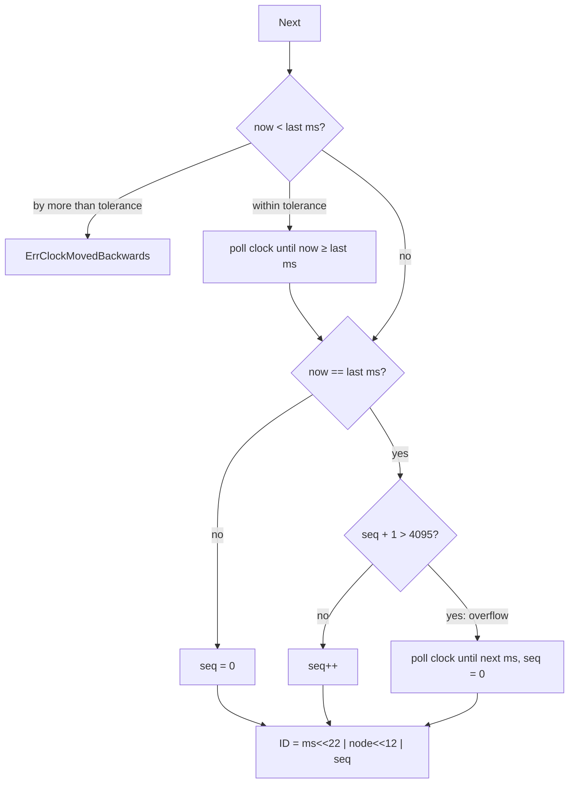

# Snowflake IDs (Distributed Unique ID Generation)

## Problem

Chat messages, orders, tweets and log events all need an ID the moment they are created, on whichever server created them. The ID should be unique across the whole fleet, fit in a `BIGINT`, and ideally sort by creation time so "latest 50 messages" is an index range scan.

- **A central counter** (a database sequence, `AUTO_INCREMENT`, Redis `INCR`) gives perfect order, but every insert on every server needs a round trip to one place. It caps throughput, adds latency, and when it is down nobody can create anything.
- **UUIDv4** needs no coordination, but it is 128 bits and random. Each insert lands on a random page of the primary-key B-tree, causing page splits and poor cache locality, and the ID says nothing about when the row was made.

## Solution

Split a 64-bit integer into fields that make collisions impossible by construction:

```
 0 | 41 bits: milliseconds since a custom epoch | 10 bits: node ID | 12 bits: sequence
```

- **Timestamp in the high bits**, so IDs sort by creation time and new rows append to the right edge of the index.
- **Node ID** (0..1023), unique per running generator, so two machines never produce the same ID even in the same millisecond.
- **Sequence** (0..4095), reset each millisecond, so one machine can make 4,096 IDs per millisecond.
- **Sign bit always 0**, so the ID is a positive `int64` in every language and database.

The only coordination is handing each generator a distinct node ID, once, at start-up. Two edge cases need a policy:

- **Sequence overflow:** the 4,097th request within one millisecond waits for the next millisecond.
- **Clock moving backwards:** reusing an old timestamp could repeat an ID that was already issued. Small regressions are waited out; beyond a tolerance the generator refuses with an error.

41 bits of milliseconds is 2^41 ms, about **69.7 years**, so the epoch is a recent custom date rather than 1970 (a 1970 epoch would already run out in 2039). With this package's default epoch of 2024-01-01, IDs run out on 2093-09-06.

## Diagram



## How this implementation works

- `New(nodeID, opts...)` validates the node ID (0..1023) and returns a `*Generator`. Options: `WithEpoch(t)`, `WithClock(func() time.Time)` (only millisecond precision is used) and `WithClockTolerance(d)` (default 10ms; 0 refuses every regression).
- `Next() (ID, error)` holds a mutex, reads the clock, and applies the flowchart above. IDs from one generator strictly increase. While waiting it keeps polling the clock: with the real clock it calls `runtime.Gosched` between polls; an injected clock must advance as it is read (the tests and example use a clock that moves a fixed step per read, so waits are deterministic and never hang).
- `ID` is an `int64` with `Millis()`, `Node()`, `Seq()`, `Time()` (assumes `DefaultEpoch`), `TimeFrom(epoch)` and `String()` (decimal). `Parse(s)` reads one back and `Compose(ms, node, seq)` builds one from fields. The epoch is not stored in the ID, so every system decoding IDs must agree on it.
- `Stats()` counts IDs generated, sequence-overflow waits, regressions waited out and regressions refused. `EndOfLife()` returns the epoch plus `Lifetime` (2^41 ms).
- Errors: `ErrClockMovedBackwards` (wrapped with how far and the tolerance), `ErrBeforeEpoch`, `ErrTimestampOverflow` once the 41 bits are used up.

**Clock-regression policy.** Twitter's original Snowflake refused to generate while the clock was behind the last timestamp, returning an error until the clock caught up: never a duplicate, but the node is unavailable for the length of the step. The alternative is to keep issuing IDs on the last timestamp and keep incrementing the sequence (borrowing from the future, as some implementations do): always available, but the IDs no longer reflect real time, and after a large step the node burns through 4,096 IDs per "virtual" millisecond until real time catches up. This package refuses, like Twitter, but waits out steps up to the tolerance first, because small NTP slews of a few milliseconds are common and waiting a few ms is cheaper than surfacing errors.

**Simplification.** The generator keeps its last timestamp only in memory. If a process restarts after the clock jumped backwards, it has no memory of the higher timestamp and can repeat IDs. Production systems guard this by persisting the last timestamp, waiting out the maximum plausible skew on start-up, or (as with lease-based node IDs) making sure a restarted node takes a fresh ID. Node-ID assignment itself is left to the caller.

## Trade-offs

| Pro | Con |
| --- | --- |
| No coordination per ID: generation is a local lock and a clock read | Each generator needs a unique node ID, and two nodes sharing one *will* collide |
| 64 bits, fits `BIGINT`, half the size of a UUID | Order across nodes is only as good as clock sync: the example shows disorder up to the skew spread |
| Roughly time-ordered: right-edge B-tree inserts, "newest first" is an ID range | Depends on the wall clock; a backwards step stops the node (or gives up time accuracy) |
| Creation time is readable from the ID, no extra column | IDs leak creation time and rough volume (`seq` per ms), which may be sensitive |
| 4,096 IDs/ms/node; 1,024 nodes | Fixed bit split: more nodes means fewer IDs per ms, and the epoch lasts only ~69 years |

## When to use / when not to

**Use it** for high-volume entities created on many servers that you want to store in a `BIGINT` primary key and page by time: messages, posts, orders, events, notifications. It is also a good fit when IDs must be generated offline or during a database outage.

**Don't use it** when you need gap-free or strictly ordered numbering (invoice numbers, a ledger sequence): use a single sequence and accept the bottleneck. Don't use it when IDs must not reveal creation time or volume to clients: use a random ID externally. If 128 bits are fine and you don't want to manage node IDs, UUIDv7 or ULID give time ordering with randomness instead of a node field.

## Real-world examples

- **Twitter Snowflake** (2010) introduced this layout: 41-bit ms timestamp, 10-bit worker (5 bits datacenter + 5 bits worker), 12-bit sequence, epoch 2010-11-04. Tweet IDs are Snowflakes, and the API added `id_str` because JavaScript can't hold 64-bit integers exactly.
- **Discord** uses Snowflakes for every message, user and channel, with a 2015-01-01 epoch and the 10 bits split into worker and process IDs. Message history is paged with `before`/`after` an ID.
- **Instagram** generates IDs inside PostgreSQL with a PL/pgSQL function: 41 bits of ms, 13 bits of **logical shard ID** (instead of a machine) and a 10-bit per-shard sequence. Because the shard ID is in the ID, the row's shard can be found from its ID alone (see [sharding](../sharding)).
- **Sonyflake** uses a different split for longer life and more machines: 39 bits of 10ms units (~174 years), 8-bit sequence, 16-bit machine ID (by default from the private IP), trading throughput per node (256 IDs per 10ms) for lifetime.
- **ULID and UUIDv7** (RFC 9562) are the coordination-free alternatives: 48 bits of ms timestamp plus random bits, 128 bits in total. They sort by time like Snowflakes but need no node IDs, at twice the size.

**Assigning node IDs.** The simplest is static configuration (one ID per host or pod ordinal, as with Kubernetes StatefulSets). Dynamic fleets lease an ID from a coordination service: an ephemeral sequential node in ZooKeeper, or an etcd key with a TTL lease that the process keeps alive, so a crashed node's ID becomes free only after its lease expires. This is the same lease mechanism as [leader election](../../distributed/leader-election) and [service discovery](../../architecture/service-discovery).

## Run it

```sh
go run ./patterns/data/snowflake-id/example
go test ./patterns/data/snowflake-id/
```

The example prints: 4 nodes x 50,000 IDs with **0 collisions**, all 501 milliseconds containing IDs from all four nodes; one decoded ID (node 42, seq 7); a 10,000-ID burst split **4,096 / 4,096 / 1,808** across three milliseconds with 2 overflow waits; a 4ms clock step waited out and a 2s step refused with `ErrClockMovedBackwards`; ordering across nodes with equal clocks (worst disorder 500µs, inside one millisecond) and with skews of 0, +1, -2, +3ms (worst 4.5ms, within the 5ms spread); and a central counter making 12,000 calls and failing 4,000 IDs during its outage, against Snowflake's 4 start-up calls and 0 failures.

## Related patterns

- [Sharding](../sharding): Instagram puts the shard ID in the ID; time-ordered IDs also make range-sharded tables hot on the newest shard
- [Idempotency key](../../reliability/idempotency-key): a client-generated unique ID is what makes retries deduplicable
- [Lamport and vector clocks](../../distributed/lamport-vector-clocks): Snowflake order is wall-clock order, roughly within skew; it says nothing about causality, which logical clocks capture
- [Leader election](../../distributed/leader-election): the lease mechanism used to hand out node IDs safely

## Further reading

- Arvind Kumar, [Duplicate Messages in WhatsApp](https://codefarm0.medium.com/duplicate-messages-in-whatsapp-system-design-interview-deep-dive-on-at-least-once-delivery-and-cecdc091fc57), on unique message IDs as the basis for deduplication under at-least-once delivery
- Khyati Jha, [High Level System Design Day-18: WebSockets (Part 6)](https://medium.com/high-level-system-desgin-interview-prep/high-level-system-design-day-178-websockets-part-6-2be2650b7b2f), on using Snowflake IDs for chat messages
