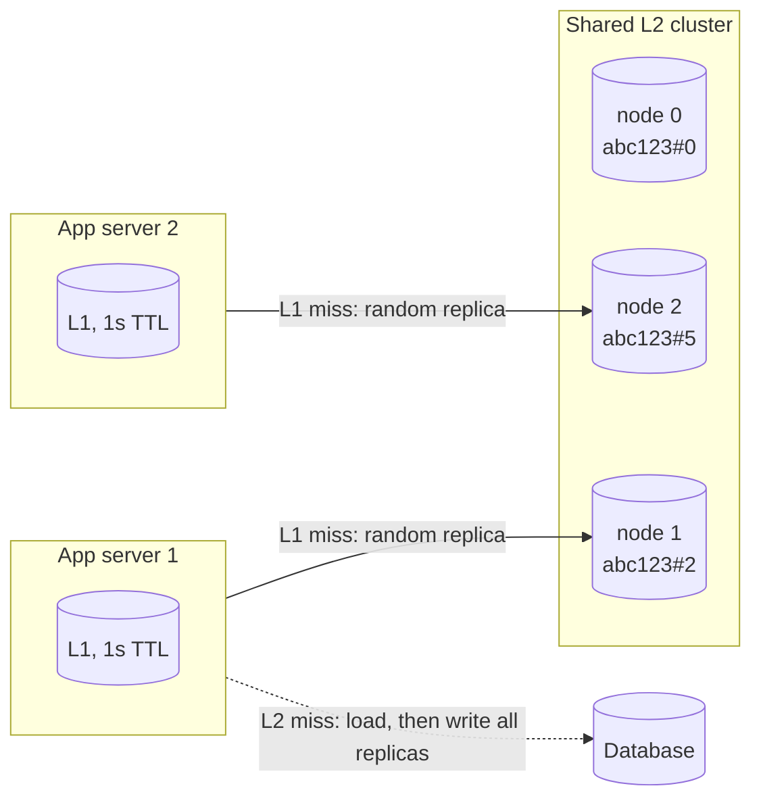

# Two-Tier Cache (L1 In-Process + L2 Shared, with Hot-Key Replication)

## Problem

A shared cache cluster (Redis Cluster, a Memcached pool) spreads keys across nodes by hash, so its capacity grows with the node count. But every key lives on exactly **one** node. When a single key goes viral (a short link shared during a cricket final, a celebrity's post, a flash-sale product), every request for it lands on the same node:

- That node's CPU or network saturates while the rest of the cluster idles. Adding nodes doesn't help, because the hot key still maps to one of them.
- Latency for *every* key on that node rises, not just the hot one.
- The app servers spend most of their time on round trips for a value that hasn't changed.

## Solution

Two independent fixes, usually combined:

1. **L1 in-process cache.** Each application server keeps recently read values in its own memory with a short TTL (often 1–5 seconds). A hot key is then fetched from L2 at most once per TTL *per server* instead of once per request.
2. **Hot-key replication in L2.** A key known to be hot is written under several L2 keys (`abc123#0`, `abc123#2`, …) that hash to different nodes. Each read picks one replica at random, so the hot key's load is split across nodes. Writes and invalidations touch every replica.

The price is consistency. L1 copies on other servers can't see a write until their TTL runs out, so L1's TTL is your staleness budget.

## Diagram



## How this implementation works

- `Shared[V]` simulates the L2 cluster: one map per node, FNV-1a hash modulo node count, a TTL, and an operation counter per node so you can watch the load.
- `Client[V]` is one app server. `Get` checks its L1 map, then L2, then the `Loader`. A load writes every L2 replica and fills L1. Loader errors are returned and never cached.
- `WithHotKeys(replicas, keys...)` marks hot keys. Naive suffixes `key#0..key#N-1` can hash to the same node, so `replicaKeys` tries suffixes until it has one per distinct node (up to the node count). Redis Cluster users get the same control with hash tags.
- `Invalidate` deletes every replica in L2 and the entry in this server's L1. It can't reach other servers' L1, which is exactly the staleness the example shows.
- `WithPicker` and `WithClock` make replica choice and L1 expiry deterministic in tests.

**Simplifications.** L1 here is an unbounded map with a TTL; production L1s are bounded with an eviction policy (see [cache eviction](../cache-eviction)). Hot keys are configured up front; real systems detect them by sampling traffic or with `redis-cli --hotkeys`, and may push invalidations to every server's L1 over pub/sub.

## Trade-offs

| Pro | Con |
| --- | --- |
| L1 removes most hot-key traffic from the network entirely | Other servers serve stale data for up to the L1 TTL after a write |
| Replication spreads one key's load across N nodes | Every write and invalidation costs N operations, and replicas can briefly disagree |
| Both are client-side changes; the cache cluster stays the same | Memory: each app server holds its own copy, and each replica is a full copy |
| Survives a single L2 node being slow, for replicated keys | Needs hot-key detection, or someone guessing correctly in advance |

## When to use / when not to

**Use it** for read-heavy, highly skewed traffic where a second or two of staleness is acceptable: URL redirects, feature flags, product and price pages, configuration, social counters, leaderboards.

**Avoid L1** for data that must reflect writes immediately (balances, inventory at checkout, permissions), or when values are large and the working set doesn't fit in each server's memory. **Avoid replication** for write-heavy keys, where it multiplies write load; use [sharded counters](../../architecture/sharded-counters) or salted keys spread by [sharding](../sharding) for those.

## Real-world examples

- **Caffeine or Guava in front of Redis** is the standard Java setup; Go services use an in-process LRU or Ristretto the same way.
- **Redis 6 client-side caching** ("tracking") is a supported L1: the server tracks which keys each client cached and pushes invalidation messages on writes, closing most of the staleness window.
- **Facebook's memcache** paper (NSDI 2013) describes replicating hot keys across a pool and regional pools; Twitter and others publish hot-key detection and local caching for the same reason.

## Run it

```sh
go run ./patterns/data/two-tier-cache/example
go test ./patterns/data/two-tier-cache/
```

## Related patterns

- [Cache-aside](../cache-aside): the loading and invalidation protocol each tier follows
- [Cache eviction](../cache-eviction): how to bound L1's memory
- [Consistent hashing](../consistent-hashing) and [sharding](../sharding): how keys are spread over L2 nodes, and why one key can't be
- [Tiered cache](../../architecture/tiered-cache): the same idea one level up, with edge caches in front of an origin shield

## Further reading

- Arvind Kumar, [URL Shortener Suddenly Crashes During IPL Finals](https://codefarm0.medium.com/url-shortener-suddenly-crashes-during-ipl-finals-how-will-you-fix-3347c9911ba3), an interview scenario on hot keys and local caching
- Khyati Jha, [High Level System Design Day-8: Caching (Part 3)](https://medium.com/high-level-system-desgin-interview-prep/high-level-system-design-day-8-caching-part-3-e3c7a27b7235), which covers local L1 caches and hot-key scatter
