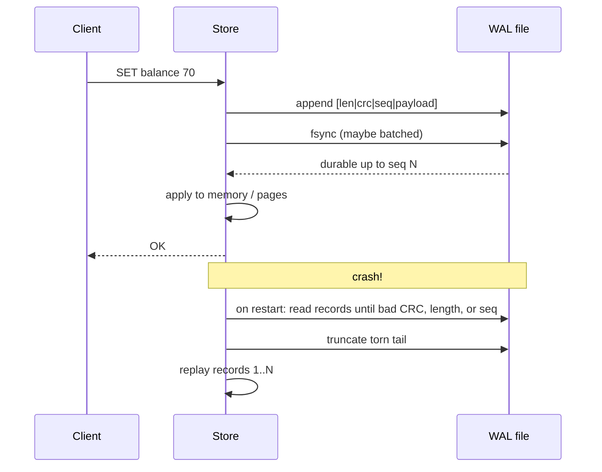

# Write-Ahead Log (WAL)

## Problem

A database applies changes to in-memory structures and data pages. If the process crashes or the power goes out halfway through, memory is gone and pages on disk may be partly updated. Some committed transactions are lost, and some uncommitted ones are half-applied. Forcing every data page to disk on every change would be far too slow, because those writes are random.

## Solution

Before changing anything, **append a record describing the change to a sequential log and fsync it**. Only then acknowledge the client and apply the change. Sequential appends are cheap, and a single `fsync` can cover many records (**group commit**).

On startup, **replay** the log to rebuild state. Each record carries a **checksum** and a **sequence number**, so recovery can find where the valid log ends. A record that was half-written when the power went (a *torn write*) fails its checksum and is truncated.

## Diagram



## How this implementation works

- **Format.** `Encode` writes a 16-byte header (`len u32`, `crc u32`, `seq u64`) followed by the payload. The CRC is CRC-32C over seq+payload. `Decode` reads records until the first short header, impossible length (above `MaxRecordSize`, so a corrupt length can't make it allocate gigabytes), checksum mismatch, or sequence gap. It returns the records and the valid prefix length.
- **Storage and the fsync hook.** `Storage` has `Write` (into the OS buffer), `Sync` (the fsync hook), `ReadAll`, and `Truncate`. `MemStorage` simulates a page cache: `Write` goes to a volatile buffer, `Sync` makes it durable, and `Crash(tornBytes)` drops unsynced bytes except a partial prefix, which models a torn write. `FlipByte` simulates bit rot.
- **Durability policy.** `WithSyncEvery(1)` (the default) fsyncs on every `Append`. `WithSyncEvery(n)` batches, and `0` leaves `Sync` to the caller (group commit). `WithOnSync` is called with the highest durable sequence after each successful fsync, which is where a server acknowledges waiting clients. `DurableSeq` never advances on a failed sync.
- **Recovery.** `Open(storage, apply)` decodes, truncates any torn tail, fsyncs the truncation, replays valid records in order through `apply`, and resumes numbering at `LastSeq+1`.
- The tests cover the round trip, every corruption kind, crash with and without group commit, torn records, bit rot, hook and fsync counts, sync failure, and concurrent appenders.

## Trade-offs

| Pro | Con |
| --- | --- |
| Sequential appends are fast, even on spinning disks | Every committed write is stored twice (log and data) |
| Exact crash recovery: everything acknowledged survives | `fsync` latency bounds commit latency unless you group-commit |
| Group commit amortises fsync across many writers | The log grows forever unless it is checkpointed and truncated |
| The log doubles as a replication stream | Recovery time grows with the log since the last checkpoint |

Notes: this implementation treats *any* invalid record as the end of the log, which is right for a torn tail. Production systems also tell mid-log corruption apart (media failure) and stop rather than silently dropping later records. After a failed `fsync`, the safest response is to crash and recover, because the OS may have discarded the dirty pages.

## When to use / when not to

**Use it** whenever in-memory or paged state must survive crashes: databases, message brokers, consensus logs, durable queues, or a [write-behind cache](../write-behind-cache) that must not lose acknowledged writes.

**Avoid it** for purely ephemeral or rebuildable caches, or when an external system already provides durability (write straight to it).

## Real-world examples

- **PostgreSQL** WAL (also used for streaming replication and point-in-time recovery). The **SQLite** WAL journal mode.
- **RocksDB** and **LevelDB** write each update to a WAL before the memtable. **etcd** and other **Raft** implementations persist their log entries to a WAL.
- **Apache Kafka** partitions are, in effect, segmented append-only logs with CRC-checked record batches.
- Filesystems such as **ext4** (jbd2) and **NTFS** journal metadata changes the same way.

## Run it

```sh
go run ./patterns/data/write-ahead-log/example
go test ./patterns/data/write-ahead-log/
```

## Related patterns

- [LSM tree](../lsm-tree): the memtable is protected by a WAL
- [Event sourcing](../event-sourcing): the log as the source of truth at the application level
- [Write-behind cache](../write-behind-cache): a WAL fixes its durability caveat
- [Read replicas](../read-replicas): shipping the log is how followers replicate
- [Leader election](../../distributed/leader-election): Raft-style leaders replicate a WAL to followers
