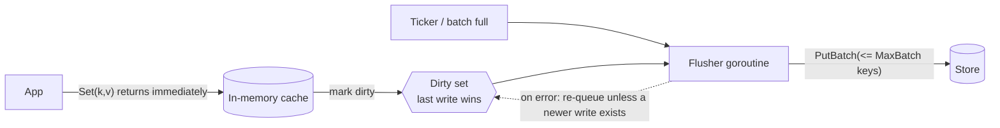

# Write-Behind (Write-Back) Cache

## Problem

Some workloads write the same keys far more often than the store can absorb: view counters, "last seen" timestamps, game state, metrics. Writing every update synchronously makes write latency equal to store latency and turns the database into the bottleneck, even though only the latest value per key matters.

## Solution

Acknowledge writes once they are in memory. Mark the key **dirty** and let a background flusher persist dirty keys in **batches**, either every interval or when enough keys are dirty. Writes to the same key between flushes are **coalesced**, so the store sees one write per key per flush instead of one per update.

**Durability caveat:** an acknowledged write that hasn't been flushed yet is lost if the process dies. Write-behind trades durability for write throughput and latency.

## Diagram



## How this implementation works

- `New(store, Config)` starts a flusher goroutine (`loop`). It wakes on the ticker (or an injected `Config.Tick` channel, which keeps tests deterministic) and on a non-blocking `kick` that `Set` sends once `len(dirty) >= MaxBatch`.
- `Set` writes into both `data` (the read path) and `dirty`, and counts a coalesce whenever it overwrites a value that hasn't been flushed yet.
- `Flush` takes up to `MaxBatch` dirty keys, releases the lock, and calls `PutBatch`. It repeats until nothing is dirty. `flushMu` lets only one flush run at a time, so batches reach the store in order. On failure the batch is re-queued, **except** keys that were written again in the meantime, because their newer value must win.
- `Close` stops new writes, stops the goroutine (no leak), and does a final flush. `Crash` simulates the process dying: it stops the flusher and reports how many acknowledged writes were lost.
- `Dirty()` reports the data at risk right now. Export it as a metric in real systems.

## Trade-offs

| Pro | Con |
| --- | --- |
| Write latency is memory latency | **Unflushed writes are lost on crash** |
| Coalescing collapses hot-key updates, so store load stays roughly flat | Other readers of the store see stale data until the next flush |
| Batching amortises round trips | Error handling is deferred. The caller never learns that its write ultimately failed |
| Smooths write spikes | Memory must hold all dirty data, and a long store outage grows it without bound. Add backpressure |

## When to use / when not to

**Use it** for high-frequency, loss-tolerant or rebuildable data: counters, analytics, presence, leaderboards, caches of derived state, or when the source can be replayed.

**Avoid it** for anything that must survive a crash once acknowledged (payments, orders, user content). For those, use [write-through](../write-through-cache), or make write-behind safe by first appending to a [write-ahead log](../write-ahead-log) and flushing from the log.

## Real-world examples

- **Operating system page caches** are write-back: `write(2)` returns once data is in memory, and the kernel flushes dirty pages later. `fsync` exists because of the durability caveat.
- **CPU caches** and **RAID controllers** with write-back mode. Controllers add battery- or flash-backed cache to survive power loss.
- Distributed caches/data grids such as **Hazelcast** (MapStore with a write delay) and **Oracle Coherence** offer write-behind with configurable batching.

## Run it

```sh
go run ./patterns/data/write-behind-cache/example
go test ./patterns/data/write-behind-cache/
```

## Related patterns

- [Write-through cache](../write-through-cache): synchronous and durable, but slower writes
- [Cache-aside](../cache-aside): the application loads and invalidates explicitly
- [Write-ahead log](../write-ahead-log): makes buffered writes durable
- [Backpressure](../../distributed/backpressure): bound the dirty set when the store can't keep up
- [Sharded counters](../../architecture/sharded-counters): another way to absorb hot-key writes
