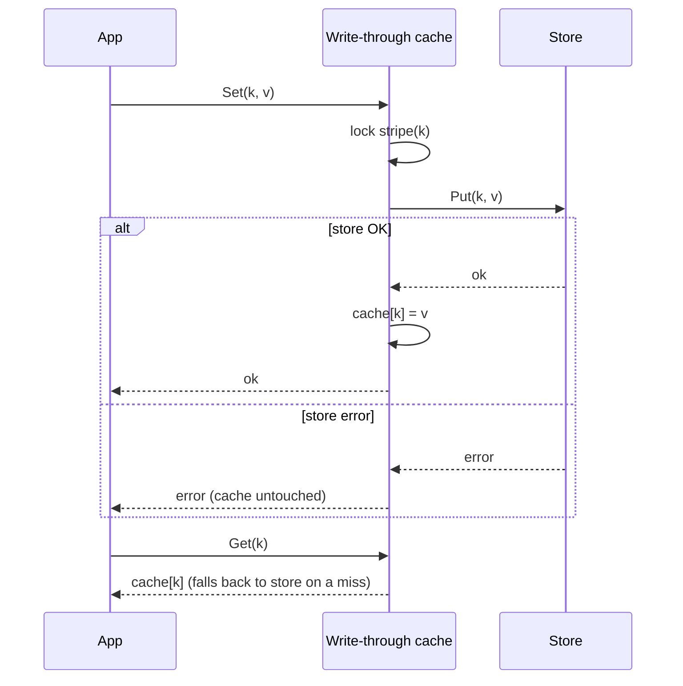

# Write-Through Cache

## Problem

With [cache-aside](../cache-aside), every write invalidates the cache entry. The next read pays a full miss, and there is a window in which readers and writers race. For data that is written and then read right away (sessions, balances, settings), you want the cache to stay warm and correct after every write.

## Solution

Route every write through the cache layer, which writes **synchronously to the store first** and then updates the cache. A write succeeds only once the store has it, so the cache never holds data the store doesn't have. Reads are served from the cache, and on a miss (for example after a restart) they fall back to the store.

## Diagram



## How this implementation works

- `Cache[V].Set` takes a **striped per-key lock** (`lockFor`, 64 FNV-hashed mutexes), calls `Store.Put`, and updates the in-memory map only if the put succeeded. The stripe lock serialises writes to the same key, so the order writes reach the store matches the order they reach the cache. Without it, two concurrent `Set`s could leave the store holding one value and the cache the other.
- `Delete` follows the same rule: store first, then cache.
- `Get` serves hits under a read lock. On a miss it takes the key's stripe lock before reading the store, so a slow read can't overwrite a newer concurrent write with an older value.
- `MemStore` is an in-memory `Store` with `FailNextPuts` for failure injection.

## Trade-offs

| Pro | Con |
| --- | --- |
| Reads right after a write hit the cache and are fresh | Every write pays store latency plus cache latency |
| Cache and store can't diverge from a failed write | Caches data that may never be read (write-heavy, read-rarely keys waste memory) |
| Simple mental model: the cache is a coherent view of the store | Writes that bypass the cache (batch jobs, other services) still make it stale. Pair it with a TTL or CDC invalidation |
| | Not atomic across the two systems: a crash between store and cache leaves a stale or missing cache entry, never a phantom value |

## When to use / when not to

**Use it** when data is read soon after being written and readers must see the latest value: user sessions, shopping carts, feature flags, account settings.

**Avoid it** when writes are frequent and reads rare (you pay double for nothing), when write latency is critical (consider [write-behind](../write-behind-cache)), or when many writers modify the store without going through the cache.

## Real-world examples

- **Amazon DynamoDB Accelerator (DAX)** is a write-through cache for DynamoDB: writes go through DAX to the table and update the item cache.
- Caching layers in front of relational databases (for example Hibernate's second-level cache in read-write mode) update the cache as part of the write.
- Storage controllers and CPUs offer *write-through* cache modes, where a write is acknowledged only after it reaches the backing store.

## Run it

```sh
go run ./patterns/data/write-through-cache/example
go test ./patterns/data/write-through-cache/
```

## Related patterns

- [Cache-aside](../cache-aside): invalidate on write instead, and load lazily
- [Write-behind cache](../write-behind-cache): acknowledge writes from the cache and persist them later
- [Read replicas](../read-replicas): read-your-writes is the same problem in a different layer
- [Transactional outbox](../../distributed/transactional-outbox): a reliable way to propagate writes to other systems
