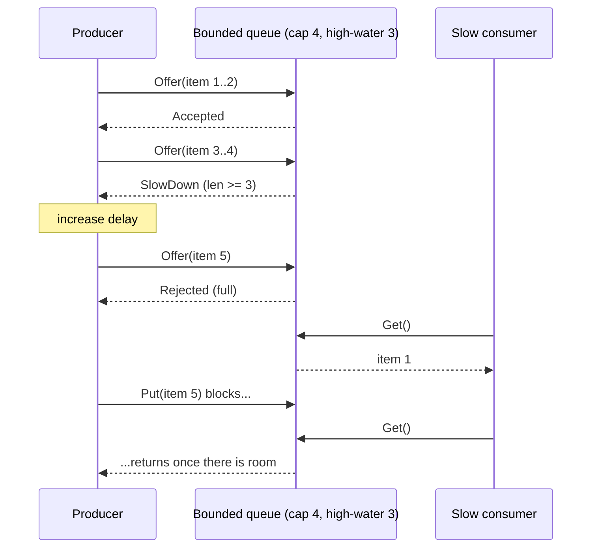

# Backpressure

## Problem

A producer generates work faster than its consumer can process it. With an
unbounded buffer in between, the backlog grows silently: latency climbs,
memory fills, and eventually the process is killed, losing everything in the
buffer. The overload is discovered at the worst possible moment.

## Solution

Make the buffer **bounded** and decide explicitly what happens when it is
full. There are three basic choices:

| Strategy | Producer experience | Data | Typical use |
|---|---|---|---|
| **Block** (`Put`) | waits until there is room | nothing lost | internal pipelines, batch jobs |
| **Drop** (`TryPut`) | never waits | excess dropped and counted | metrics, telemetry, live video frames |
| **Signal** (`Offer`) | never waits, told to slow down or retry | producer decides | APIs (429/503 + Retry-After), adaptive senders |

Blocking pushes the slowness upstream until it reaches something that can
absorb it (a client that waits, a TCP window that closes). Dropping keeps the
producer fast and admits loss. Signalling hands the decision to the producer.

**Fan-out needs one queue per subscriber.** When one publisher feeds many
connections (a WebSocket or SSE hub, a chat room, a price feed), a single
shared buffer, or a publisher that writes to each socket in turn, lets the
slowest client set the pace for everyone. Give every connection its own
bounded `SendQueue` and a writer goroutine that drains it; the publisher only
pushes into memory, and the queue's overflow policy decides what a full queue
costs that one subscriber:

| Policy | When the subscriber's queue is full | The slow subscriber sees | Publisher cost |
|---|---|---|---|
| `Block` | wait up to a deadline, then drop the message | gaps once the deadline passes | up to one deadline per overflowing message, felt by every subscriber |
| `DropOldest` | evict the oldest queued message | skips ahead; always has the latest | none |
| `DropNewest` | discard the incoming message | keeps its stale backlog, misses the latest | none |
| `Disconnect` | close the subscriber | nothing more; reconnects and resyncs | none |

## Diagram



## How this implementation works

- `New[T](capacity, highWater)` creates a generic queue backed by a buffered
  channel; invalid sizes return `ErrBadConfig`.
- `Put(ctx, v)` blocks until there is room, the context ends, or the queue
  is closed.
- `TryPut(v)` is a non-blocking send; on a full queue it increments
  `Dropped()`.
- `Offer(v)` is a non-blocking send that returns `Accepted`, `SlowDown`
  (accepted, but `Len() >= highWater`) or `Rejected` (counted in
  `Rejected()`).
- `Get(ctx)` receives; after `Close` it drains remaining items and then
  returns `ErrClosed`, so no accepted item is lost on shutdown.
- `NewSendQueue[T](capacity, policy, opts...)` builds the per-connection
  outbox. Options: `WithBlockTimeout(d)` (default 1s, used by `Block`) and
  `WithOnDisconnect(fn)`, which runs once when `Disconnect` fires so the hub
  can unregister the connection and close its socket.
- `Push(v)` returns nil when queued, `ErrSendTimeout` (Block) or
  `ErrQueueFull` (DropNewest) when the message was dropped, and
  `ErrDisconnected` when the subscriber was dropped. `DropOldest` evicts under
  a small mutex so concurrent pushers can't evict more than they need.
- `Pop(ctx)` and `TryPop()` feed the connection's writer. After `Close` they
  drain and then report `ErrClosed`; after a disconnect `Pop` returns
  `ErrDisconnected` at once, because the backlog belongs to a connection that
  is being torn down.
- `Stats()` reports `Pushed`, `Popped`, `Dropped` and `Disconnected`, which
  is what you alert on: a rising drop count per client is the early warning.
- Example step 4 fans 20 messages out to two fast subscribers and one that
  reads one message per four published, under each policy. The fast pair get
  20/20 every time; the slow one gets 7 messages (13 dropped) under Block,
  DropOldest and DropNewest, and is disconnected at message 4 under
  Disconnect. Under Block the publisher also stalled 13 × 2ms.
- **Simplification.** The example runs in one goroutine, so under `Block`
  the slow reader can never make room while the publisher waits, and it loses
  exactly what `DropNewest` loses. With a real writer goroutine some waits end
  early, at the cost of a slower publisher. A production hub also caps the
  socket write with its own deadline, and often treats repeated Block timeouts
  as grounds to disconnect.

## Trade-offs

- **Block**: lossless and simple, but a stuck consumer stalls every producer;
  always pair it with a context deadline. Can deadlock cycles of services that
  block on each other.
- **Drop**: bounded latency and memory, but silent data loss unless you
  monitor the drop counter. Choose drop-newest vs drop-oldest deliberately
  (see the pub/sub pattern for drop-oldest).
- **Signal**: most flexible, but only works if producers cooperate; a
  misbehaving client that ignores 429s still needs rate limiting.
- **Per-connection send queues** keep one slow client from stalling the
  publisher and every other client, but cost memory per connection (capacity
  × message size × connections) and force a choice of who loses: `Block`
  still leaks some slowness to everyone, the drop policies lose messages
  silently unless you watch `Dropped`, and `Disconnect` turns a slow client
  into a reconnect, which needs resumption (sequence numbers or a replay log)
  and can storm if many clients are cut at once.
- Capacity is a latency budget: queue length divided by consumer throughput
  is how long the newest item waits. Small queues are usually better than big
  ones.
- This is in-process. Across a network, backpressure comes from protocol flow
  control (TCP windows, HTTP/2 and gRPC flow control, Reactive Streams'
  `request(n)`, Kafka consumers pulling at their own pace).

## When to use / when not to

Use a bounded queue with an explicit policy at every boundary between stages
that run at different speeds: worker pools, log shippers, request handlers in
front of a database.

An unbounded queue is only acceptable when the input is provably bounded (a
fixed batch) and fits in memory.

## Real-world examples

- Go channels: a full buffered channel blocks the sender.
- TCP flow control: the receive window shrinks and the sender stops.
- Reactive Streams / RxJava / Project Reactor: consumers request `n` items.
- HTTP 429 Too Many Requests and 503 with `Retry-After`.
- Logging agents such as Fluent Bit, which can be configured to pause inputs
  or drop when their buffers fill.

## Run it

```sh
go run ./patterns/distributed/backpressure/example
go test ./patterns/distributed/backpressure/
```

## Related patterns

- [Pub/Sub](../pub-sub): per-subscriber drop policies.
- [WebSocket hub](../../architecture/websocket-hub): a hub that gives every connection its own send queue.
- [Server-sent events](../../architecture/server-sent-events): drops slow subscribers and lets them resume with `Last-Event-ID`.
- [Competing consumers](../competing-consumers): add consumers instead of slowing producers.
- [Load shedding](../../reliability/load-shedding): reject work at the edge under overload.
- [Rate limiter (token bucket)](../../reliability/rate-limiter-token-bucket)
- [Rate limiter (leaky bucket)](../../reliability/rate-limiter-leaky-bucket)
- [Bulkhead](../../reliability/bulkhead)
- [Timeout](../../reliability/timeout)

## Further reading

- Khyati Jha, [High Level System Design Day-16: WebSockets (Part 4)](https://medium.com/high-level-system-desgin-interview-prep/high-level-system-design-day-16-websockets-part-4-fb945fae6297), on per-connection backpressure for WebSocket servers
