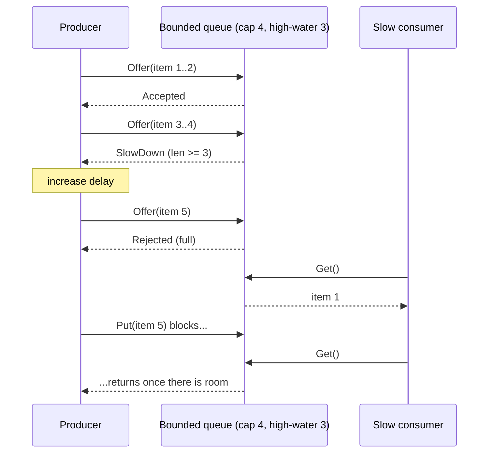

# Backpressure

## Problem

A producer generates work faster than its consumer can process it. With an
unbounded buffer in between, the backlog grows silently: latency climbs,
memory fills, and eventually the process is killed, losing everything in the
buffer. The overload is discovered at the worst possible moment.

## Solution

Make the buffer **bounded** and decide explicitly what happens when it is
full. There are three basic choices:

| Strategy | Producer experience | Data | Typical use |
|---|---|---|---|
| **Block** (`Put`) | waits until there is room | nothing lost | internal pipelines, batch jobs |
| **Drop** (`TryPut`) | never waits | excess dropped and counted | metrics, telemetry, live video frames |
| **Signal** (`Offer`) | never waits, told to slow down or retry | producer decides | APIs (429/503 + Retry-After), adaptive senders |

Blocking pushes the slowness upstream until it reaches something that can
absorb it (a client that waits, a TCP window that closes). Dropping keeps the
producer fast and admits loss. Signalling hands the decision to the producer.

## Diagram



## How this implementation works

- `New[T](capacity, highWater)` creates a generic queue backed by a buffered
  channel; invalid sizes return `ErrBadConfig`.
- `Put(ctx, v)` blocks until there is room, the context ends, or the queue
  is closed.
- `TryPut(v)` is a non-blocking send; on a full queue it increments
  `Dropped()`.
- `Offer(v)` is a non-blocking send that returns `Accepted`, `SlowDown`
  (accepted, but `Len() >= highWater`) or `Rejected` (counted in
  `Rejected()`).
- `Get(ctx)` receives; after `Close` it drains remaining items and then
  returns `ErrClosed`, so no accepted item is lost on shutdown.

## Trade-offs

- **Block**: lossless and simple, but a stuck consumer stalls every producer;
  always pair it with a context deadline. Can deadlock cycles of services that
  block on each other.
- **Drop**: bounded latency and memory, but silent data loss unless you
  monitor the drop counter. Choose drop-newest vs drop-oldest deliberately
  (see the pub/sub pattern for drop-oldest).
- **Signal**: most flexible, but only works if producers cooperate; a
  misbehaving client that ignores 429s still needs rate limiting.
- Capacity is a latency budget: queue length divided by consumer throughput
  is how long the newest item waits. Small queues are usually better than big
  ones.
- This is in-process. Across a network, backpressure comes from protocol flow
  control (TCP windows, HTTP/2 and gRPC flow control, Reactive Streams'
  `request(n)`, Kafka consumers pulling at their own pace).

## When to use / when not to

Use a bounded queue with an explicit policy at every boundary between stages
that run at different speeds: worker pools, log shippers, request handlers in
front of a database.

An unbounded queue is only acceptable when the input is provably bounded (a
fixed batch) and fits in memory.

## Real-world examples

- Go channels: a full buffered channel blocks the sender.
- TCP flow control: the receive window shrinks and the sender stops.
- Reactive Streams / RxJava / Project Reactor: consumers request `n` items.
- HTTP 429 Too Many Requests and 503 with `Retry-After`.
- Logging agents such as Fluent Bit, which can be configured to pause inputs
  or drop when their buffers fill.

## Run it

```sh
go run ./patterns/distributed/backpressure/example
go test ./patterns/distributed/backpressure/
```

## Related patterns

- [Pub/Sub](../pub-sub): per-subscriber drop policies.
- [Competing consumers](../competing-consumers): add consumers instead of slowing producers.
- [Load shedding](../../reliability/load-shedding): reject work at the edge under overload.
- [Rate limiter (token bucket)](../../reliability/rate-limiter-token-bucket)
- [Rate limiter (leaky bucket)](../../reliability/rate-limiter-leaky-bucket)
- [Bulkhead](../../reliability/bulkhead)
- [Timeout](../../reliability/timeout)
