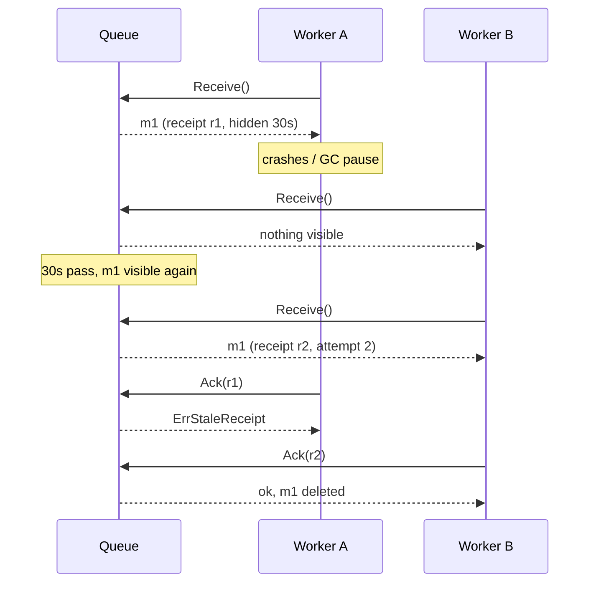

# Competing Consumers

## Problem

A stream of independent jobs (send email, resize image, charge card) arrives
faster than one worker can handle. You want to add workers to scale out, and
you need a job to survive a worker crashing halfway through, without two
workers routinely doing the same job.

## Solution

Put the jobs on a shared **work queue** and let N consumers pull from it. Each
message goes to exactly one consumer at a time:

1. `Receive` hands out the oldest visible message and hides it for a
   **visibility timeout** (a lease).
2. The consumer **acks** when done, which deletes the message.
3. If the consumer crashes or is too slow, the timeout expires and the message
   becomes visible again for **redelivery** to another consumer.
4. After `MaxReceives` attempts a poison message is moved to a
   **dead-letter queue** so it stops blocking work and a human can inspect it.

## Diagram



## How this implementation works

- `NewQueue(Config{VisibilityTimeout, MaxReceives, Clock})`. The `Clock` is
  injectable; tests and the example use `ManualClock` so timeouts are
  deterministic and instant.
- `Queue.Receive` scans in FIFO order for a message whose `visibleAt` has
  passed, bumps its receive count, issues a fresh receipt handle and pushes
  `visibleAt` forward. A message already received `MaxReceives` times is moved
  to the DLQ on the next receive attempt (the same lazy behaviour as SQS).
- `Queue.Ack` / `Queue.Nack` only accept the *current, unexpired* receipt. A
  stale worker therefore cannot delete a message someone else now owns.
  (This is stricter than SQS, which may accept a late ack if nobody else has
  received the message yet.)
- `RunWorkers(ctx, q, n, poll, handler)` starts `n` competing goroutines:
  handler `nil` means ack, an error means nack. The returned `wait` function
  blocks until all workers exit, so nothing leaks.

## Trade-offs

- **At-least-once, not exactly-once.** A slow worker can finish after its
  message was redelivered, so the job runs twice. Make handlers idempotent
  (see idempotency key).
- **Choosing the visibility timeout**: too short and healthy-but-slow work is
  duplicated; too long and crashed work waits a long time. Long jobs should
  extend their lease (heartbeat), which this example omits.
- **Ordering** is only approximately FIFO: retries and parallel workers
  reorder. Use partitioned queues (Kafka partitions, SQS FIFO message groups)
  when per-key order matters.
- In-memory and single-node; a real queue persists and replicates messages.

## When to use / when not to

Use it for independent, idempotent background jobs where throughput must scale
with worker count and a crashed worker must not lose work.

Avoid it when every consumer needs every message (use pub/sub), when strict
global ordering is required, or when the caller needs a synchronous result.

## Real-world examples

- Amazon SQS: visibility timeout, receipt handles, `maxReceiveCount` redrive
  to a DLQ.
- RabbitMQ queues with manual acks and multiple consumers (unacked messages
  are requeued when a consumer's channel closes).
- Google Cloud Pub/Sub subscriptions with ack deadlines and dead-letter topics.
- Sidekiq, Celery and similar job runners built on a shared queue.

## Run it

```sh
go run ./patterns/distributed/competing-consumers/example
go test ./patterns/distributed/competing-consumers/
```

## Related patterns

- [Pub/Sub](../pub-sub): every subscriber gets every message.
- [Backpressure](../backpressure): what to do when the queue fills up.
- [Transactional outbox](../transactional-outbox): getting jobs onto the queue reliably.
- [Idempotency key](../../reliability/idempotency-key): make redelivery safe.
- [Retry with backoff](../../reliability/retry-backoff)
- [Load shedding](../../reliability/load-shedding)
