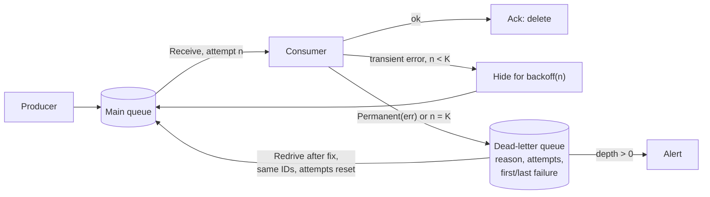

# Dead-Letter Queue

## Problem

Most failed messages are worth retrying: a timeout, a deadlock, a downstream
that is restarting. Some never will succeed, however many times you try:

- a **malformed payload** (bad JSON, a schema version the consumer doesn't know),
- a **bug for one record type** (the refund handler panics on a nil currency),
- a **permanently failing downstream** for one tenant (account deleted, 403 forever).

If the consumer keeps retrying such a "poison" message, the damage depends on
the queue. In an **ordered** queue (a Kafka partition, an SQS FIFO message
group) it blocks everything behind it: head-of-line blocking, so a single bad
record stalls a key or partition for hours. In an **unordered** queue the
good messages get through, but the poison ones keep burning worker time,
inflate latency under load, keep the queue from ever draining, and hide in
the general retry noise, so nobody is paged.

## Solution

Bound the retries and park what is left over:

1. Count **attempts** per message. After a failure, hide the message for a
   **backoff** that grows with each attempt (delayed redelivery, like a
   visibility timeout), so other messages flow in between.
2. After **K attempts**, move the message to a separate **dead-letter queue**
   with the metadata needed to triage it: error reason, attempt count, first
   and last failure times, original message ID.
3. Let the consumer say "don't bother": errors wrapped with **`Permanent`**
   (a parse error, a validation failure) skip the retries and go straight to
   the DLQ.
4. **Alert on DLQ depth.** Anything above zero is a bug or an incident that
   needs a human.
5. After a fix, **redrive**: replay dead letters back onto the main queue,
   optionally only those matching a filter, keeping their IDs so an
   idempotent consumer can still deduplicate.

**Ordering trade-off.** Parking a message lets later messages of the same key
overtake it, so per-key order is broken. If order matters (account ledger,
state-machine events) the options are: park the **whole key** (every later
message for that key goes to the DLQ too, and comes back together on
redrive), stop the partition and page someone, or make the consumer tolerate
reordering (versions, last-writer-wins, commutative updates).

## Diagram



## How this implementation works

- `New(opts...)` returns a `*Queue`. Options: `WithMaxAttempts(k)` (default 5;
  `RetryForever` disables the DLQ, to show the problem), `WithBackoff(base, max)`
  (default 1s doubling to 1m), `WithVisibilityTimeout(d)` (default 30s),
  `WithPerKeyOrder()`, `WithParkKey()` and `WithClock`. Invalid settings are
  rejected, including `WithParkKey` without `WithPerKeyOrder`.
- `Send(id, key, payload)` enqueues; `Receive()` returns the oldest visible
  message and a fresh receipt; `Ack(receipt)` deletes it; `Nack(receipt, err)`
  records a failure. `ProcessOne(handler)` does receive, handle, ack-or-nack.
- A failure at attempt `n` hides the message until `failure + min(max,
  base·2ⁿ⁻¹)`. A lease that runs out (the consumer crashed) counts as a failed
  attempt with reason "visibility timeout expired", and its old receipt is
  rejected with `ErrUnknownReceipt`.
- `Permanent(err)` wraps an error; `IsPermanent` finds it through `%w` chains.
  A permanent nack dead-letters on the first attempt.
- `DeadLetter` holds the original `Message` (ID, key, payload, `SentAt`,
  `Attempts`) plus `Reason`, `Permanent`, `FirstFailure`, `LastFailure` and
  `DeadAt`. `DeadLetters()`, `DLQDepth()` and `Stats()` (sent, delivered,
  acked, retried, expired, dead-lettered, redriven, depth, in-flight, DLQ
  depth) are the observability surface.
- `Redrive(filter)` moves matching dead letters (nil filter: all) to the back
  of the main queue with the same ID, payload and `SentAt`, `Attempts` reset to
  zero and `Redrives` incremented.
- With `WithPerKeyOrder`, a key's next message is not delivered while an
  earlier one is in flight or backing off. `WithParkKey` additionally
  dead-letters the rest of the key (reason `key parked behind <id>`), sends
  new messages for a parked key straight to the DLQ, and makes `Redrive`
  bring back a parked key as a whole, in order, as soon as any of its
  messages matches the filter.
- `NextVisible()` reports when something will next become receivable, so a
  simulation can jump a fake clock instead of sleeping.

**Simplification.** This is an in-memory, single-process queue: no
persistence, no partitions, and `Receive` scans the queue linearly. The DLQ is
a slice on the same object rather than a separate queue with its own
retention and consumers. Backoff has no jitter (see
[retry-backoff](../../reliability/retry-backoff) for why production retries
want it). Parking a key holds that key until a human redrives it; real systems
often add a retention period and an expiry alert for the DLQ itself.

## Trade-offs

| Pro | Con |
| --- | --- |
| One bad message can't stall a queue or partition, or burn workers forever | Parked messages are not processed until someone fixes and redrives them: the DLQ needs an owner and an alert |
| Permanent errors cost one attempt instead of K | Misclassifying a transient error as permanent sends good messages to the DLQ |
| Failure metadata (reason, attempts, times) makes triage fast | Parking breaks per-key order unless you park the whole key, which delays healthy messages too |
| Redrive with stable IDs turns recovery into a replay, safe with an idempotent consumer | Redriven messages arrive late and possibly out of order relative to newer ones |
| DLQ depth is a crisp, low-noise alert | Choosing K is a guess: too low parks blips, too high delays parking (K attempts × backoff) |

## When to use / when not to

**Use it** for any asynchronous consumer that retries: job queues, event
consumers, webhook delivery, notification fan-out, CDC and ETL pipelines.
Pair it with an idempotent consumer, because redrives and retries mean
duplicates.

**Think harder** when strict ordering is the contract (a bank ledger, a state
machine per entity): either park the whole key or stop the partition and page,
and make sure the consumer can cope with the replay. **Don't** use a DLQ as a
silent bin: without an alert and an owner, it just converts a visible outage
into invisible data loss.

## Real-world examples

- **Amazon SQS** redrive policy: after `maxReceiveCount` receives a message
  moves to the configured DLQ; *DLQ redrive* moves messages back to the
  source queue (with a rate) once the consumer is fixed.
- **RabbitMQ** dead-letter exchanges: a queue's `x-dead-letter-exchange`
  receives messages that are rejected without requeue, expire (TTL) or exceed
  the queue length, with an `x-death` header recording why and how often.
- **Kafka** has no built-in DLQ, so it is a convention: Kafka Connect's
  `errors.tolerance=all` with `errors.deadletterqueue.topic.name` (failure
  context in headers), and Spring Kafka's retry topics with backoff ending in a
  `-dlt` topic.
- **Azure Service Bus** dead-letters a message after `MaxDeliveryCount`, on
  TTL expiry, or explicitly, with `DeadLetterReason` and
  `DeadLetterErrorDescription` properties.

## Run it

```sh
go run ./patterns/distributed/dead-letter-queue/example
go test ./patterns/distributed/dead-letter-queue/
```

The example sends 400 events (20/s for 20s, over 8 keys) with 4 poison events:
2 refunds that hit a bug (a transient-looking error) and 2 in a legacy format
(a `Permanent` parse error). One consumer takes 45ms per event, so it runs at
about 90% utilisation. Results within a 5-minute simulated horizon:

| Setup | Good events done | Good latency p99 | Attempts on poison | Left behind |
| --- | --- | --- | --- | --- |
| Ordered per key, no DLQ | 287/396 | 45ms | 56 and counting | 113 stuck in the queue |
| Unordered, no DLQ | 396/396 | 90ms | 56 and counting | 4 retrying forever |
| Unordered, DLQ (K=5) | 396/396 | 45ms | 12 | 4 in DLQ, done in 27.8s |
| Ordered, DLQ, park key | 287/396 | 45ms | 12 | 113 in DLQ (109 good ones parked behind the 4) |

Without a DLQ, the ordered queue loses 4 of its 8 keys for good (each poison
event sits on a different key), and both no-DLQ queues keep retrying every 30s for as
long as you let them; the 56 is simply what fits in 5 minutes. The unordered
queue's good latency only doubles here because backoff spaces the retries
out; with immediate retries, or many workers, poison events would eat a much
bigger share of capacity. With a DLQ, the legacy-format events cost one
attempt each and the refunds five, and the alert fires. Unordered, though,
109 later events on the poisoned keys were applied before the parked ones.
Parking the whole key keeps order at the cost of holding those 109 healthy
events back until the redrive.

Then the example deploys the refund fix and redrives only refunds: since keys
are parked, the two refund keys come back whole (54 events, all applied). It
then deploys the parser fix and redrives the rest (59). In total all 400 IDs
are applied once, with no duplicates and nothing out of per-key order.

## Related patterns

- [Retry with backoff](../../reliability/retry-backoff): the in-process retry loop; the DLQ is what happens when its attempts run out on a queue
- [Competing consumers](../competing-consumers): the work queue with leases and a basic `MaxReceives` DLQ; this pattern adds backoff, permanent errors, failure metadata, redrive and ordering
- [Idempotent consumer](../idempotent-consumer): makes retries and redrives safe by deduplicating on the preserved message ID
- [Per-key ordering](../per-key-ordering): why parking one message breaks a key's order, and why parking the whole key is the conservative fix
- [Webhook delivery](../../architecture/webhook-delivery): at-least-once delivery to external endpoints with backoff and permanent-failure handling, where exhausted deliveries are natural dead letters

## Further reading

- Arvind Kumar, [Instagram Notification Storm](https://codefarm0.medium.com/instagram-notification-storm-system-design-deep-dive-on-fanout-architecture-and-push-notification-0e8e3d86841c), on fan-out through async queues for push delivery, where failed sends need somewhere to go
- Arvind Kumar, [Kafka Consumer Processes Same Event Twice](https://codefarm0.medium.com/kafka-consumer-processes-same-event-twice-system-design-deep-dive-on-offset-management-and-1134f0507792), on offset management and duplicate processing, the reason redriven messages keep their IDs
