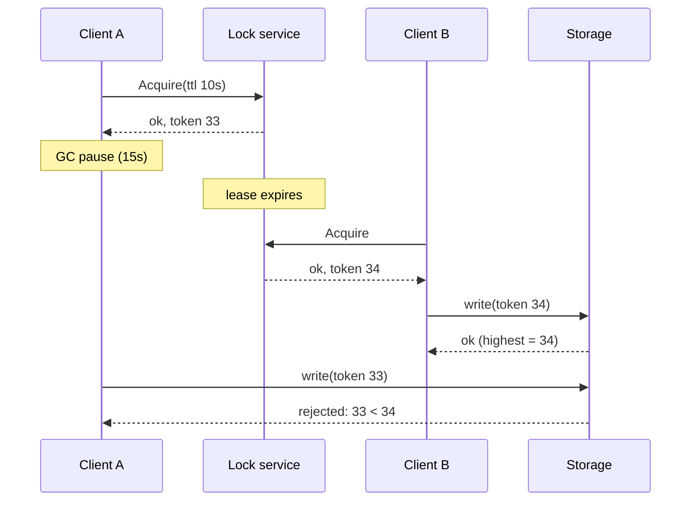

# Distributed Lock with Fencing Tokens

## Problem

Several processes on different machines must not modify a shared resource
(a file in object storage, a row, an external account) at the same time.
A lease-based lock ("you hold it for 10 seconds") avoids deadlock when a
holder crashes, but introduces a subtle bug: the holder can **pause** (GC,
swapping, VM migration, a slow network) for longer than the lease. The lock
service hands the lock to someone else, and then the paused process wakes up
and writes, convinced it still holds the lock. Checking "do I still hold it?"
right before writing does not help; the pause can happen between the check
and the write.

## Solution

Every time the lock service grants the lock, it returns a **fencing token**: a
number that strictly increases with every grant. The client sends the token
with every write, and the **storage** remembers the highest token it has
accepted and rejects any write with a lower one. The safety check moves from
the client (which cannot be trusted to know it was paused) to the resource.

## Diagram



## How this implementation works

- `LockService.Acquire(name, owner, ttl)` grants a lease if the lock is free
  or expired and assigns `Token = last + 1`. Tokens are never reused, even
  after `Release` or when the same owner re-acquires.
- `LockService.Renew` only extends a lease that is still live and still
  identified by the same token; once it expired the client must re-acquire
  and receive a new token. `Release` with an old grant cannot free someone
  else's lock.
- `Storage.Write(key, value, token)` keeps the highest token per key and
  returns `ErrStaleToken` for anything lower. Equal tokens are allowed so the
  current holder can write repeatedly.
- `ManualClock` drives lease expiry deterministically in tests and the
  example.

## Trade-offs

- **The resource must cooperate.** Fencing only works if the storage checks
  tokens (a conditional write, a version column, a `WHERE token <= ?`). Many
  external APIs cannot, and then a lease lock is only a best-effort
  optimisation.
- **The lock service must be consistent.** Tokens are only monotonic if the
  service is linearizable. This one is a single in-process object; in
  production use etcd (the key's revision), ZooKeeper (the znode zxid or
  version) or a database sequence. Redis-based locks such as Redlock do not
  provide fencing tokens on their own.
- **Leases trade safety for liveness.** Too short and healthy holders lose the
  lock mid-operation; too long and a crashed holder blocks everyone.
- Fencing prevents stale writes but does not make the stale client's earlier
  partial work disappear; operations should be idempotent or transactional.

## When to use / when not to

Use a lease lock with fencing for mutual exclusion over a resource that can
check a token: a job that rewrites a file, a single writer to a partition, a
scheduler.

Avoid distributed locks entirely when you can: use single-writer ownership
(partition by key), optimistic concurrency (compare-and-swap on a version), or
idempotent operations. If correctness depends on the lock and the resource
cannot check tokens, a lease lock is not enough.

## Real-world examples

- Martin Kleppmann's "How to do distributed locking" (2016) and *Designing
  Data-Intensive Applications* popularised fencing tokens for lease locks.
- Google's Chubby lock service issues sequencers that servers can check.
- ZooKeeper's zxid / znode versions and etcd's revisions used as tokens.
- HDFS NameNode HA uses epoch numbers to fence the old active NameNode from
  the shared edit log (quorum journal manager).

## Run it

```sh
go run ./patterns/distributed/distributed-lock-fencing/example
go test ./patterns/distributed/distributed-lock-fencing/
```

## Related patterns

- [Leader election](../leader-election): the same lease + term mechanism for choosing one active node.
- [Two-phase commit](../two-phase-commit): locking across participants.
- [Lamport and vector clocks](../lamport-vector-clocks): another use of monotonically increasing counters.
- [Idempotency key](../../reliability/idempotency-key)
- [Timeout](../../reliability/timeout)
