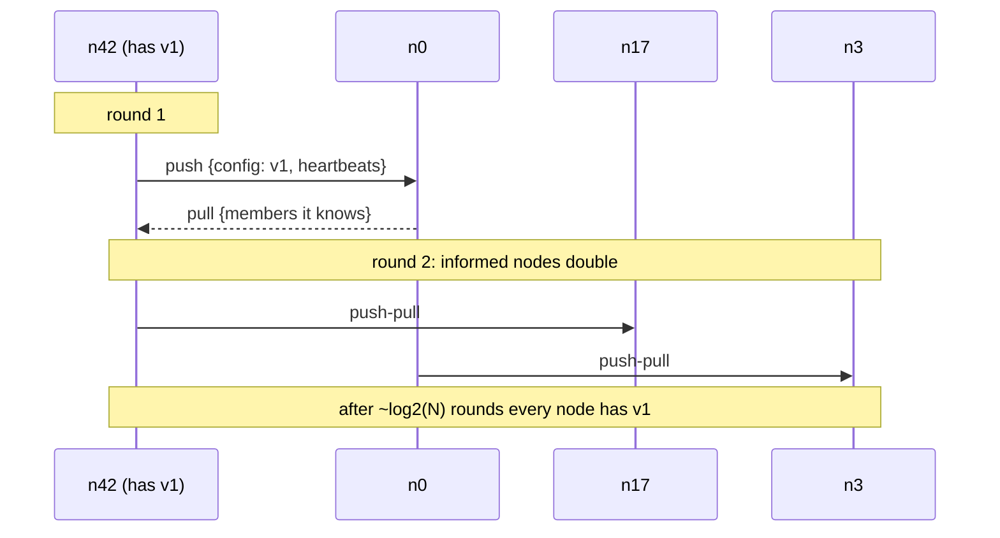

# Gossip (Epidemic) Protocol

## Problem

A cluster of hundreds or thousands of nodes needs to share information:
who is a member, who is alive, which config version is current, which node
owns which token range. A central registry is a bottleneck and a single point
of failure, and having every node broadcast to every other node costs O(N²)
messages per update.

## Solution

Spread information the way rumours (or epidemics) spread. Every round, each
node picks a few random peers (the **fanout**) and exchanges state with them
(**push-pull**). Each entry carries a version, and merging keeps the newer
one, so exchanges are idempotent and order-independent. Because the number of
informed nodes roughly multiplies every round, an update reaches all N nodes
in **O(log N) rounds** with high probability, with each node sending only a
constant number of messages per round, even when many messages are lost.

The same mechanism gives **membership and failure detection**: every node
increments its own **heartbeat** each round and gossips it. If a member's
heartbeat stops increasing for `SuspectAfter` rounds, it is suspected dead.

## Diagram



## How this implementation works

- `NewCluster(Config{Nodes, Fanout, DropRate, SuspectAfter, Seed})` creates
  nodes `n0..nN-1`. Each starts knowing only itself and the **seed** node
  `n0`; full membership is learned through gossip. All randomness comes from a
  seeded PCG generator, so runs are reproducible.
- `Cluster.Round` bumps every live node's heartbeat, snapshots all state, then
  lets each live node exchange with `Fanout` random, non-suspected peers.
  Using the start-of-round snapshot means information travels at most one hop
  per round. Each exchange is lost with probability `DropRate`.
- `merge` keeps the newer `Versioned` value (higher `Version`, ties broken by
  `Origin`) and the higher heartbeat per member, recording the local round in
  which it last changed.
- `Converged`, `RunUntilConverged`, `Suspects`, `Known` and `Messages` let
  tests and the example observe spread, failure detection and cost.

## Trade-offs

- **Eventually consistent.** There is a window where nodes disagree; gossip
  never gives you agreement or linearizability. Use consensus for that.
- **Detection latency vs false positives.** A small `SuspectAfter` detects
  crashes fast but suspects healthy nodes when heartbeats propagate slowly
  (large clusters, packet loss). It must exceed the propagation time.
- **Bandwidth.** This simulation exchanges full state. Real protocols exchange
  digests (key + version) first and then only the missing entries, and
  periodically drop dead members.
- **Seed nodes** speed bootstrapping (notice how quickly everything reaches
  `n0` in the example) but must be reachable when a node first joins.
- Simplified failure detector: real systems use SWIM-style direct and indirect
  probes or phi-accrual detectors and a "suspect" state that can be refuted.

## When to use / when not to

Use gossip for cluster membership, failure detection, and spreading
slowly-changing metadata or aggregates across large clusters where eventual
consistency is fine.

Do not use it for data that needs strong consistency or ordering (leader
identity, locks, money), or for tiny clusters where a direct broadcast is
simpler.

## Real-world examples

- Apache Cassandra uses gossip for membership, node state and schema
  versions, with a phi-accrual failure detector.
- HashiCorp Serf, Consul and Nomad use memberlist, an implementation of the
  SWIM protocol.
- Amazon's Dynamo paper describes gossip-based membership.
- Redis Cluster nodes gossip cluster state over the cluster bus.

## Run it

```sh
go run ./patterns/distributed/gossip/example
go test ./patterns/distributed/gossip/
```

## Related patterns

- [Quorum reads/writes](../quorum): consistency for the data itself.
- [Lamport and vector clocks](../lamport-vector-clocks): versioning gossiped state.
- [Leader election](../leader-election): when you need agreement instead.
- [Consistent hashing](../../data/consistent-hashing): ring ownership is often gossiped.
- [Service discovery](../../architecture/service-discovery)
- [Health check](../../reliability/health-check)
