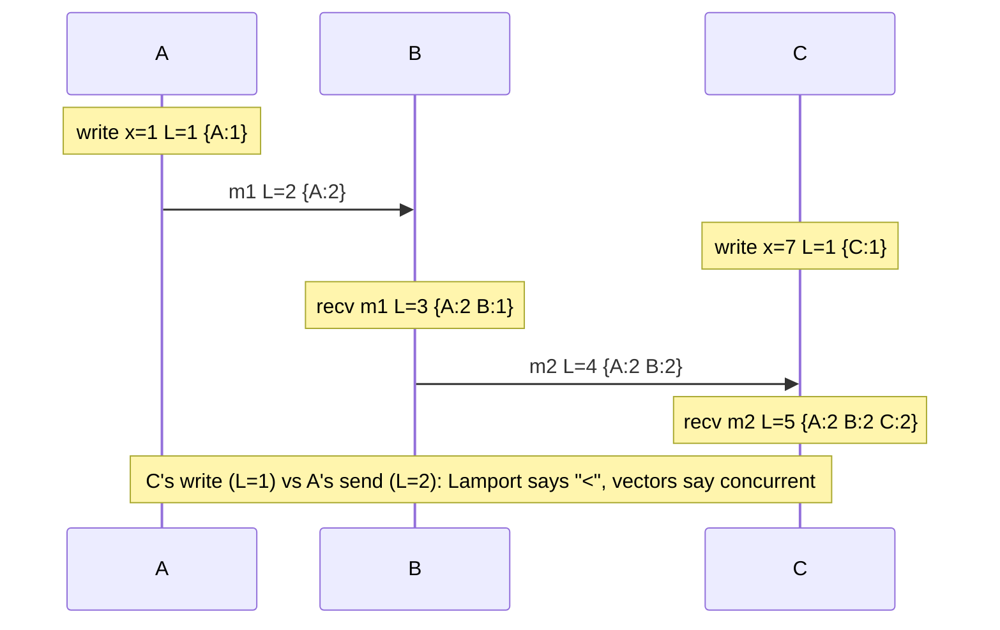

# Lamport Clocks and Vector Clocks

## Problem

In a distributed system there is no global clock. Physical clocks drift and
jump (NTP corrections, leap seconds, VM pauses), so wall-clock timestamps
cannot reliably say which of two events on different machines came first, or
whether one could have caused the other. Yet replicas need exactly that: to
apply updates in a sensible order, and to detect two writes that conflict.

## Solution

Use **logical clocks** that count events and travel with messages.

**Lamport clock** (one integer per process):
- On a local event or send: `t = t + 1`, attach `t` to the message.
- On receive of a message stamped `r`: `t = max(t, r) + 1`.
- Guarantee: if *a happened before b* then `L(a) < L(b)`. Adding the node ID
  as a tie-breaker gives a total order consistent with causality.
- Limitation: `L(a) < L(b)` does **not** imply a happened before b.

**Vector clock** (one counter per process):
- On a local event or send: increment your own entry.
- On receive: take the element-wise max with the sender's vector, then
  increment your own entry.
- Compare: `V(a) <= V(b)` element-wise (and not equal) means a happened before
  b. If neither is `<=` the other, **a and b are concurrent**.

## Diagram



## How this implementation works

- `LamportClock` with `Tick` (local/send) and `Observe(remote)` (receive),
  safe for concurrent use. `LamportStamp.Less` is the total order with node-ID
  tie-break.
- `VectorClock` is a `map[string]uint64` treated as immutable: `Increment`,
  `Merge` and `Copy` return new clocks, so a stamp attached to a message can
  never be changed later by its sender. `Compare` returns `Equal`, `Before`,
  `After` or `Concurrent`; missing entries count as zero.
- `Process` keeps both clocks. `Local`, `Send` and `Receive` apply the update
  rules and return a `Stamp` with both timestamps, so the tests can check the
  Lamport clock condition against the vector order on the same events.

## Trade-offs

- **Lamport**: constant size and a cheap total order (good for things like
  ordering log entries or breaking ties in mutual exclusion), but it cannot
  detect concurrency.
- **Vector**: exact causality, but size grows with the number of
  participants and entries for departed nodes must be garbage collected.
  Systems bound this with version vectors per replica (not per client),
  dotted version vectors, or by pruning old entries.
- Neither tells you about real time. If you need "happened before in wall-clock
  time", look at hybrid logical clocks (HLC) or TrueTime-style bounded
  uncertainty.
- Detecting a conflict is only half the job: the application still has to
  resolve concurrent values (merge, CRDTs, ask the user, or last-writer-wins
  with a tie-breaker).

## When to use / when not to

Use Lamport timestamps when you need a cheap, causality-respecting total
order. Use vector clocks (or version vectors) when replicas accept writes
independently and you must tell "newer" from "conflicting".

Avoid vector clocks with an unbounded or very large set of writers, and do not
use either as a substitute for consensus when you need agreement.

## Real-world examples

- Amazon's Dynamo paper (2007) uses vector clocks to detect conflicting
  versions; Riak used vector clocks and later dotted version vectors.
- Leslie Lamport's "Time, Clocks, and the Ordering of Events in a Distributed
  System" (1978) introduced Lamport clocks.
- CockroachDB and YugabyteDB use hybrid logical clocks, which combine a
  Lamport-style counter with physical time.

## Run it

```sh
go run ./patterns/distributed/lamport-vector-clocks/example
go test ./patterns/distributed/lamport-vector-clocks/
```

## Related patterns

- [Quorum reads/writes](../quorum): versioned values replicated across nodes.
- [Gossip](../gossip): versioned state merged between peers.
- [Distributed lock with fencing](../distributed-lock-fencing): monotonic tokens.
- [Event sourcing](../../data/event-sourcing): ordering events.
- [Write-ahead log](../../data/write-ahead-log)
