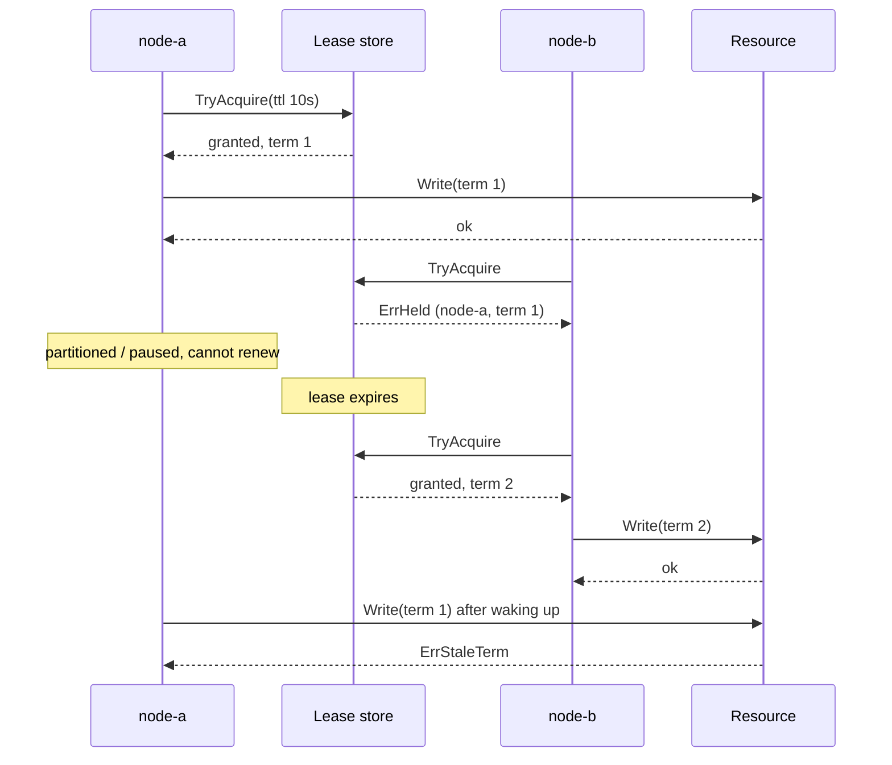

# Leader Election (lease-based, with terms)

> **Simplified teaching version.** This is not Raft or Paxos. The hard part of
> leader election, a fault-tolerant, linearizable store for the lease, is a
> single in-process object here. In production, build on etcd, ZooKeeper,
> Consul, or a database row updated with compare-and-swap, or use a consensus
> library rather than writing your own.

## Problem

Several replicas of a service are running, but some work must be done by
exactly one of them at a time: running a scheduler, relaying an outbox,
owning a shard, being the primary that accepts writes. If the active one dies,
another must take over automatically, and two must never act as leader at the
same time (split brain).

## Solution

Use a **lease**: a record in a strongly consistent store saying "node X is
leader until time T". Each node periodically tries to acquire or renew it:

- If the lease is free or expired, the node takes it and the **term** (epoch)
  is incremented.
- If the node already holds it, it renews and keeps the same term.
- Otherwise it is a follower until the lease expires.

A node acts as leader only while its own view of the lease is unexpired,
minus a safety **margin** for clock drift. A partitioned leader cannot renew,
so it stops acting when its lease runs out, and only then can another node
take over.

Leases alone are not enough: a leader can be paused (GC, VM migration) and
resume after losing the lease, still believing it leads. So the leader stamps
its **term** on every write, and resources reject writes from a term lower
than the highest they have seen.

## Diagram



## How this implementation works

- `LeaseStore.TryAcquire(node, ttl)` atomically grants, renews or refuses
  the lease and bumps `Term` on every change of holder. `Release` allows fast
  failover; `Partition` simulates a node losing contact with the store.
- `Node.Tick` is one iteration of the election loop (call it from a ticker,
  well inside the TTL). `Node.IsLeader` uses only the node's own last
  successful lease and its own clock, minus `margin`, exactly like a real
  process that cannot see the store's state.
- `Resource.Write(term, entry)` is the term check (fencing) that makes a
  deposed leader harmless.
- `ManualClock` makes elections deterministic; `TestAtMostOneLeader` runs a
  long schedule of partitions and heals and asserts no split brain.

## Trade-offs

- **Safety depends on clocks.** Lease expiry assumes bounded clock drift and
  bounded pauses. The margin helps with drift; only the term check protects
  against pauses.
- **Failover time vs churn.** Short TTLs give fast failover but more renewal
  traffic and spurious leader changes during brief hiccups.
- **The store is the real distributed system.** It must be linearizable and
  replicated (Raft in etcd/Consul, Zab in ZooKeeper). A plain cache with
  eventual consistency is not safe for leases.
- **Unavailability window.** Between the old lease expiring and a new node
  ticking, there is no leader.
- Terms only protect resources that check them.

## When to use / when not to

Use it for singleton background work or a primary/standby setup where a few
seconds without a leader is acceptable, and you already run a consistent
store.

Do not hand-roll it for replicated state machines (use Raft), and do not use
it if the work can be partitioned across all nodes instead (consistent
hashing, competing consumers).

## Real-world examples

- Kubernetes controller leader election using `Lease` objects in the API
  server (backed by etcd), via client-go's `leaderelection` package.
- etcd's `concurrency.Election` and ZooKeeper's ephemeral sequential nodes
  recipe.
- HashiCorp Consul sessions and locks for leader election.
- Raft terms and ZooKeeper's epochs are the consensus-level versions of the
  term idea.

## Run it

```sh
go run ./patterns/distributed/leader-election/example
go test ./patterns/distributed/leader-election/
```

## Related patterns

- [Distributed lock with fencing](../distributed-lock-fencing): the same lease + token idea for arbitrary critical sections.
- [Two-phase commit](../two-phase-commit): a coordinator that needs failover.
- [Transactional outbox](../transactional-outbox): run a single active relay.
- [Gossip](../gossip): membership and failure detection without a central store.
- [Health check](../../reliability/health-check)
- [Service discovery](../../architecture/service-discovery)
