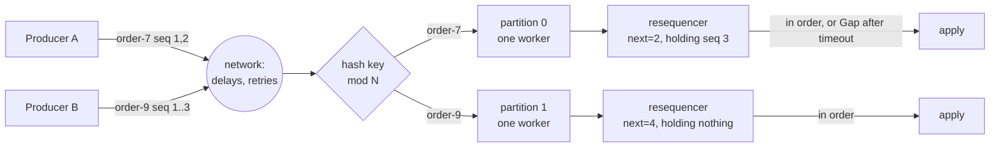

# Per-Key Ordering (partition by key + resequencer)

## Problem

An order produces a short story of events: `created`, `paid`, `packed`, `shipped`. A consumer that applies them out of sequence does real damage: it ships an unpaid order, or a late `created` resets an order that has already shipped. Two things scramble the sequence:

- **Parallel consumers.** Hand events round-robin to a pool of workers, or spread them over partitions without thinking about keys, and `paid` and `shipped` for the same order can be handled at the same time by different workers. Whichever finishes first wins.
- **Delivery itself.** With several producers, retries, multi-region replication or a network that reorders, events reach the consumer in the wrong order before any worker touches them.

The obvious fix, one queue with one consumer, gives a global order nobody needed and throws away all parallelism. Order only matters *within* an order, never between two different orders.

## Solution

Order per key, parallelism across keys, with two complementary tools:

1. **Partition by key.** Hash the ordering key (the order ID) to one of N partitions and give each partition exactly one sequential worker. All events of one order meet the same worker in the order they were submitted; different orders run in parallel on different partitions.
2. **Resequence** when order is lost upstream. The producer, the single writer for that entity, stamps each event with a per-key sequence number (1, 2, 3...). The consumer keeps the next expected number per key, buffers early arrivals and releases only contiguous runs.
   - **Gap timeout.** If a number never arrives, the key waits at most a gap timeout, then the missing numbers are **skipped** and a `Gap` notification is emitted in their place, so the consumer can alert, re-read the entity from its source of truth or mark it for repair. A missing event that turns up after the skip is ignored. (The other policy, halting the key until someone intervenes, is the right call for ledgers; this implementation picks skip-and-report so a lost message can't freeze an order forever.)
   - **Bounded buffer per key.** A key holds at most `MaxBuffer` early events; beyond that `Offer` returns `ErrBufferFull` and the event should be redelivered later.
   - **No cross-key head-of-line blocking.** Buffers, timers and next-expected numbers are per key, so a gap on order A never delays order B.
3. **Combine them.** Route by key so one worker owns each key, and give that worker a resequencer so it can repair whatever the network scrambled.

## Diagram



## How this implementation works

- `PartitionFor(key, n)` is FNV-1a modulo `n`. It is stable for a fixed `n`; changing `n` remaps most keys.
- `NewDispatcher(partitions, handler, WithQueueSize(n))` starts one goroutine per partition, each draining its own buffered channel. `Submit(e)` routes by `e.Key` and blocks while that partition is full (backpressure); `Close()` drains every queue and waits. Per-key order is the order of `Submit` calls for that key, so each key needs a single producer goroutine, or sequence numbers plus a resequencer.
- `NewResequencer(gapTimeout, WithMaxBuffer(n), WithClock(now))` keeps, per key, the next sequence number to release and a map of buffered early events with their arrival times. Sequences start at 1.
  - `Offer(e)` returns the `[]Item` that can now be applied, in order: the event and any buffered run behind it, nothing if it was early, or `Gap` items and runs if the key's gap had already expired. Duplicates (already buffered, already released, or skipped) are ignored and counted.
  - The gap clock starts at the earliest buffered arrival of that key. `Tick()` resolves expired gaps for all waiting keys (sorted by key for determinism); call it periodically. `Offer` resolves the offered key's expired gap first, which may make room in a full buffer.
  - `Stats()` reports released, duplicates, rejected, gaps, skipped numbers and currently buffered events; `NextSeq(key)` shows where a key stands.
  - It is safe for concurrent use, but results are returned to the caller, so apply each key's returned items before its next call: give each key one owner, which is exactly what a dispatcher partition is.
- The example is a seeded discrete-event simulation: 300 orders, 1,046 events, 8 workers with 1-9ms of work per event. Workers and the network are modelled in simulated time so the counts are repeatable; step 2 also runs the same stream through the real goroutine `Dispatcher`.

**Simplification.** Per-key state lives in memory and is never forgotten. A production consumer stores the next expected sequence per key durably, together with the effects it applied (otherwise a restart starts every key at 1), and expires state for keys that have gone quiet. It also only needs to buffer at all because delivery is unordered; on Kafka, where a partition is already ordered, consumers usually just compare the event's version with the stored one and drop stale ones.

## Trade-offs

| Pro | Con |
| --- | --- |
| Per-key order with near-full parallelism: in the example, 8 key partitions finish in 923ms, round-robin in 913ms, one global consumer in 5.2s | A hot key serializes on one partition and one worker; spreading it (see [hot-key salting](../../data/hot-key-salting)) gives up its ordering |
| Partitioning needs no extra state or coordination, just a hash | Adding or removing partitions remaps keys; events in flight during the move can overtake each other unless you drain or pause first |
| The resequencer repairs reordering from multiple producers, retries and replication | Buffered events add latency (up to 34.7ms in the example) and memory; a lost event stalls its key for a full gap timeout |
| Gaps are detected, not silently hidden, because sequence numbers are contiguous | Needs a single sequencer per key: two writers to one order can't share a counter without coordination |
| No head-of-line blocking across keys | Skipping a gap means the consumer may act without one event and must reconcile later |

**Sequence numbers vs Lamport clocks.** A per-key sequence number (or entity version) is assigned by the one writer that owns the entity, so it is a total order *within the key* and it is dense: 3 after 1 proves 2 is missing. [Lamport clocks](../lamport-vector-clocks) order events across many processes that all write, consistent with causality, but the numbers jump, so a receiver can never tell "missing" from "never existed" and cannot resequence with them; vector clocks add concurrency detection, not gap detection. Use sequence numbers when an entity has one owner, logical clocks when it doesn't.

## When to use / when not to

**Use it** when events describe the evolution of an entity and applying them out of order gives a wrong state: order and payment lifecycles, account ledgers, inventory per SKU, chat messages per conversation, CDC streams per row, device telemetry state machines.

**Don't use it** when events are independent (send this email, resize that image: plain [competing consumers](../competing-consumers) are simpler and balance better), when handlers are commutative or the state carries its own version so the consumer can simply drop stale updates, or when you truly need a global order across all keys (then you pay for a single sequencer, a single partition, or a consensus log).

## Real-world examples

- **Kafka**: the record key picks the partition, and order is guaranteed only within a partition; a consumer group gives each partition to one consumer. Idempotent producers attach per-partition sequence numbers so the broker can reject duplicates and out-of-order retries.
- **Amazon SQS FIFO**: `MessageGroupId` is the ordering key. Messages in one group are delivered one at a time in order, while different groups are consumed in parallel.
- **Amazon Kinesis**: the partition key selects the shard; records within a shard have increasing sequence numbers.
- **Google Cloud Pub/Sub**: messages with the same ordering key in the same region are delivered in order; when one fails, the key pauses until the client resumes publishing for it.
- **TCP** is the original resequencer: per-connection sequence numbers, a receive buffer for out-of-order segments, in-order delivery to the application, and retransmission instead of skipping gaps.
- **Chat systems** sequence messages per conversation rather than globally, so a slow room never delays another.

## Run it

```sh
go run ./patterns/distributed/per-key-ordering/example
go test ./patterns/distributed/per-key-ordering/
```

Key numbers from the example (seeded, so every run prints the same):

| Step | Setup | Out-of-order applies |
| --- | --- | --- |
| 1 | single global consumer (done at 5.18s) | 0 |
| 1 | round-robin pool of 8 (913ms) | 149 events in 132 of 300 orders |
| 1 | 8 key partitions (923ms) | 0 |
| 2 | real goroutine `Dispatcher`, 8 partitions | 0 |
| 3 | network delays each event 0-40ms, key partitions alone | 390 events in 253 orders |
| 3 | same, plus resequencer | 0 (at most 23 events buffered, longest wait 34.7ms) |
| 4 | four `paid` events lost, one 300ms late, 100ms gap timeout | 0; 5 gaps reported after 100.8-104.4ms, the late event ignored |

In step 4 the 5 affected orders waited up to 104.4ms while the other 295 orders never waited more than 34.7ms, the same as step 3 without any loss: a gap only holds back its own key. Waits run slightly past 100ms because the simulation checks expiry on a 5ms `Tick`.

## Related patterns

- [Lamport and vector clocks](../lamport-vector-clocks): ordering across many writers, and why it can't detect gaps
- [Competing consumers](../competing-consumers): the unordered worker pool; fine until events about the same entity must stay in sequence
- [Pub/Sub](../pub-sub): fan-out; each subscriber still needs per-key order if it builds entity state
- [Idempotent consumer](../idempotent-consumer): the resequencer drops duplicates per key, but redelivery after a crash still needs idempotent effects
- [Sharding](../../data/sharding): the same hash-the-key routing, for data instead of events
- [Hot-key salting](../../data/hot-key-salting): what to do when one key is too hot for one partition, at the cost of its ordering

## Further reading

- Arvind Kumar, [Order Events Arrive Out of Sequence](https://codefarm0.medium.com/order-events-arrive-out-of-sequence-system-design-deep-dive-on-event-ordering-and-kafka-41a0ad4e585a), a deep dive into event ordering for order lifecycles and how Kafka partition keys provide it
- Khyati Jha, [High Level System Design Day-17: WebSockets (Part 5)](https://medium.com/high-level-system-desgin-interview-prep/addhigh-level-system-design-day-17-websockets-part-5-fea1631aaaa2), on sequencing chat messages per conversation
