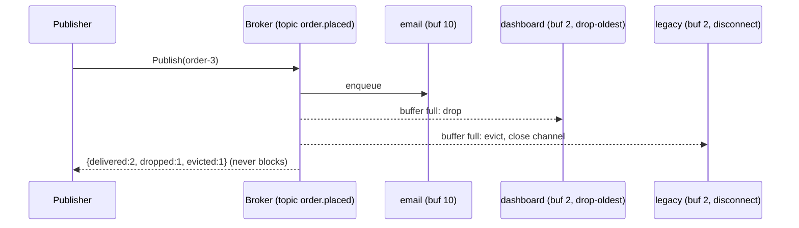

# Publish/Subscribe

## Problem

A producer needs to tell many other components that something happened (an
order was placed, a price changed) without knowing who they are or waiting for
each of them. Calling every consumer directly couples the producer to all of
them, and one slow or dead consumer can stall the whole flow.

## Solution

Put a broker in the middle. Producers publish to a named **topic**; every
**subscriber** of that topic gets its own copy (fan-out). Each subscriber has
its own bounded buffer, and the broker applies an explicit **overflow policy**
when a subscriber falls behind, so a slow consumer only hurts itself:

- **drop-newest**: keep what is queued and discard new messages.
- **drop-oldest**: discard the oldest queued message and keep the latest
  (good for "current state" feeds like dashboards).
- **disconnect**: evict the subscriber; it must reconnect and resync.

## Diagram



## How this implementation works

- `Broker.Subscribe(topic, buffer, policy)` creates a `Subscription` with a
  buffered channel, available through `C()`.
- `Broker.Publish` assigns a per-topic sequence number (`Message.Seq`, so
  subscribers can detect gaps) and does a **non-blocking** send to each
  subscriber while holding the broker lock. On a full buffer it applies the
  policy and reports the outcome in `PublishStats`.
- Because every send and every `close` happen under the same lock,
  `Cancel`, eviction and `Close` can never cause a send on a closed channel.
- `Subscription.Dropped()` and `Evicted()` expose per-subscriber health.

## Trade-offs

- **In-memory, at-most-once.** Messages live only in channel buffers. A crash
  loses them and subscribers only see messages published after they
  subscribed. Durable brokers (Kafka, Pub/Sub, SNS+SQS) persist messages and
  track consumer offsets or acks.
- **Ordering** is per-topic for a single publisher. With concurrent
  publishers the order is whatever order they acquired the lock in.
- **Dropping vs blocking.** This broker never blocks publishers. If losing
  messages is unacceptable you need backpressure (see related patterns) or a
  durable log that consumers read at their own pace.
- Holding one lock during fan-out keeps it simple and correct, but limits
  throughput with very many subscribers. Real brokers shard by topic or
  partition.

## When to use / when not to

Use it to decouple producers from a changing set of consumers: notifications,
cache invalidation, live dashboards, domain events inside a process.

Avoid it when exactly one consumer must handle each message (use competing
consumers), when you need a reply (use request/response), or when consumers
must replay history (use a durable log or event sourcing).

## Real-world examples

- Apache Kafka topics with multiple consumer groups.
- Google Cloud Pub/Sub, AWS SNS fan-out to SQS queues.
- Redis Pub/Sub, which, like this example, drops messages for disconnected
  clients and disconnects clients whose output buffer grows too large.
- NATS core subjects, which disconnect "slow consumers".

## Run it

```sh
go run ./patterns/distributed/pub-sub/example
go test ./patterns/distributed/pub-sub/
```

## Related patterns

- [Competing consumers](../competing-consumers): one message, one worker.
- [Backpressure](../backpressure): slow the producer instead of dropping.
- [Transactional outbox](../transactional-outbox): publish reliably after a DB write.
- [Saga (choreography)](../saga-choreography): services coordinating via events.
- [Event sourcing](../../data/event-sourcing)
- [Fan-out feed](../../architecture/fan-out-feed)
- [Server-sent events](../../architecture/server-sent-events)
