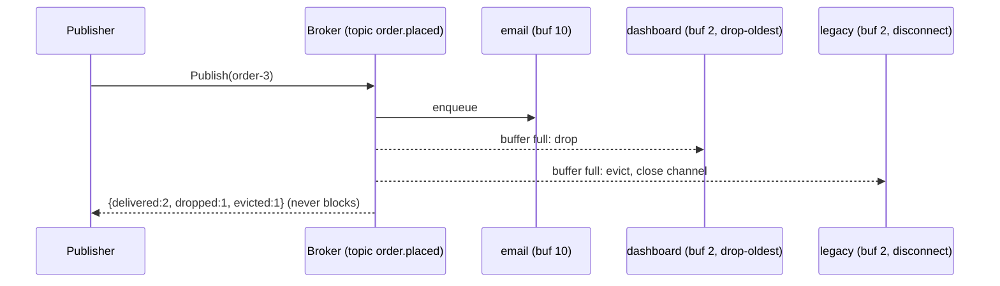
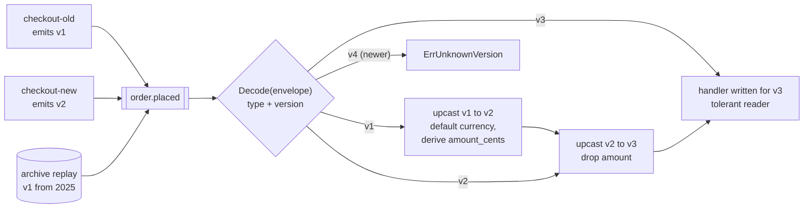

# Publish/Subscribe

## Problem

A producer needs to tell many other components that something happened (an
order was placed, a price changed) without knowing who they are or waiting for
each of them. Calling every consumer directly couples the producer to all of
them, and one slow or dead consumer can stall the whole flow.

## Solution

Put a broker in the middle. Producers publish to a named **topic**; every
**subscriber** of that topic gets its own copy (fan-out). Each subscriber has
its own bounded buffer, and the broker applies an explicit **overflow policy**
when a subscriber falls behind, so a slow consumer only hurts itself:

- **drop-newest**: keep what is queued and discard new messages.
- **drop-oldest**: discard the oldest queued message and keep the latest
  (good for "current state" feeds like dashboards).
- **disconnect**: evict the subscriber; it must reconnect and resync.

### Event versioning and upcasting

A topic outlives every version of its producers. During a rollout one
producer still emits v1 while another emits v2, and a consumer replaying
history sees events written long ago. So every event travels in an
**envelope** that names its type and schema version, and the consumer keeps a
**registry of upcasters**, small functions that turn a vN payload into
vN+1. They chain (v1 -> v2 -> v3), so business logic only ever handles the
newest shape, and old events stay readable without rewriting the log.

- **Tolerant reader.** Consumers ignore fields they don't know and default
  fields that are missing. That makes *adding* a field safe in both
  directions: old consumers skip it, new consumers default it on old events.
- **Breaking changes go through expand/contract.** To replace `amount`
  (dollars, float) with `amount_cents` (int): *add* the new field and
  dual-write both (v2), move every consumer to read the new one, and only
  then *remove* the old field (v3). The v1 -> v2 upcaster derives the new
  field, and the v2 -> v3 one drops the old.
- **Upcasting is idempotent.** An event already at the current version passes
  through untouched, and an upcaster never overwrites a field the producer
  already set (the v2 dual-write wins over the derived value).
- **Never downcast.** An event *newer* than the consumer is an error. The
  rollout order is consumers first, producers second.

## Diagram



Versioned events on the consumer side:



## How this implementation works

- `Broker.Subscribe(topic, buffer, policy)` creates a `Subscription` with a
  buffered channel, available through `C()`.
- `Broker.Publish` assigns a per-topic sequence number (`Message.Seq`, so
  subscribers can detect gaps) and does a **non-blocking** send to each
  subscriber while holding the broker lock. On a full buffer it applies the
  policy and reports the outcome in `PublishStats`.
- Because every send and every `close` happen under the same lock,
  `Cancel`, eviction and `Close` can never cause a send on a closed channel.
- `Subscription.Dropped()` and `Evicted()` expose per-subscriber health.
- **Versioning** (`versioning.go`) is independent of the broker: producers
  publish `Encode(type, version, payload)` bytes, and consumers call
  `Registry.Decode(raw)`. `Declare(type, current)` sets the version the
  consumer is written for, and `Register(type, from, upcaster)` adds the
  `from -> from+1` step. An `Upcaster` mutates a
  `map[string]json.RawMessage`, so fields it doesn't touch (including unknown
  ones) pass through byte for byte. `Decode` returns the step count and fails
  with `ErrUnknownVersion` (newer than current), `ErrMissingUpcaster` (a
  hole in the chain), or `ErrUnknownEventType`. `Stats()` counts decoded,
  upcasted, steps, and failed events.
- `ReadTolerant` is plain `json.Unmarshal` (unknown fields ignored, missing
  fields keep the defaults you pre-filled). `ReadStrict` uses
  `DisallowUnknownFields` to show the brittle alternative.
- In the example, a v1 and a v2 producer share a topic. The v3 consumer with
  the full chain decodes all 6 events (9 upcast steps). One that shipped only
  the v2 -> v3 upcaster decodes 3 and reports **3 errors**, one per v1 event.
  A replayed v1 event upcasts in 2 steps and re-upcasting it takes 0. A v4
  event is rejected.

**Simplification.** The schema history lives in Go code on the consumer. In
production it usually sits in a schema registry next to the broker, and the
registry rejects an incompatible schema at publish time rather than at
consume time.

## Trade-offs

- **In-memory, at-most-once.** Messages live only in channel buffers. A crash
  loses them and subscribers only see messages published after they
  subscribed. Durable brokers (Kafka, Pub/Sub, SNS+SQS) persist messages and
  track consumer offsets or acks.
- **Ordering** is per-topic for a single publisher. With concurrent
  publishers the order is whatever order they acquired the lock in.
- **Dropping vs blocking.** This broker never blocks publishers. If losing
  messages is unacceptable you need backpressure (see related patterns) or a
  durable log that consumers read at their own pace.
- Holding one lock during fan-out keeps it simple and correct, but limits
  throughput with very many subscribers. Real brokers shard by topic or
  partition.
- **Upcasting on read vs migrating the log.** Upcasters keep old events
  readable forever without rewriting history, but every consumer pays the
  conversion on every read of an old event, and the chain only grows. Teams
  eventually compact or rewrite very old events and delete the earliest
  upcasters. A missing upcaster fails only when an old event shows up, which
  may be weeks later during a replay, so test the chain against stored
  samples of every version.

## When to use / when not to

Use it to decouple producers from a changing set of consumers: notifications,
cache invalidation, live dashboards, domain events inside a process.

Avoid it when exactly one consumer must handle each message (use competing
consumers), when you need a reply (use request/response), or when consumers
must replay history (use a durable log or event sourcing).

## Real-world examples

- Apache Kafka topics with multiple consumer groups.
- Google Cloud Pub/Sub, AWS SNS fan-out to SQS queues.
- Redis Pub/Sub, which, like this example, drops messages for disconnected
  clients and disconnects clients whose output buffer grows too large.
- NATS core subjects, which disconnect "slow consumers".
- **Confluent Schema Registry** stores a versioned schema per subject and
  checks each new one against a compatibility mode: `BACKWARD` (new
  consumers can read old data, so upgrade consumers first), `FORWARD` (old
  consumers can read new data), `FULL` (both), and `*_TRANSITIVE` variants
  that check against every earlier version, not just the last.
- **Protocol Buffers** build the tolerant reader into the wire format. Fields
  are identified by number, not name, so unknown numbers are skipped and
  missing ones read as defaults. A removed field's number must be `reserved`
  and never reused, or old bytes get decoded as the wrong field. Avro does the
  same with reader/writer schema resolution and field defaults.
- Event-sourcing frameworks such as Axon expose upcasters for exactly this
  job.

## Run it

```sh
go run ./patterns/distributed/pub-sub/example
go test ./patterns/distributed/pub-sub/
```

## Related patterns

- [Competing consumers](../competing-consumers): one message, one worker.
- [Backpressure](../backpressure): slow the producer instead of dropping.
- [Transactional outbox](../transactional-outbox): publish reliably after a DB write.
- [Saga (choreography)](../saga-choreography): services coordinating via events.
- [Event sourcing](../../data/event-sourcing)
- [Fan-out feed](../../architecture/fan-out-feed)
- [Server-sent events](../../architecture/server-sent-events)

## Further reading

- Khyati Jha, [System Design Interview Prep: High-Level Design Day-1](https://medium.com/high-level-system-desgin-interview-prep/system-design-interview-prep-high-level-dessign-day-1-302a3759e144), which covers event-driven systems, including how events are versioned
