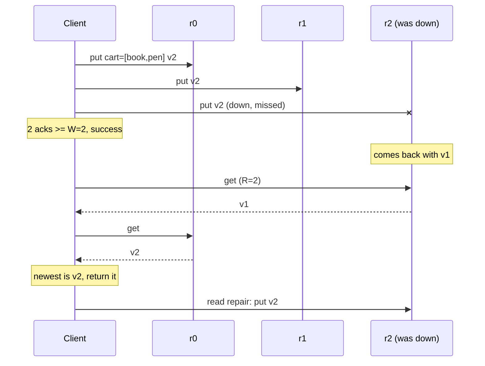

# Quorum Reads and Writes (N / R / W)

## Problem

Data is replicated to several nodes so that it survives failures, but nodes
go down, get partitioned, or fall behind. If writes wait for *all* replicas,
one slow node blocks every write. If reads and writes each touch just one
replica, a read can return stale data. You need a tunable middle ground.

## Solution

Store each key on **N** replicas. A write is successful once **W** replicas
acknowledge it; a read asks **R** replicas and returns the value with the
highest version. If **R + W > N**, every read set overlaps every successful
write set in at least one replica, so a read always sees the latest successful
write. Reads also perform **read repair**: any contacted replica that returned
an older version is updated with the newest one.

Common settings with N = 3: `R=2, W=2` (balanced), `R=1, W=3` (fast reads),
`R=3, W=1` (fast writes), and `R=1, W=1` (fast, but stale reads possible).

## Diagram



## How this implementation works

- `Config{N, R, W}` with `Validate` and `Strong()` (R + W > N).
- `Replica` is an in-memory node with `SetDown`. `Replica.Put` never replaces
  a newer version with an older one, so retries and repairs are safe in any
  order.
- `Store.Put(writer, key, data)` reads the current version from the reachable
  replicas (at least R must answer), picks `Version{Counter: max+1, Writer}`,
  sends the write to all N replicas in parallel and succeeds when W
  acknowledge. A failed quorum is **not** rolled back: replicas that accepted
  the write keep it, which a later read can surface. That is how real
  Dynamo-style stores behave.
- `Store.Get` / `GetFrom(key, start)` contact replicas in preference order
  from a rotating (or explicit) start index and stop after R answers, which
  models "the first R replicas to respond". They return the newest version and
  repair stale or missing copies among the replicas contacted.

## Trade-offs

- **Latency vs consistency.** Larger R or W means waiting for more (and
  slower) replicas. R + W > N gives read-your-latest-write for successful
  writes, but it is still not linearizable under concurrent reads and writes
  or with partial writes; that needs extra mechanisms (e.g. ABD-style write-back
  before returning, or consensus).
- **Availability.** With R=2, W=2, N=3 the system tolerates one replica down.
  Two down means both reads and writes are refused.
- **Last-writer-wins** (counter + writer ID) is simple but loses one of two
  concurrent writes. Dynamo and Riak keep siblings with vector clocks
  instead; Cassandra uses timestamps (LWW).
- **Simplifications.** Fixed replica set (no consistent hashing or hinted
  handoff), synchronous in-process calls, read repair done inline instead of
  in the background, and no anti-entropy (Merkle trees) for keys nobody reads.

## When to use / when not to

Use quorums for replicated key/value data where you want to tune the
consistency/latency/availability balance per workload, and where
last-writer-wins or application-level merges are acceptable.

Use consensus (Raft/Paxos) instead when you need linearizable operations,
compare-and-swap, or a single agreed order of updates.

## Real-world examples

- Amazon's Dynamo paper (2007), which popularised N/R/W.
- Apache Cassandra consistency levels (`ONE`, `QUORUM`, `ALL`, `LOCAL_QUORUM`)
  and its read repair.
- Riak's tunable `n_val`, `r` and `w`.
- ScyllaDB, which is Cassandra-compatible and has the same consistency
  levels.

## Run it

```sh
go run ./patterns/distributed/quorum/example
go test ./patterns/distributed/quorum/
```

## Related patterns

- [Lamport and vector clocks](../lamport-vector-clocks): detect concurrent writes instead of LWW.
- [Gossip](../gossip): membership and anti-entropy between replicas.
- [Consistent hashing](../../data/consistent-hashing): choose which N nodes hold a key.
- [Read replicas](../../data/read-replicas): primary-based replication for comparison.
- [Sharding](../../data/sharding)
- [Hedged requests](../../reliability/hedged-requests): cut tail latency on reads.
