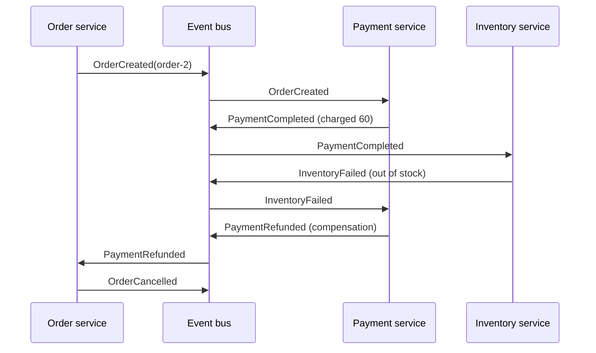

# Saga (Choreography)

## Problem

Same as any saga: an operation (place an order) spans several services with
separate databases, there is no global transaction, and partial work must be
undone when a later step fails. But you do not want a central coordinator that
knows about every service and becomes a bottleneck or a point of coupling.

## Solution

Let the services **choreograph** themselves through events. Each service
subscribes to the events it cares about, runs its local transaction, and
publishes the outcome. A failure is just another event; services that already
did work listen for it and run their own **compensation**.

```
OrderCreated      -> Payment charges      -> PaymentCompleted | PaymentFailed
PaymentCompleted  -> Inventory reserves   -> InventoryReserved | InventoryFailed
InventoryReserved -> Order confirms       -> OrderConfirmed
InventoryFailed   -> Payment refunds      -> PaymentRefunded   (compensation)
PaymentFailed | PaymentRefunded -> Order cancels -> OrderCancelled
```

## Diagram



## How this implementation works

- `Bus` is a deterministic in-process FIFO: `Publish` enqueues,
  `RunUntilIdle(max)` delivers events (including ones handlers publish) until
  the queue is empty. `max` guards against accidental event loops.
  `NewBus(true)` delivers every event twice to simulate an at-least-once
  broker.
- `NewSystem(balances, stock, duplicate)` builds `OrderService`,
  `PaymentService` and `InventoryService` and subscribes each to its events.
  No component knows the whole flow; it emerges from the subscriptions.
- Handlers are **idempotent** using per-order state: `PaymentService` records
  which orders it has decided (`done`) and what it charged (`charged`), so a
  duplicate `OrderCreated` does not double-charge and a duplicate
  `InventoryFailed` does not double-refund. `OrderService.transition` only
  moves an order out of `pending` once.
- Events carry all the data the next step needs (customer, item, amount), so
  no service calls another synchronously.

## Trade-offs

- **Implicit flow.** The process is spread across subscriptions, which makes
  it hard to see, test end to end, and change. Beyond a handful of steps,
  orchestration is usually easier to maintain.
- **Cyclic dependencies** between services' events can creep in; watch for
  event loops.
- **No isolation**, as with every saga: bob's money is gone briefly before
  the refund. Design states (`pending`) so others do not act on intermediate
  data.
- **Simplifications.** The bus is synchronous and in-memory. A real system
  uses a durable broker, publishes each event through a transactional outbox
  in the same transaction as the state change, handles out-of-order delivery,
  and tracks saga timeouts (what if `PaymentCompleted` never arrives?).

## When to use / when not to

Use choreography for short flows between a few autonomous services owned by
different teams, where loose coupling matters more than central visibility.

Prefer [orchestration](../saga-orchestration) when the flow has many steps,
branches, or timeouts, or when someone needs to answer "where is order 42 in
the process?" quickly.

## Real-world examples

- Event-driven microservices on Kafka, RabbitMQ or Amazon EventBridge where
  services react to each other's domain events.
- The choreography-based saga as described on microservices.io by
  Chris Richardson, which uses this order/payment/inventory example shape.

## Run it

```sh
go run ./patterns/distributed/saga-choreography/example
go test ./patterns/distributed/saga-choreography/
```

## Related patterns

- [Saga (orchestration)](../saga-orchestration): the centrally coordinated variant.
- [Pub/Sub](../pub-sub): the transport for the events.
- [Transactional outbox](../transactional-outbox): publish each event atomically with the state change.
- [Two-phase commit](../two-phase-commit)
- [Idempotency key](../../reliability/idempotency-key)
- [Event sourcing](../../data/event-sourcing)
- [CQRS](../../data/cqrs)
