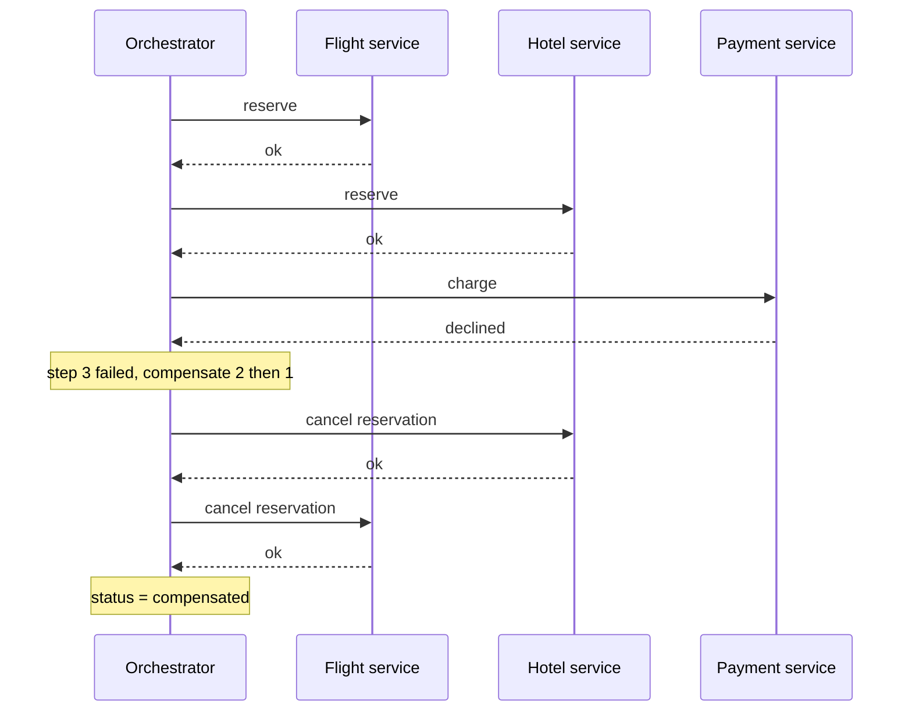

# Saga (Orchestration)

## Problem

A business operation spans several services, each with its own database:
book a trip means reserving a flight, reserving a hotel and charging a card.
There is no single transaction that covers all three, and holding locks across
services with two-phase commit is slow and blocks when a participant fails.
If the card is declined after the flight and hotel are reserved, those
reservations must not be left behind.

## Solution

Model the operation as a **saga**: a sequence of local transactions, each with
a **compensating action** that semantically undoes it (cancel reservation,
refund payment). In the **orchestration** style a central orchestrator tells
each service what to do, in order. When a step fails, the orchestrator runs
the compensations of the already-completed steps **in reverse order**.

## Diagram



## How this implementation works

- A saga is a `[]Step`, each with `Name`, `Action` and an optional
  `Compensate`.
- `Orchestrator.Run(ctx, steps)` runs actions in order, recording an `Event`
  per outcome. On the first failure (or when `ctx` is cancelled between steps)
  it walks back through the completed steps and calls `Compensate`.
- Compensations run under `context.WithoutCancel(ctx)`: the caller timing out
  must not prevent undoing work already done.
- Each compensation is retried `CompensationAttempts` times. If it still
  fails, the run ends with `CompensationFailed`, keeps undoing the remaining
  steps, and returns the joined errors so an operator or a repair job can
  finish the job.
- `Result` carries the final `Status`, the failed step, and the log.

## Trade-offs

- **No isolation.** Between steps, other requests can see the hotel reserved
  but not yet paid. Use semantic locks (a "pending" state), commutative
  updates, or reorder steps so the step most likely to fail goes first.
- **Compensations must be idempotent and must eventually succeed.** Some
  actions cannot be undone (an email was sent); put them last, after the
  pivot step that can no longer fail.
- **Orchestrator is a single point of logic.** It is easy to read and debug
  (the whole flow is in one place) but it couples the orchestrator to every
  participant.
- **Durability omitted.** This orchestrator keeps the log in memory. A real
  one persists state after every step (or uses a workflow engine) so it can
  resume after a crash, and calls services over the network with timeouts and
  idempotency keys.

## When to use / when not to

Use orchestration when a business process has several steps, clear
compensations and you want the flow visible and testable in one place
(order fulfilment, travel booking, onboarding).

Prefer [choreography](../saga-choreography) for a few loosely coupled
services reacting to events. Prefer a single database transaction if the data
can live in one database. Avoid sagas when you truly need isolation.

## Real-world examples

- Temporal and Cadence workflows (durable orchestration with compensation).
- AWS Step Functions, which documents the saga pattern with catch/compensate
  states.
- Netflix Conductor and Camunda workflow engines.
- The original "Sagas" paper by Garcia-Molina and Salem (1987).

## Run it

```sh
go run ./patterns/distributed/saga-orchestration/example
go test ./patterns/distributed/saga-orchestration/
```

## Related patterns

- [Saga (choreography)](../saga-choreography): the decentralised variant.
- [Two-phase commit](../two-phase-commit): atomic but blocking alternative.
- [Transactional outbox](../transactional-outbox): emit each step's event reliably.
- [Idempotency key](../../reliability/idempotency-key): safe retries of steps.
- [Retry with backoff](../../reliability/retry-backoff)
- [Timeout](../../reliability/timeout)
