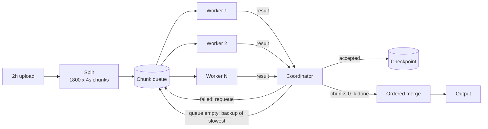

# Split-Process-Merge (chunked parallel jobs)

## Problem

Some jobs are one big unit of work. Encoding a two-hour upload into every resolution a player needs can take six hours of CPU, and done as one process:

- **It is slow.** Wall time equals CPU time; adding machines does not help one process.
- **Failure is expensive.** A crash, a pre-empted VM or a deploy at 95% throws away five and a half hours, and the retry starts from zero.
- **It is all or nothing.** You cannot see progress, resume, or give up gracefully at a deadline with partial work saved.

## Solution

Cut the job into many small, independent chunks, process them in parallel, and stitch the results back together in order.

1. **Split.** Cut the input into chunks (four-second segments of video). Fixed-duration cuts are simplest. For video, cutting **at keyframes** is better: each chunk then starts with a full frame and decodes without the previous chunk, at the cost of uneven chunk lengths.
2. **Fan out.** Put one task per chunk on a queue and let N workers compete for them ([competing consumers](../competing-consumers)).
3. **Retry per chunk.** A failed chunk goes back on the queue on its own, up to a maximum number of attempts. Past that the job fails with the chunk's error (or the chunk goes to a [dead-letter queue](../dead-letter-queue) for a human).
4. **Checkpoint.** Record every finished chunk durably. A crashed or cancelled job restarts by loading the checkpoint and running only the unfinished chunks.
5. **Merge in order.** Results arrive in any order, so slot them by index. The merge needs every chunk, in index order: either all at the end, or **streamed** as soon as chunks 0..k are all done.
6. **Mitigate stragglers.** With many workers the job finishes when its slowest chunk does. Once the queue is empty, idle workers start **backup copies** of the longest-running chunks (MapReduce's backup tasks). The first result wins; the loser is cancelled and any result it sends later is ignored, so there is exactly one result per chunk.
7. **Bound the job.** A job-level deadline or cancel stops handing out work and cancels in-flight attempts. What finished stays in the checkpoint.

## Diagram



## How this implementation works

- **Splitting.** `SplitFixed(total, size)` and `SplitAtKeyframes(total, keyframes, target)` return `[]Chunk{Index, Start, End}`. The keyframe splitter starts a new chunk at the first keyframe at least `target` after the current chunk's start.
- **One scheduler, two drivers.** An internal scheduler holds the queue and per-chunk state: pending/running/done, attempt and failure counts, and live attempts in start order. `Run` drives it with real goroutines; `Simulate` drives the same code in simulated time.
- **`Run(ctx, chunks, process, Config[R])`** starts `Workers` goroutines and a single coordinator. Only the coordinator touches the scheduler, so it needs no lock. Each attempt gets its own context. `process(ctx, Attempt)` sees `Attempt.Number` and `Attempt.Backup`.
  - A failure requeues the chunk at the *front* of the queue, because it is blocking the merge prefix. After `MaxAttempts` failures (default 3) `Run` returns a `*ChunkError`, which matches both `ErrChunkFailed` and the cause with `errors.Is`.
  - With `Speculate`, whenever a worker is idle and the queue is empty, it gets a backup of the oldest-started running chunk that has no backup yet. When one copy succeeds the other's context is cancelled. A late result from it is counted in `Stats.Duplicates` and dropped.
  - `Checkpoint` (`Load`/`Save`; `MemoryCheckpoint` is provided) is loaded at start, and those chunks are never processed. Every accepted result is saved before it is merged.
  - `OnMerge(chunk, result)` is called strictly in index order for the contiguous prefix of finished chunks (a streaming merge). `Report.Results` holds every result in index order.
  - When `ctx` is cancelled or its deadline passes, `Run` stops dispatching, cancels in-flight attempts, waits for every worker to return, and wraps `ctx.Err()`.
- **`Simulate(SimConfig)`** is a discrete-event simulation. Each attempt costs `ChunkOverhead + media × CostPerMediaSecond`, spread by `Jitter`. With probability `StragglerRate` the cost is multiplied by `StragglerFactor`, and with probability `FailRate` the attempt fails halfway. The draw is seeded by `(Seed, chunk, attempt number)`, so a chunk costs the same however many workers there are, and every run is deterministic. It models `Crashes` (a dead worker's chunk is requeued when its lease, `DetectAfter`, expires), `StopAt` (a deadline or coordinator crash; `Done` is the checkpoint), `Resume`, and merge cost: `MergePerChunk` per chunk, serial, after the last chunk or streamed.
- `Stats` counts attempts, failures, lost attempts, reruns, backups, backup wins and ignored duplicates. A rerun is a non-backup attempt on a chunk that had been started before.

**Simplification.** The coordinator is a single goroutine holding state in memory, and only the checkpoint survives a crash. A production system keeps the job state in a database, so another coordinator can take over, and uses a real queue with leases. Speculation uses start order as a proxy for "slowest"; MapReduce and Spark compare each task's progress rate with its peers. The simulator gives a backup a fresh cost draw, which models a slow *machine* rather than a chunk that is inherently expensive (a complex scene). For an inherently expensive chunk a backup does not help, and splitting it smaller does. Encoding chunks independently also has a quality cost at the boundaries (rate control restarts per chunk), which real encoders soften with overlap or two-pass analysis.

## Trade-offs

| Pro | Con |
| --- | --- |
| Wall time drops roughly with worker count (the example: 6h serial to 13 min on 64 workers) | Per-chunk overhead: on one worker the chunked job is slower than serial (7h22m vs 6h) |
| A failure costs one chunk, not the job | The merge is serial and needs every chunk: it caps the speedup (Amdahl) |
| Checkpointed progress: restart, resume, or stop at a deadline without losing finished work | Stragglers decide the finish time once there are many workers |
| Backups trim the tail cheaply (64 workers: 13m5s to 9m49s) | Backups burn extra work on chunks that were never slow, and need idempotent output |
| Progress and per-chunk retries are visible and controllable | Chunk boundaries must be real cut points (keyframes); otherwise the output glitches |

## When to use / when not to

**Use it** when a job splits into pieces that can be processed independently and recombined cheaply: video and audio transcoding, image tiling, large file uploads and checksums, batch ETL over partitioned files, ML batch inference, rendering frames, test-suite sharding.

**Don't use it** when chunks depend on each other's results (the work is a chain, not a set), when the merge is as expensive as the work, or when the job is already short. If one chunk takes a few seconds, the coordination overhead costs more than the parallelism saves. Choose the chunk size to balance these. Smaller chunks mean better balance, smaller stragglers and cheaper retries, but more per-chunk overhead and merge work.

## Real-world examples

- **YouTube and Netflix** encode uploads by splitting them into segments, encoding the segments in parallel across a fleet, and assembling the outputs. Netflix has written about its chunk-based encoding platforms (Archer, and later Cosmos), which spread per-chunk encodes over many machines.
- **MapReduce, Hadoop and Spark** split input into splits or partitions, run a task per split, rerun failed tasks, and launch **backup** (speculative) tasks for stragglers near the end of a stage (`spark.speculation`).
- **AWS Elemental MediaConvert** and similar cloud transcoders accelerate long jobs by processing segments in parallel.
- **ffmpeg** does it by hand: `-f segment` splits at keyframes, each segment is encoded separately, and the `concat` demuxer joins them in order.
- **S3 multipart upload** is the same shape for upload: parts are sent in parallel, retried individually, and combined in part-number order.

## Run it

```sh
go run ./patterns/distributed/split-process-merge/example
go test ./patterns/distributed/split-process-merge/
```

Steps 1 to 6 are simulated and print the same numbers on every run. Step 7 uses real goroutines, so its exact counts vary, and it checks that the resume processed only chunks missing from the checkpoint.

## Related patterns

- [Competing consumers](../competing-consumers): the worker pool and queue the chunks are fanned out to.
- [Scatter-gather](../../architecture/scatter-gather): the same fan-out and gather, for one request across services rather than one job across chunks.
- [Backpressure](../backpressure): bounding how many chunks are queued or in flight.
- [Dead-letter queue](../dead-letter-queue): where a chunk that exhausts its attempts can go instead of failing the job.
- [Async request-reply](../../architecture/async-request-reply): how a client submits a long job like this and polls for the result.

## Further reading

- Arvind Kumar, [YouTube Video Processing Pipeline](https://codefarm0.medium.com/youtube-video-processing-pipeline-system-design-deep-dive-on-distributed-encoding-and-async-a39a7afc4d72): chunk-based parallel encoding and the async pipeline around it.
- Jeffrey Dean and Sanjay Ghemawat, "MapReduce: Simplified Data Processing on Large Clusters" (OSDI 2004): splits, re-execution on failure, and backup tasks for stragglers.
