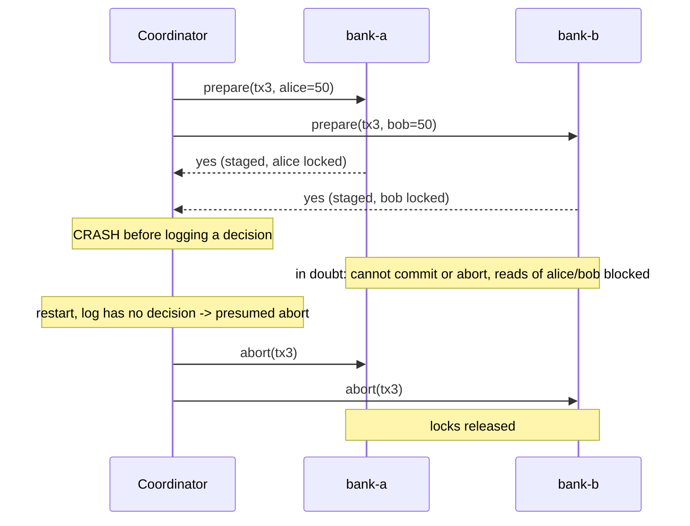

# Two-Phase Commit (2PC)

## Problem

A transaction must update data owned by several independent resource managers
(two bank databases, a database and a message broker) and **either all of
them apply it or none do**. Each one can fail or vote against independently,
and there is no shared log they all write to.

## Solution

Appoint a **coordinator** and split the commit into two phases:

1. **Prepare (voting).** The coordinator sends the writes to every
   participant. A participant checks constraints, durably stages the writes,
   locks the affected keys and votes **yes**, or votes **no**. A yes vote is a
   promise: from now on it can commit, and it must not decide on its own.
2. **Commit/abort (decision).** If all votes are yes, the coordinator durably
   logs COMMIT (this is the commit point) and tells everyone to commit.
   Otherwise it logs ABORT. Decisions are re-sent until every participant
   acknowledges.

**The blocking failure mode:** if the coordinator crashes after participants
voted yes but before they learn the decision, they are *in doubt*. They cannot
commit (maybe someone voted no) and cannot abort (maybe the coordinator logged
COMMIT and another participant already committed). They hold their locks until
the coordinator comes back.

## Diagram



## How this implementation works

- `Participant` is the interface the coordinator talks to: `Prepare`,
  `Commit`, `Abort`. `Store` is an in-memory key/value participant with
  per-key locks, staged writes per transaction, and `SetDown` to simulate a
  crash or partition. It votes no on a negative value (a constraint) or a key
  locked by another transaction. `Get` on a locked key returns `ErrLocked`,
  and `InDoubt` lists prepared-but-undecided transactions.
- `Coordinator.Execute` runs phase 1 in parallel, decides, records the
  decision in its log, and delivers it. If a participant is down in phase 2
  the decision still stands and the error is returned.
- `CrashAfterPrepare` is a fault-injection hook that stops `Execute` right
  after phase 1, leaving participants in doubt.
- `Coordinator.Recover` is the restart procedure: undecided transactions are
  aborted (**presumed abort**, safe because nobody commits without a logged
  COMMIT), and every decision is re-sent to participants that have not
  acknowledged it. A logged COMMIT is never turned into an abort.
- All participant operations are idempotent, so re-delivery is safe.

## Trade-offs

- **Blocking.** The coordinator is a single point of failure for in-doubt
  transactions; their locks stall unrelated work. Three-phase commit and
  consensus-replicated coordinators (e.g. running the coordinator's log on
  Paxos/Raft, as Spanner does) exist to remove this.
- **Latency and throughput.** Two round trips plus durable log writes on every
  participant, and locks are held across the network round trips.
- **Everyone must support it.** Participants need a prepared state (XA,
  `PREPARE TRANSACTION` in PostgreSQL). Many brokers and SaaS APIs do not.
- **Simplifications.** The coordinator log and participants' prepared state
  are in memory (real ones are on disk, fsynced before replying). A conflicting
  transaction here votes no immediately instead of waiting for the lock with a
  timeout.

## When to use / when not to

Use 2PC inside a single trust domain with few participants that support it
and where atomicity is mandatory: distributed SQL databases, XA transactions
between a database and a queue in the same data centre.

Avoid it across services or organisations, over high-latency links, or when
participants cannot hold locks. Use a saga with compensations or a
transactional outbox instead.

## Real-world examples

- XA / JTA distributed transactions (Java EE, Narayana, Atomikos).
- PostgreSQL `PREPARE TRANSACTION` / `COMMIT PREPARED`, MySQL XA.
- Google Spanner and CockroachDB use 2PC across shards, with each
  participant replicated by consensus to avoid the blocking problem.
- Kafka transactions use a two-phase-commit-style protocol through a
  transaction coordinator.

## Run it

```sh
go run ./patterns/distributed/two-phase-commit/example
go test ./patterns/distributed/two-phase-commit/
```

## Related patterns

- [Saga (orchestration)](../saga-orchestration): non-blocking, but no isolation.
- [Saga (choreography)](../saga-choreography)
- [Transactional outbox](../transactional-outbox): avoid needing 2PC between a DB and a broker.
- [Leader election](../leader-election): replicate/replace the coordinator.
- [Write-ahead log](../../data/write-ahead-log): how the decision is made durable.
- [Timeout](../../reliability/timeout)
