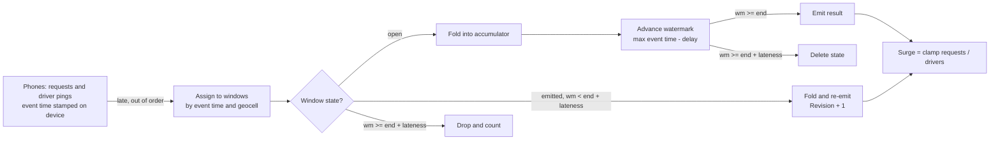

# Windowed Stream Aggregation (event time, watermarks, allowed lateness)

## Problem

A ride-hailing app sets surge prices from "ride requests vs available drivers, per geocell, per minute". The inputs are an unbounded stream of events from phones, and phones on bad networks (a rain shower, a tunnel, a crowded stadium) buffer events and deliver them seconds or minutes late, out of order.

- **Grouping by arrival time is wrong.** A request made at 18:08 that arrives at 18:09:40 is counted in the 18:09 minute. The minute it belonged to looks quieter than it was, the next one busier, and riders are charged a surge for the wrong minute. The error is worst exactly when it matters: bad weather makes demand spike *and* networks degrade.
- **Waiting for everything is impossible.** The stream never ends, and there is no moment when you know the last 18:08 event has arrived.
- **Storing every event and recomputing is too expensive.** Millions of pings a minute across a city cannot be rescanned for every price update.

## Solution

Aggregate by **event time** (the timestamp the phone stamped), incrementally, and use a **watermark** to decide when a window is "done enough":

1. **Windows.** Each event is assigned by its timestamp to windows of a fixed size, keyed by geocell. *Tumbling* windows (size = slide) do not overlap; *sliding* (hopping) windows of size 5m and slide 1m overlap, so each event lands in size/slide = 5 of them. Windows are half-open: `[start, end)`.
2. **Incremental state.** A window holds one accumulator, updated by a fold function (`{requests, drivers}` here), never the raw events.
3. **Watermark.** The watermark is the pipeline's claim that "event time has reached W": here, the largest event time seen minus a fixed **watermark delay** (bounded out-of-orderness). It never goes backwards. When it passes a window's end, the window **emits** its result.
4. **Late data.** An event that arrives after its window has emitted is late. If the watermark is still within the window's end + **allowed lateness**, the event updates the window and the window **re-emits** a revised result. Beyond that it is **dropped** and counted.
5. **Cleanup.** Once the watermark passes end + allowed lateness, nothing can change the window, so its state is deleted. Memory is bounded by how many windows are open, not by how many events have been seen.

The watermark delay and allowed lateness are two different knobs: the delay postpones *every* first answer to make it more complete; lateness keeps answering on time and repairs answers afterwards, at the cost of re-emissions and longer-lived state.

## Diagram



## How this implementation works

- `New[K, E, A](spec, fold, opts...)` returns an `Aggregator`. `spec` is `Tumbling(size)` or `Sliding(size, slide)`; size must be a multiple of slide so every event is in exactly size/slide windows. `fold func(A, E) A` starts from `A`'s zero value. Options: `WithWatermarkDelay(d)` and `WithAllowedLateness(d)`, both default 0.
- `Spec.Assign(t)` returns the windows containing `t`, aligned to the Unix epoch, start inclusive and end exclusive (an event at exactly 18:01:00 is in `[18:01, 18:02)`, not `[18:00, 18:01)`).
- `Add(event)` folds the event into each of its windows that is still within allowed lateness, then advances the watermark if the event is the newest seen. It returns the results this causes: late re-emissions first, then windows the watermark just closed, sorted by window end, start and key. A `Result` has the `Key`, `Window`, `Value`, the number of `Events` folded in, a `Revision` (0 for the first emission) and the `Watermark` at emission.
- A late event for a window that never had state (no events for that geocell before the window closed) creates it and emits immediately, as Revision 0.
- With sliding windows, an event can be too late for its older windows but on time for newer ones. It is folded into the ones that will take it; `Stats.Dropped` only counts events that no window accepted. `Stats.Late` counts events that updated an already-emitted window.
- `AdvanceWatermark(t)` moves the watermark forward explicitly: for an idle source (a heartbeat saying "nothing older than t is coming") or to flush a bounded stream. Earlier values are ignored.
- The aggregator is a single mutex-protected struct, safe for concurrent `Add` calls. The example contrasts processing time by feeding the same aggregator events stamped with their *arrival* time: processing-time windowing is event-time windowing on the wrong clock, and since arrival times only increase, nothing is ever late and nothing is ever corrected.

**Simplification.** There is one watermark for the whole stream, derived from the largest event time seen. Real engines track a watermark per source partition (per Kafka partition, per device fleet) and use the **minimum** across them, so one fast partition cannot declare windows done while a slow one is still catching up; idle partitions are then excluded or advanced by heartbeats, or they hold every window open. Here a single device with a skewed clock far in the future would push the watermark ahead and drop everyone else's events; production systems clamp or reject such timestamps. The cleanup scan is O(open windows) per watermark step, where engines use timer queues ordered by window end. State lives in memory with no checkpoints; Flink and Kafka Streams persist it (RocksDB, changelog topics) so a crash does not reset the counts. Results are returned to the caller, so a downstream consumer must treat a higher Revision of the same (key, window) as replacing the earlier one (an upsert), not as an additional count.

## Trade-offs

| Pro | Con |
| --- | --- |
| Results are attributed to the minute events happened in, however they arrive | First answers can be incomplete; consumers must accept revisions (upserts) |
| State is one accumulator per open window, not every event | State is held for window size + lateness; sliding windows multiply it by size/slide |
| Late data within the lateness bound corrects earlier answers | Data later than the bound is lost (counted, but not reflected) |
| The watermark delay and lateness make the latency/completeness trade explicit | A single bad timestamp or idle source can stall or rush the watermark |
| Sliding windows react to a spike every slide while still smoothing over the full size | Sliding windows emit size/slide times as many results and fold every event size/slide times |

## When to use / when not to

**Use it** for real-time metrics over device or user events where the timestamp of the action matters: surge and dynamic pricing, fraud and anomaly detection per account, ad impressions and click-through per campaign per minute, IoT sensor rollups, per-endpoint error rates, leaderboard and trending counts.

**Don't use it** when arrival time is what you mean (server load per second, queue depth: processing time is correct and simpler), when every single event must be counted exactly regardless of delay (billing, ledgers: write events durably and reconcile with batch), or when volumes are small enough to store raw events and query them directly.

## Real-world examples

- **Apache Flink** defines event-time windows (tumbling, sliding, session), watermarks generated with `WatermarkStrategy.forBoundedOutOfOrderness`, `allowedLateness` that re-fires windows on late elements, and side outputs for data later than that.
- **Apache Beam / Google Cloud Dataflow** formalised the model: windowing, watermarks, triggers (early, on-time, late firings) and accumulation modes, with `withAllowedLateness` bounding how long window state is kept.
- **Kafka Streams** has tumbling and hopping `TimeWindows` with a **grace period** (`ofSizeAndGrace`): records arriving within the grace period update the window, later ones are dropped and counted in a metric. `suppress(untilWindowCloses)` emits only the final result.
- **Spark Structured Streaming** uses `withWatermark("eventTime", "10 minutes")` with `window(...)` grouping; the watermark both admits late data and lets Spark drop old aggregation state.
- **Uber's surge pricing** streams requests and driver supply into per-hexagon (H3 geocell) aggregates over short windows and turns the demand/supply ratio into a price multiplier, recomputed continuously rather than in batch.

## Run it

```sh
go run ./patterns/distributed/windowed-stream-aggregation/example
go test ./patterns/distributed/windowed-stream-aggregation/
```

The example generates 1,157 requests and driver pings across three geocells over 20 minutes, with a rain shower over two of them from 18:08 to 18:13 that boosts demand, takes some drivers off the road and delays 40% of the wet cells' events during the shower by 15 s to 7 min (others by 0.2–4 s, with 1% of dry events delayed up to a minute). The arrival order comes from a seeded delay per event:

- **Per minute, downtown.** Processing-time windows show 2.8x for 18:08 (true: 1.8x) and 2.9x for 18:12 (true: 1.6x), because delayed driver pings and requests land in later minutes. Event time with a 10 s watermark delay first emits 3.0x for 18:08 from the 15 requests and 5 driver pings that had arrived. Eleven late updates then bring it to 20/11 = 1.8x. The final answers match the truth except where an event was dropped.
- **All 60 cell-minutes**, surge off by at least 0.2x: processing time 8 (mean error in rain minutes 0.55x); event-time first emission with 10 s delay 7 (0.43x); with a 60 s delay 2 (0.10x), but every answer 50 s later; event time after late updates 2 (0.07x). The first emission with a short delay is hardly better than processing time. The difference is that event time can be *corrected*, and is, by 89 late events. 16 events arrived beyond the 2-minute lateness and were dropped. (17 had a delay over 2m10s, but whether an event is dropped depends on where in its minute it happened too: one stamped early in the minute has up to a minute more slack before its window's end + lateness.)
- **Tumbling vs sliding, 5-minute windows on downtown.** The sliding window (1-minute slide) first shows surge of 1.5x or more at watermark 18:11:05 and peaks at 2.8x. The tumbling one first does at 18:15:02, and its peak is 1.7x, because its fixed boundaries (18:05–18:10, 18:10–18:15) split the shower and dilute it. The price is 19 emissions and up to 8 windows held for one cell, against 3 and 2.

The tests cover start-inclusive/end-exclusive boundaries (including times before the epoch), sliding assignment into size/slide windows, emission exactly when the watermark reaches a window end, a monotonic watermark, late updates and their revision numbers, late events into a window that had no state, drops beyond lateness (including zero lateness), a sliding event too late for some of its windows but not others, state cleanup with no resurrection by stragglers, per-key isolation with a struct aggregate, validation, and concurrent `Add` calls under `-race` whose final window sums equal 2× the event count for a size/slide = 2 spec.

## Related patterns

- [Pub/Sub](../pub-sub): the event bus that carries the request and driver streams into the aggregator
- [Backpressure](../backpressure): what to do when the stream outruns the aggregator; dropping events here would silently bias the surge
- [Sharded counters](../../architecture/sharded-counters): spreading a hot counter (a busy geocell) across shards, then summing; the aggregator can be partitioned by key the same way
- [Geospatial index](../../data/geospatial-index): turning a latitude/longitude into the geocell key the windows are grouped by
- [Materialized view](../../data/materialized-view): the emitted per-window results are an incrementally maintained view, upserted on each revision

## Further reading

- Arvind Kumar, [Uber Surge Pricing During Rain](https://codefarm0.medium.com/uber-surge-pricing-during-rain-system-design-deep-dive-on-real-time-demand-supply-and-dynamic-f71fd58fdb03): streaming demand and supply per area into a dynamic price, and why rain stresses it
- Khyati Jha, [System Design Interview Prep: High-Level Design Day-1](https://medium.com/high-level-system-desgin-interview-prep/system-design-interview-prep-high-level-dessign-day-1-302a3759e144): synchronous vs asynchronous processing and where streaming fits
- Tyler Akidau, "The world beyond batch: Streaming 101" and "Streaming 102": event time vs processing time, windows, watermarks, triggers and lateness
