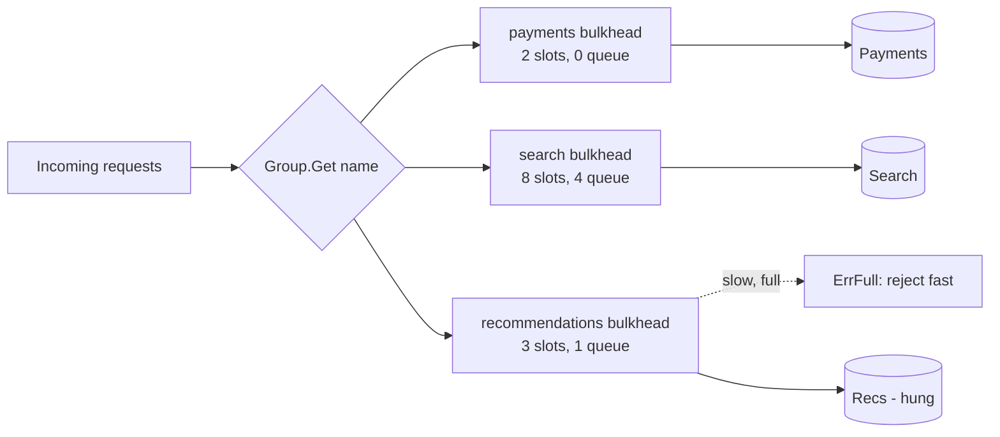

# Bulkhead

## Problem

A service calls several dependencies from one shared pool of goroutines,
connections and memory. When one dependency becomes slow (not down, just slow),
requests to it pile up, hold resources for the full timeout, and eventually
starve calls to the healthy dependencies. One bad neighbour takes down the
whole process.

## Solution

Partition resources like the watertight compartments of a ship's hull. Each
dependency gets its own fixed number of concurrent slots and a small, bounded
wait queue. When a compartment fills, extra calls to *that* dependency are
rejected immediately, and everything else keeps working.

## Diagram



## How this implementation works

- `New(Config)` builds a counting semaphore from a buffered channel of size
  `MaxConcurrent`.
- `Acquire(ctx)` grabs a free slot without blocking if it can. Otherwise it
  joins the wait queue, but only if fewer than `MaxWaiting` callers are already
  queued (tracked with an atomic counter); else it returns `ErrFull`
  immediately. Queued callers give up when `ctx` is done.
- `Release()` frees a slot; an unmatched `Release` is a harmless no-op rather
  than a deadlock or panic.
- `Execute(ctx, fn)` wraps acquire, call and release.
- `Group` lazily creates one bulkhead per dependency name with optional
  per-name overrides, which is how you would wire this into an HTTP client
  layer.
- `Stats()` exposes in-flight, waiting, capacity and rejection counts for
  metrics.

## Trade-offs

- Static limits must be tuned per dependency. Too low wastes capacity; too high
  gives no isolation. Little's law helps: `limit ~ peak RPS * p99 latency`.
- Rejections are visible errors; pair with a [fallback](../fallback).
- Partitioning reduces peak utilisation: idle slots in one compartment cannot
  be borrowed by another.
- A semaphore bounds concurrency, not rate; use a
  [rate limiter](../rate-limiter-token-bucket) to bound requests per second.

## When to use / when not to

Use when a process talks to several dependencies with independent failure
modes, or when tenants share a service and must not starve each other. It is
unnecessary for a service with a single dependency, where a global concurrency
limit or [load shedding](../load-shedding) is simpler.

## Real-world examples

- Netflix Hystrix ran each dependency in its own thread pool (or semaphore)
  bulkhead; Resilience4j offers `Bulkhead` and `ThreadPoolBulkhead`.
- Envoy's circuit-breaking settings (`max_connections`, `max_pending_requests`,
  `max_requests`) are per-cluster bulkheads.
- Kubernetes resource requests and limits, and Linux cgroups, are bulkheads for
  CPU and memory.

## Run it

```sh
go run ./patterns/reliability/bulkhead/example
go test ./patterns/reliability/bulkhead/
```

## Related patterns

- [Circuit breaker](../circuit-breaker): stop calling a dependency that is failing outright.
- [Timeout](../timeout): bounds how long a slot can be held.
- [Load shedding](../load-shedding): protect the whole service, not just one dependency.
- [Fallback](../fallback): what to serve when the bulkhead rejects.
- [Backpressure](../../distributed/backpressure): bounded queues are the root of backpressure.
- [Sidecar](../../architecture/sidecar): proxies like Envoy enforce bulkheads outside the app.
