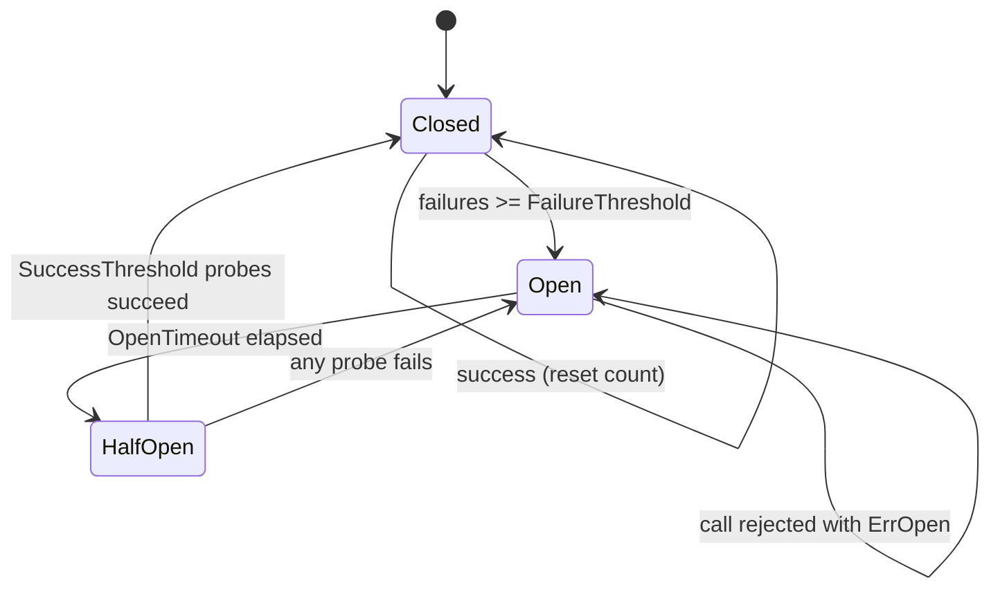

# Circuit Breaker

## Problem

When a dependency is down or badly degraded, every call to it waits for a
timeout, ties up a goroutine, a connection and memory, and adds load to a
service that is trying to recover. Callers slow down too, and the failure
cascades up the call graph.

## Solution

Wrap calls to the dependency in a state machine, named after the electrical
breaker:

- **Closed**: calls flow normally; consecutive failures are counted.
- **Open**: after `FailureThreshold` failures the breaker trips and rejects
  calls immediately with `ErrOpen`, without touching the dependency.
- **Half-open**: after `OpenTimeout` a small number of probe calls are let
  through. Success closes the breaker; any failure re-opens it and restarts
  the timer.

## Diagram



## How this implementation works

- `New(Settings)` fills defaults. `Now` is injectable, so tests move a fake
  clock instead of sleeping.
- `Execute(fn)` is the simple API. `Allow()` is the two-phase form: it returns
  a `done(err)` callback, which is handy when the call is asynchronous or
  the outcome is only known later (for example, after reading a response body).
- `currentState()` performs the lazy open to half-open transition when the
  timeout has passed, so there is no background goroutine to leak.
- Every transition bumps a `generation`. `record` drops results whose
  generation is stale, so a slow call that started while closed cannot close a
  breaker that has since tripped and moved to half-open.
- `HalfOpenProbes` caps concurrent probes (`ErrTooManyProbes` otherwise), and
  `IsFailure` lets you ignore errors that are the caller's fault, such as 4xx.

## Trade-offs

- Consecutive-failure counting is simple and predictable but ignores error
  *rate*; high-volume services often trip on "error rate over a rolling window
  with a minimum request count" instead.
- While open, some requests that would have succeeded are rejected. Pair with a
  [fallback](../fallback) so users get a degraded answer rather than an error.
- One breaker per dependency (or per host) is the norm. A single global breaker
  lets one bad endpoint block healthy ones.
- Choosing `OpenTimeout` is a balance: too short and you keep hammering a
  broken dependency, too long and recovery is slow.

## When to use / when not to

Use around remote calls that can fail as a whole: databases, downstream
services, third-party APIs. It is less useful for purely local work, or when
every request needs a fresh answer and there is no fallback, though failing
fast still protects your own resources.

## Real-world examples

- Netflix Hystrix popularised the pattern for JVM services; Resilience4j is its
  maintained successor.
- Envoy and Istio provide circuit breaking (connection and request limits) and
  outlier detection that ejects failing hosts.
- `sony/gobreaker` is a widely used Go implementation with the same
  closed/open/half-open model and generation counter.

## Run it

```sh
go run ./patterns/reliability/circuit-breaker/example
go test ./patterns/reliability/circuit-breaker/
```

## Related patterns

- [Retry with backoff](../retry-backoff): retries handle blips; the breaker handles outages.
- [Fallback](../fallback): what to return while the circuit is open.
- [Bulkhead](../bulkhead): limits blast radius by capping concurrency per dependency.
- [Timeout](../timeout): turns slow failures into countable failures.
- [Health check](../health-check): an active alternative to passive failure detection.
- [Load balancing](../../architecture/load-balancing): outlier ejection is a per-host breaker.
- [Service discovery](../../architecture/service-discovery): removes unhealthy instances from rotation.
