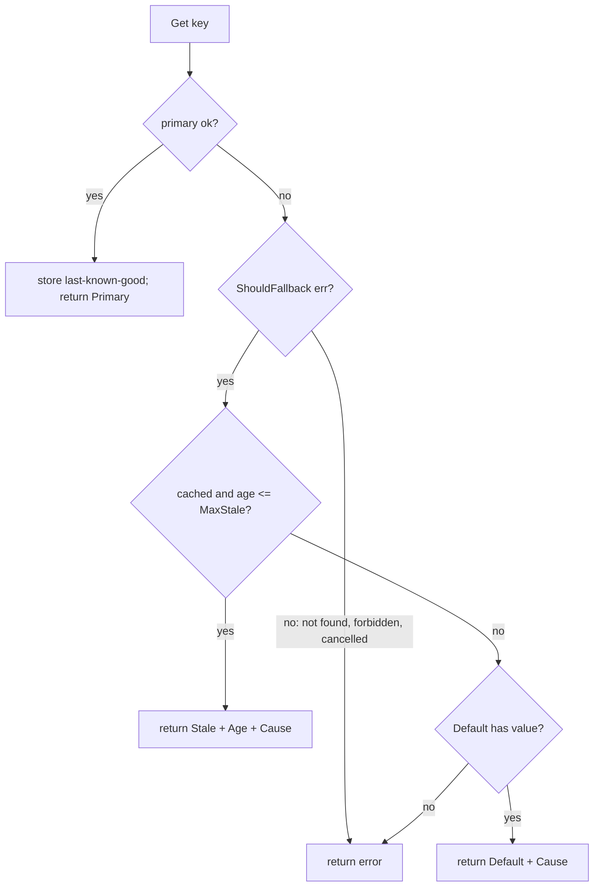
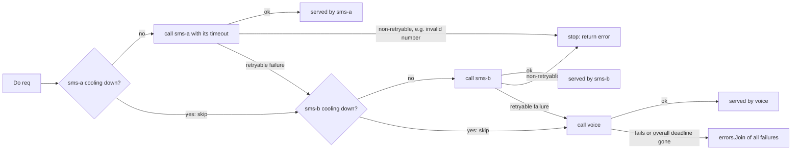

# Fallback (Graceful Degradation)

## Problem

A product page depends on a dozen services: pricing, reviews,
recommendations, inventory. If any one of them failing turns the whole page
into a 500, availability is the *product* of every dependency's availability.
Many of those features are optional, and a slightly old answer or a generic
one is far better than an error.

## Solution

Define an ordered chain of answers and serve the best one available:

1. **Primary**: the live, fresh value.
2. **Stale**: the last known good value for this key, if it is younger than
   `MaxStale`.
3. **Default**: a static, safe answer such as bestsellers, an empty review
   list, or "price unavailable".
4. Only then, an **error**.

Every result carries its `Source` (and the primary's error as `Cause`), so the
UI can label degraded content and dashboards can count how often you are
degraded.

When the alternatives are *interchangeable providers* rather than worse
answers (primary SMS provider, secondary SMS provider, voice call), use a
**failover chain** instead:

- Try each provider **in order**, each with its **own timeout**, all inside an
  **overall deadline** (the user is waiting for the code).
- **Skip unhealthy providers**: after N consecutive failures a provider cools
  down and is skipped, so requests stop paying its timeout; after the
  cooldown one probe request decides whether it is back.
- **Don't fail over on non-retryable errors**: "invalid phone number" will be
  invalid at the next provider too, so stop and return it.
- Report **which provider served** and the joined errors of the ones that
  failed, for metrics and billing reconciliation.

## Diagram



The failover chain:



## How this implementation works

- `New(primary, Options)` wraps any `func(ctx, K) (V, error)`; it is generic
  over key and value types.
- `Get` calls the primary. On success, `remember` stores the value with a
  timestamp (only when the stale tier is on). The store is bounded by
  `MaxEntries` and evicts the oldest entry; a production version would use an
  LRU list.
- `ShouldFallback` filters errors. By default everything except
  `context.Canceled` falls back. Override it so that semantic errors (not
  found, permission denied) propagate: serving a stale value for a deleted or
  forbidden resource would be a bug, not resilience.
- `Result.Age` reports how stale the value is; the clock is injectable.

The failover chain lives in `chain.go`:

- `NewChain([]Provider[Req, Resp], ChainOptions)` validates the providers
  (named, unique, with a `Call`) and returns a `*Chain`. Each `Provider` has a
  `Name`, a `Call(ctx, req)` and an optional per-attempt `Timeout`.
- `Do(ctx, req)` walks the providers in order. Each attempt gets a context
  with `min(provider timeout, time left of ChainOptions.Deadline)`. The
  deadline is also checked against the injectable `Now` before each attempt,
  so simulations and tests can drive it with a fake clock.
- Health tracking reuses the [circuit breaker](../circuit-breaker): one
  breaker per provider, tripped by `FailureThreshold` consecutive retryable
  failures (default 3) and open for `Cooldown` (default 30s). An open breaker
  means "skip"; after the cooldown the breaker's single half-open probe slot
  lets one request try the provider again. `FailureThreshold: -1` turns
  tracking off.
- `Permanent(err)` marks an error as non-retryable; the default `Retryable`
  also stops on `context.Canceled`. A non-retryable answer counts as a
  *healthy* response from the provider: it answered, the input was bad.
- `ChainResult` holds the `Value`, the serving `Provider`, every `Attempt`
  (skipped, error, time taken) and `Errors`, an `errors.Join` of the failed
  attempts, each prefixed with the provider name. When nothing serves, `Do`
  returns the same joined error, plus `ErrDeadline` (which wraps
  `context.DeadlineExceeded`) or `ErrNoProvider` (everything cooling down).
- An attempt cut short by the caller cancelling or by the overall deadline is
  not counted against the provider.

**Simplification.** When every provider is cooling down the chain fails fast
with `ErrNoProvider` instead of trying one anyway; a production router might
prefer to force a "least bad" attempt. Health is per process and based only
on consecutive errors; real OTP routers also weigh delivery receipts,
per-country success rates and price, and share health across instances.
Attempts are sequential; starting the next provider after a short delay (see
[hedged requests](../hedged-requests)) trades cost for latency. In the
example, a provider "hangs" by advancing the simulated clock by its timeout
rather than by blocking on the context.

## Trade-offs

- Stale data can be wrong. Choose `MaxStale` per feature: fine for
  recommendations, dangerous for account balances, never for authorisation.
- Fallback paths are rarely exercised and therefore rot. Test them (chaos
  experiments, forced-failure flags) and alert on the `Source` metrics.
- The last-known-good store costs memory and holds data per key. Values are
  returned by reference, so do not mutate returned slices or maps.
- Hiding failures can delay detection; always emit metrics when degraded.
- Failover chains cost money and can duplicate work. Secondary providers are
  usually pricier and slower (in the example voice costs 6x an SMS, and the
  outage run costs $13.25 against $5.85 had the primary stayed up). The
  cooldown also delays noticing a recovery by up to one cooldown, so a little
  more traffic stays on the expensive fallbacks. Worse, a "failed" primary may
  in fact have delivered (it timed out after accepting the message), so the
  user gets two codes. Send an [idempotency key](../idempotency-key) to each
  provider where supported, and make the OTP tolerate it (the same code in
  both messages, or accept any code issued in the window).

## When to use / when not to

Use for optional or enrichment features, read paths with acceptable
staleness, and anything that has a sensible generic answer. Do not use it for
writes, for strongly consistent reads (balances, inventory decrements), or
for security decisions. Fail closed there.

## Real-world examples

- OTP and notification platforms route SMS across several aggregators (for
  example Twilio, MessageBird/Bird and Vonage), failing over to another
  provider and finally to a voice call when delivery fails; Twilio Verify
  exposes SMS, voice and other channels for exactly this kind of fallback.
- Payment orchestration layers retry a timed-out or soft-declined charge on a
  second acquiring gateway, but never a hard decline such as "stolen card":
  the non-retryable rule.
- DNS failover (for example Route 53 failover routing with health checks)
  answers with a secondary endpoint while the primary's health check fails.

- Netflix has described degrading to non-personalised or cached content when
  personalisation services fail, and Hystrix made a `getFallback()` method a
  first-class part of every command.
- HTTP caching's `stale-if-error` directive (RFC 5861), supported by many CDNs
  and proxies, serves a stale cached response when the origin errors.
- Resilience4j and Polly (.NET) provide fallback policies that compose with
  retries and circuit breakers.

## Run it

```sh
go run ./patterns/reliability/fallback/example
go test ./patterns/reliability/fallback/
```

## Related patterns

- [Circuit breaker](../circuit-breaker): decides when to skip the primary; fallback decides what to return. The failover chain keeps one per provider.
- [Retry budget](../retry-budget): caps how much extra load failover and retries may add.
- [Idempotency key](../idempotency-key): prevents double delivery when a "failed" provider actually succeeded.
- [Hedged requests](../hedged-requests): start the next provider early instead of waiting for a timeout.
- [Bulkhead](../bulkhead): rejected calls need a fallback too.
- [Timeout](../timeout): a timed-out primary is the most common fallback trigger; the chain gives each provider its own timeout inside an overall deadline.
- [Cache-aside](../../data/cache-aside): the stale tier is a cache read only on failure.
- [Read replicas](../../data/read-replicas): a replica can be a fallback for reads.
- [Backend for frontend](../../architecture/backend-for-frontend): a natural place to assemble partial responses.

## Further reading

- Arvind Kumar, [OTP Service Fails During Peak Traffic](https://codefarm0.medium.com/otp-service-fails-during-peak-traffic-system-design-deep-dive-on-rate-limiting-retry-storms-7c2677aded90), an OTP system design deep dive that includes failing over between SMS providers.
