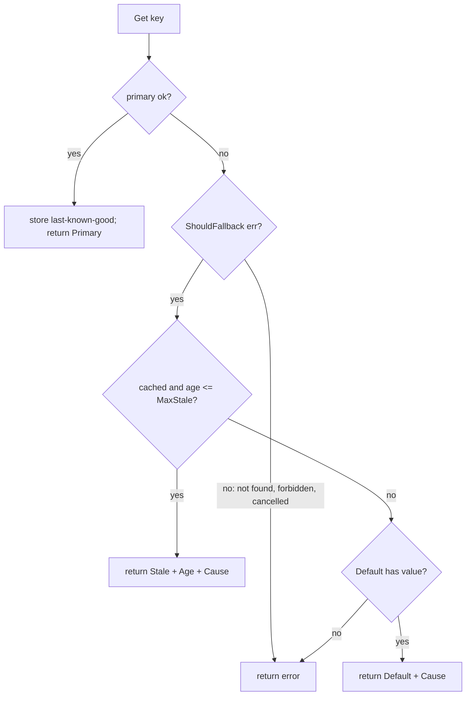

# Fallback (Graceful Degradation)

## Problem

A product page depends on a dozen services: pricing, reviews,
recommendations, inventory. If any one of them failing turns the whole page
into a 500, availability is the *product* of every dependency's availability.
Many of those features are optional, and a slightly old answer or a generic
one is far better than an error.

## Solution

Define an ordered chain of answers and serve the best one available:

1. **Primary**: the live, fresh value.
2. **Stale**: the last known good value for this key, if it is younger than
   `MaxStale`.
3. **Default**: a static, safe answer such as bestsellers, an empty review
   list, or "price unavailable".
4. Only then, an **error**.

Every result carries its `Source` (and the primary's error as `Cause`), so the
UI can label degraded content and dashboards can count how often you are
degraded.

## Diagram



## How this implementation works

- `New(primary, Options)` wraps any `func(ctx, K) (V, error)`; it is generic
  over key and value types.
- `Get` calls the primary. On success, `remember` stores the value with a
  timestamp (only when the stale tier is on). The store is bounded by
  `MaxEntries` and evicts the oldest entry; a production version would use an
  LRU list.
- `ShouldFallback` filters errors. By default everything except
  `context.Canceled` falls back. Override it so that semantic errors (not
  found, permission denied) propagate: serving a stale value for a deleted or
  forbidden resource would be a bug, not resilience.
- `Result.Age` reports how stale the value is; the clock is injectable.

## Trade-offs

- Stale data can be wrong. Choose `MaxStale` per feature: fine for
  recommendations, dangerous for account balances, never for authorisation.
- Fallback paths are rarely exercised and therefore rot. Test them (chaos
  experiments, forced-failure flags) and alert on the `Source` metrics.
- The last-known-good store costs memory and holds data per key. Values are
  returned by reference, so do not mutate returned slices or maps.
- Hiding failures can delay detection; always emit metrics when degraded.

## When to use / when not to

Use for optional or enrichment features, read paths with acceptable
staleness, and anything that has a sensible generic answer. Do not use it for
writes, for strongly consistent reads (balances, inventory decrements), or
for security decisions. Fail closed there.

## Real-world examples

- Netflix has described degrading to non-personalised or cached content when
  personalisation services fail, and Hystrix made a `getFallback()` method a
  first-class part of every command.
- HTTP caching's `stale-if-error` directive (RFC 5861), supported by many CDNs
  and proxies, serves a stale cached response when the origin errors.
- Resilience4j and Polly (.NET) provide fallback policies that compose with
  retries and circuit breakers.

## Run it

```sh
go run ./patterns/reliability/fallback/example
go test ./patterns/reliability/fallback/
```

## Related patterns

- [Circuit breaker](../circuit-breaker): decides when to skip the primary; fallback decides what to return.
- [Bulkhead](../bulkhead): rejected calls need a fallback too.
- [Timeout](../timeout): a timed-out primary is the most common fallback trigger.
- [Cache-aside](../../data/cache-aside): the stale tier is a cache read only on failure.
- [Read replicas](../../data/read-replicas): a replica can be a fallback for reads.
- [Backend for frontend](../../architecture/backend-for-frontend): a natural place to assemble partial responses.
