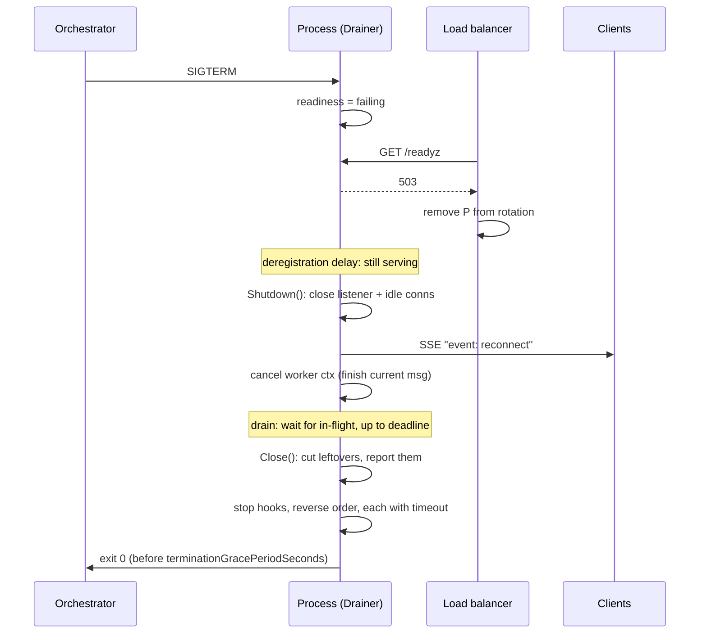

# Graceful Shutdown (Connection Draining)

## Problem

Every deploy, scale-in and node drain stops processes, and a process that simply exits when told to takes work down with it:

- **In-flight requests** get a connection reset. Retries help only for idempotent requests, and only if the client retries at all.
- **The load balancer is late.** Removing an instance from rotation is asynchronous: health checks have to fail a few times, or the endpoint removal has to reach every proxy. For a few seconds after the process starts exiting, new requests keep arriving at a port that is closing.
- **Long-lived connections** (SSE, WebSocket, gRPC streams) drop without warning. Every client notices at the same moment and reconnects at once, sometimes to the same dying instance.
- **Background consumers** abandon the message in hand. With at-least-once delivery it is redelivered (a duplicate if the side effect already happened); with auto-commit it can be lost.

## Solution

Treat the shutdown as a sequence, triggered by SIGTERM and bounded by a deadline:

1. **Fail readiness** while everything still works, so the load balancer stops choosing this instance. Liveness keeps passing, so the orchestrator does not kill it early.
2. **Wait a deregistration delay**, still serving normally, so the load balancer has time to notice. This wait is what closes the "LB is late" gap.
3. **Stop accepting new connections** and close idle keep-alive connections (`http.Server.Shutdown`). Tell long-lived handlers to send a "reconnect elsewhere" message and return. Cancel background workers' context: finish and acknowledge the current message, stop pulling new ones.
4. **Drain** in-flight requests and workers up to a **drain deadline**, then **force-close** what is left (`http.Server.Close`) and report exactly what was cut.
5. **Run stop hooks in reverse startup order**, each with its own timeout: things that use the database stop before the database pool closes.

## Diagram



## How this implementation works

- `New(srv, opts...)` wraps an `*http.Server`. It installs a tracking wrapper around `srv.Handler` (to know which requests are in flight and name the ones that get cut) and a `ConnState` hook (to count connections). Options: `WithReadiness`, `WithDeregistrationDelay` (default 5s), `WithDrainTimeout` (default 20s), `WithClock`, and `WithSleep`, which replaces the deregistration wait so tests can act while the instance is "not ready but still serving".
- `Readiness` is a one-method interface, `SetDraining(bool)`; `healthcheck.Checker` from [../health-check](../health-check) satisfies it, so `/readyz` returns 503 the moment shutdown starts.
- `Run(ctx, ln)` serves until `ctx` is done, then shuts down. In `main`, `ctx` comes from `signal.NotifyContext`. The shutdown itself uses `context.WithoutCancel(ctx)`: reusing the already-cancelled signal context would abort the drain the instant it starts, a common bug.
- `Shutdown(ctx)` runs the sequence once (`sync.Once`); concurrent and later callers wait for it and get the same `Report`. `ctx` is an outer bound on all the waits.
- Long-lived handlers select on `Draining()`, which closes when the listener closes. `OnDrain(fn)` runs a callback at the same moment, for things `Shutdown` does not track, such as a WebSocket hub's hijacked connections.
- `Go(name, fn)` starts a worker whose context is cancelled when draining starts. The drain waits for workers and HTTP requests in parallel, under the same deadline.
- `OnStop(name, timeout, fn)` hooks run after the drain, last registered first. Each runs in its own goroutine with a buffered result channel, so a hook that ignores its context costs at most its timeout.
- The `Report` has a `Timeline` of phases with offsets, `InFlightAtDrain`, `Forced`, `Cut` (as `"GET /export"`), `ForcedConns`, per-worker results (`Cut` if still running at the deadline) and per-hook results (`Err`, `TimedOut`, `Took`). `Go`, `OnStop` and `OnDrain` return `ErrShuttingDown` once draining has begun.

The example runs two backends behind a simulated load balancer that polls `/readyz` every 10ms, with 4 clients sending steady traffic, three 80ms requests and one 400ms export in flight on backend A, an SSE stream on A, and a queue consumer on A taking 15ms per message. A gets SIGTERM at 60ms. In a typical run, naively closing A failed anywhere from 4 to about 40 requests across runs (the three slow ones, plus normal requests that were in flight or routed to A in the 10ms before the load balancer noticed; the count varies with timing because a refused connection fails in microseconds and the client immediately tries again), dropped the SSE stream silently and abandoned one message mid-processing. With the Drainer (40ms deregistration delay, 150ms drain) no normal or slow request failed, the SSE client got a reconnect hint, the consumer finished its message and left the rest in the queue, and the 400ms export was cut at the deadline and named in the report. The export fails either way: no drain saves a request longer than the deadline.

**Simplification.** Real time is unavoidable here because the point is real `net/http` behaviour on loopback, so the example's counts vary between runs; the tests assert only the robust properties. A worker cut at the deadline keeps running (Go cannot kill a goroutine); in production the process exits right after and the broker redelivers its message. `http.Server.Shutdown` polls for idle connections with a backoff of up to 500ms, so a clean drain can finish slightly after the last request. It also treats a connection that was opened but has not yet sent a request as busy for up to 5 seconds; HTTP clients open such spare connections, so `Forced` can be true with nothing in `Cut`. That is why `ForcedConns` is reported separately.

## Trade-offs

| Pro | Con |
| --- | --- |
| Deploys and scale-in cost zero requests inside the deadline | Every shutdown takes at least the deregistration delay, slowing rollouts |
| Closes the load-balancer race that a plain `Shutdown()` leaves open | Delay and deadline must be tuned against the LB and the orchestrator's grace period |
| Long-lived clients reconnect elsewhere on a hint, spread out, not in a stampede | Requests longer than the deadline are still cut; they need resumability or async jobs |
| Workers finish the message in hand: no mid-message loss, fewer redeliveries | A worker or hook that ignores its context can only be abandoned, not stopped |
| The report says exactly what was cut, so it can be alerted on | More moving parts than `os.Exit`, and the sequence has to be tested |

## When to use / when not to

**Use it** in every long-running server behind a load balancer or orchestrator: HTTP and gRPC APIs, SSE and WebSocket gateways, queue consumers, anything rolled out with rolling deploys or autoscaled.

**Don't rely on it alone** for crash safety: `SIGKILL`, OOM kills, kernel panics and power loss skip every step. Consumers still need [idempotency](../../distributed/idempotent-consumer) and clients still need retries. Short-lived batch jobs and CLIs usually want a simpler "finish or checkpoint, then exit".

## Kubernetes and load balancers in practice

- **Kubernetes termination sequence.** When a pod is deleted, two things start in parallel: the kubelet runs the `preStop` hook and then sends SIGTERM, while the endpoints controller removes the pod from the Service's EndpointSlices and every kube-proxy, ingress controller and service mesh sidecar has to catch up. The `terminationGracePeriodSeconds` clock (default 30s) covers the preStop hook *and* the time after SIGTERM; when it runs out, the container gets SIGKILL.
- **The endpoint-removal race.** Because removal is asynchronous, a pod that exits on SIGTERM can still receive new connections for a few seconds. The usual fix is a short sleep in `preStop` (for example `sleep 5`, or the native `sleep` action in newer Kubernetes versions) and/or a deregistration delay in the application, as here. The application-side delay also covers load balancers that rely on readiness probes.
- **Budget.** `preStop sleep + deregistration delay + drain timeout + hooks` must fit inside `terminationGracePeriodSeconds`, with margin.
- **AWS ALB / NLB.** Target groups have a *deregistration delay* (default 300s) during which a deregistering target gets no new requests but existing connections may finish. Health checks have their own interval and unhealthy threshold; the in-app delay should exceed `interval x threshold` when readiness is how the LB learns.
- **`signal.NotifyContext` in main:**

  ```go
  ctx, stop := signal.NotifyContext(context.Background(), syscall.SIGTERM, os.Interrupt)
  defer stop()
  rep, err := drainer.Run(ctx, ln)
  ```

  After the first signal, call `stop()` (or let `Run` return) so a second Ctrl-C kills the process the default way.
- **Keep-alive connections.** `http.Server.Shutdown` closes the listener, closes idle keep-alive connections, and lets active ones finish, after which they are closed too (Go sends `Connection: close` on responses once shutdown has begun). Clients holding pooled connections reconnect, and the LB sends them elsewhere. Shutdown does *not* wait for hijacked connections (WebSockets) or stop long-running handlers; that is what `Draining()` and `OnDrain` are for.
- **Draining WebSockets and SSE.** Don't just close: send a WebSocket close frame (code 1001 "going away", or 1012 "service restart") or an SSE event with a `retry:` hint, ideally with jitter so thousands of clients do not reconnect in the same millisecond. Clients reconnect through the load balancer, which no longer routes to this instance.

## Real-world examples

- **Go `net/http`**: `Server.Shutdown(ctx)` for draining, `Server.Close()` for the forced stop, `RegisterOnShutdown` for hijacked-connection owners; gRPC-Go has the same split in `GracefulStop` and `Stop`.
- **Kubernetes pod lifecycle**: preStop hooks, SIGTERM, `terminationGracePeriodSeconds`, readiness gates and EndpointSlice `terminating` conditions.
- **Envoy**: on hot restart or listener drain it enters a drain period (`--drain-time-s`), sending `Connection: close` on HTTP/1 and GOAWAY on HTTP/2 so clients move to another instance.
- **Kafka consumers**: on shutdown, `consumer.close()` commits offsets and leaves the group so partitions are reassigned at once; during rebalances, committing processed offsets in the "partitions revoked" callback keeps the next owner from reprocessing them.

## Run it

```sh
go run ./patterns/reliability/graceful-shutdown/example
go test ./patterns/reliability/graceful-shutdown/
```

## Related patterns

- [Health check](../health-check): the readiness probe that the shutdown flips first
- [Timeout](../timeout): the drain deadline and per-hook timeouts are timeouts on the shutdown itself
- [Load balancing](../../architecture/load-balancing): the component that has to notice and route around a draining instance
- [Server-sent events](../../architecture/server-sent-events): streams that must be told to reconnect instead of being dropped
- [WebSocket hub](../../architecture/websocket-hub): hijacked connections that `Shutdown` does not track, drained via `OnDrain`
- [Idempotent consumer](../../distributed/idempotent-consumer): makes the redeliveries that a hard kill still causes harmless

## Further reading

- Khyati Jha, [High Level System Design Day-14: WebSockets (Part 2)](https://medium.com/high-level-system-desgin-interview-prep/high-level-system-design-day-14-websockets-part-2-6690efe31651), on the WebSocket connection lifecycle and what deploys do to open connections
