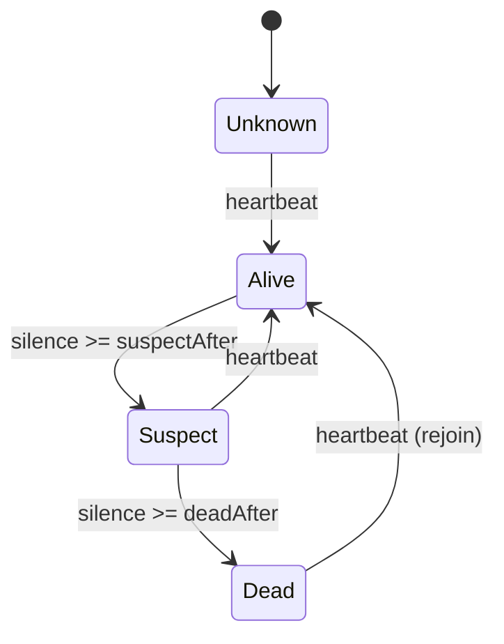
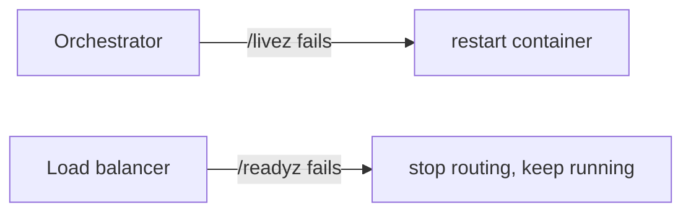

# Health Check (Liveness, Readiness, Heartbeats)

## Problem

Load balancers and orchestrators need to know which instances to send
traffic to and which to replace. A single `/health` endpoint conflates two
questions with very different remedies. If it checks the database, a database
outage makes the orchestrator restart *every* pod, which cannot fix the
database and adds a thundering herd of reconnects on recovery. If it checks
nothing, traffic keeps flowing to instances that cannot serve it. In
peer-to-peer clusters there is no orchestrator at all, and nodes must detect
failed peers themselves.

## Solution

Split the question:

| Probe | Question | On failure | Should check |
|---|---|---|---|
| **Liveness** (`/livez`) | Is the process stuck beyond repair? | restart it | the process only: deadlocks, a wedged event loop |
| **Readiness** (`/readyz`) | Should it get traffic now? | remove it from the LB, keep it running | dependencies, warm-up, draining |

For peers, use a **heartbeat failure detector**: each node heartbeats
periodically. After `suspectAfter` of silence a peer is *suspect* (maybe slow
or partitioned), and after `deadAfter` it is *dead*. The suspect state lets
callers route around a peer without yet triggering expensive recovery such as
re-replication or leader election.

## Diagram





## How this implementation works

- `Checker.AddLiveness` and `AddReadiness` register named `CheckFunc`s.
  `Ready` runs both sets, since a stuck process is not ready.
- `run` executes all checks **concurrently**, each with its own timeout. A
  check that ignores `ctx` still cannot stall the probe, and its result goes
  into a buffered channel so its goroutine exits whenever it finishes.
- `SetDraining(true)` fails readiness while liveness keeps passing. Call it on
  `SIGTERM`, wait for the load balancer to notice, then shut down.
- `LiveHandler` and `ReadyHandler` serve 200 or 503 with a JSON report and
  `Cache-Control: no-store`.
- `Detector` stores the last heartbeat per node; `State` and `Snapshot` derive
  Alive, Suspect or Dead from the silence using an injected clock, so nothing
  runs in the background.

## Trade-offs

- Readiness checks on shared dependencies can remove *all* instances at once
  when the dependency blips. Consider failing readiness only for dependencies
  this instance cannot work without, and serving degraded responses otherwise.
- Health probes cost resources; keep them cheap and cache expensive checks.
- Fixed-timeout detectors trade detection speed against false positives (GC
  pauses, network jitter). Adaptive detectors such as phi-accrual adjust to
  observed heartbeat intervals.
- A detector only gives a *local* opinion; clusters combine opinions through
  [gossip](../../distributed/gossip) or a quorum before acting.

## When to use / when not to

Every long-running service behind a load balancer or orchestrator should
expose separate liveness and readiness endpoints. Use heartbeat detectors in
clustered systems with peer membership: databases, caches, and anything
running [leader election](../../distributed/leader-election). Do not use
liveness probes to detect dependency failures.

## Real-world examples

- Kubernetes defines liveness, readiness and startup probes with exactly these
  semantics; the Kubernetes API server itself exposes `/livez` and `/readyz`.
- AWS Elastic Load Balancing and Envoy run active health checks and stop
  routing to failing targets.
- Cassandra and Akka use the phi-accrual failure detector, and HashiCorp's
  Serf and Consul (SWIM-based) mark members *suspect* before declaring them
  failed.

## Run it

```sh
go run ./patterns/reliability/health-check/example
go test ./patterns/reliability/health-check/
```

## Related patterns

- [Circuit breaker](../circuit-breaker): passive failure detection from real traffic.
- [Load shedding](../load-shedding): an overloaded instance may also report not ready.
- [Service discovery](../../architecture/service-discovery): health status decides which instances are registered.
- [Load balancing](../../architecture/load-balancing): consumes readiness to pick backends.
- [Gossip](../../distributed/gossip): spreads failure-detector opinions through a cluster.
- [Leader election](../../distributed/leader-election): triggered when the leader stops heartbeating.
