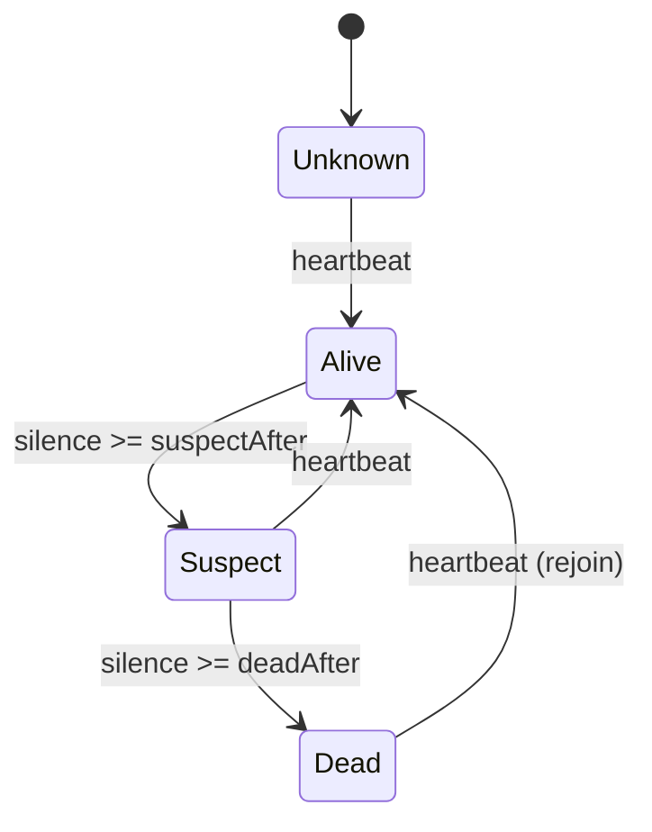
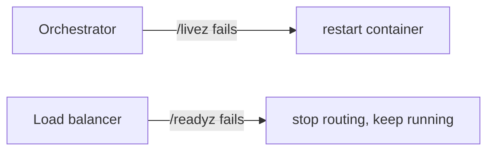

# Health Check (Liveness, Readiness, Heartbeats)

## Problem

Load balancers and orchestrators need to know which instances to send
traffic to and which to replace. A single `/health` endpoint conflates two
questions with very different remedies. If it checks the database, a database
outage makes the orchestrator restart *every* pod, which cannot fix the
database and adds a thundering herd of reconnects on recovery. If it checks
nothing, traffic keeps flowing to instances that cannot serve it. In
peer-to-peer clusters there is no orchestrator at all, and nodes must detect
failed peers themselves. And a server holding thousands of long-lived
client connections cannot tell a quiet client from a vanished one: a phone
that lost signal sends no FIN, so its socket stays open and keeps its
memory and fan-out slot until something notices.

## Solution

Split the question:

| Probe | Question | On failure | Should check |
|---|---|---|---|
| **Liveness** (`/livez`) | Is the process stuck beyond repair? | restart it | the process only: deadlocks, a wedged event loop |
| **Readiness** (`/readyz`) | Should it get traffic now? | remove it from the LB, keep it running | dependencies, warm-up, draining |

For peers, use a **heartbeat failure detector**: each node heartbeats
periodically. After `suspectAfter` of silence a peer is *suspect* (maybe slow
or partitioned), and after `deadAfter` it is *dead*. The suspect state lets
callers route around a peer without yet triggering expensive recovery such as
re-replication or leader election.

For servers holding many **long-lived client connections** (WebSockets, SSE,
raw TCP sessions), use a **per-connection heartbeat**. Either the server pings
each client and expects a pong, or each client sends a heartbeat on its own;
both count as a beat. A connection that misses `K` consecutive intervals is
declared dead, its socket closed and its buffers freed. Three liveness tools,
three different questions:

| | Endpoint health check (`Checker`) | Per-connection heartbeat (`HeartbeatMonitor`) | TCP keepalive |
|---|---|---|---|
| Direction | pull: an orchestrator or LB asks the instance | push: each connection proves itself to the server | kernel probes, invisible to the app |
| Granularity | one verdict per instance | one verdict per connection | one per socket |
| Detects | stuck process, unready dependencies | dead peers, half-open sockets, hung client apps | dead peers at the TCP level only |
| Typical speed | seconds | interval × K, e.g. 30s × 2 | Linux defaults: 2h idle + 9 × 75s probes |
| Action | restart, or stop routing | close that one connection | the kernel errors the socket |

TCP keepalive alone is not enough: its defaults are measured in hours, a
client whose TCP stack still ACKs while its application is frozen looks
healthy to it, and NATs, load balancers and proxies usually drop idle flows
after a few minutes, long before the first probe. Application heartbeats are
also traffic, so they keep those middleboxes from timing the connection out.

## Diagram





## How this implementation works

- `Checker.AddLiveness` and `AddReadiness` register named `CheckFunc`s.
  `Ready` runs both sets, since a stuck process is not ready.
- `run` executes all checks **concurrently**, each with its own timeout. A
  check that ignores `ctx` still cannot stall the probe, and its result goes
  into a buffered channel so its goroutine exits whenever it finishes.
- `SetDraining(true)` fails readiness while liveness keeps passing. Call it on
  `SIGTERM`, wait for the load balancer to notice, then shut down.
- `LiveHandler` and `ReadyHandler` serve 200 or 503 with a JSON report and
  `Cache-Control: no-store`.
- `Detector` stores the last heartbeat per node; `State` and `Snapshot` derive
  Alive, Suspect or Dead from the silence using an injected clock, so nothing
  runs in the background.
- `NewHeartbeatMonitor(interval, maxMisses, opts...)` validates its input
  (`ErrHeartbeatConfig`). `Beat(connID)` records a heartbeat or pong and
  registers new connections; `Remove` forgets one on a clean close;
  `Missed(connID)` reports whole intervals elapsed since the last beat.
- `Sweep()`, called from a ticker, removes and returns (sorted) every
  connection with `missed >= maxMisses`. Callbacks run outside the lock:
  `WithOnDead` to close the socket, `WithOnLate` for connections that are
  behind but within their allowance (send an extra ping, mark suspect).
  `WithHeartbeatClock` injects time, so tests and the example use a fake clock.
- Example step 3 holds three connections with a 1s interval and K = 3: a
  mobile client that misses two beats survives, and a half-open connection
  (last beat at t=1s) is reaped by the sweep at t=4s.
- **Simplification.** Misses are counted from the last beat, not per ping
  sent, so the monitor works the same whichever side initiates. A real
  server also needs the transport plumbing: sending pings, reading pongs on
  the connection's read loop, and closing the socket in `OnDead`.

## Trade-offs

- Readiness checks on shared dependencies can remove *all* instances at once
  when the dependency blips. Consider failing readiness only for dependencies
  this instance cannot work without, and serving degraded responses otherwise.
- Health probes cost resources; keep them cheap and cache expensive checks.
- Fixed-timeout detectors trade detection speed against false positives (GC
  pauses, network jitter). Adaptive detectors such as phi-accrual adjust to
  observed heartbeat intervals.
- Per-connection heartbeats cost a little bandwidth and wakeups per client;
  at a million connections a 30s interval is about 33,000 beats a second.
  Short intervals detect faster but drain mobile batteries and misfire on
  flaky networks, so mobile clients usually get longer intervals and a K of
  2 or 3.
- A detector only gives a *local* opinion; clusters combine opinions through
  [gossip](../../distributed/gossip) or a quorum before acting.

## When to use / when not to

Every long-running service behind a load balancer or orchestrator should
expose separate liveness and readiness endpoints. Use heartbeat detectors in
clustered systems with peer membership: databases, caches, and anything
running [leader election](../../distributed/leader-election). Use
per-connection heartbeats on any server that keeps client connections open
for minutes or more, so dead clients don't hold memory and fan-out slots
forever. Do not use
liveness probes to detect dependency failures.

## Real-world examples

- Kubernetes defines liveness, readiness and startup probes with exactly these
  semantics; the Kubernetes API server itself exposes `/livez` and `/readyz`.
- AWS Elastic Load Balancing and Envoy run active health checks and stop
  routing to failing targets.
- Cassandra and Akka use the phi-accrual failure detector, and HashiCorp's
  Serf and Consul (SWIM-based) mark members *suspect* before declaring them
  failed.
- The WebSocket protocol (RFC 6455) has ping and pong control frames for
  exactly this; Socket.IO and MQTT (`PINGREQ`/`PINGRESP` with a keep-alive
  interval) build heartbeats into the protocol.

## Run it

```sh
go run ./patterns/reliability/health-check/example
go test ./patterns/reliability/health-check/
```

## Related patterns

- [Circuit breaker](../circuit-breaker): passive failure detection from real traffic.
- [Load shedding](../load-shedding): an overloaded instance may also report not ready.
- [Service discovery](../../architecture/service-discovery): health status decides which instances are registered.
- [Load balancing](../../architecture/load-balancing): consumes readiness to pick backends.
- [Gossip](../../distributed/gossip): spreads failure-detector opinions through a cluster.
- [Leader election](../../distributed/leader-election): triggered when the leader stops heartbeating.
- [Server-sent events](../../architecture/server-sent-events): `: ping` comments keep idle SSE streams alive.
- [WebSocket hub](../../architecture/websocket-hub): reaps dead connections with per-connection heartbeats.

## Further reading

- Khyati Jha, [High Level System Design Day-14: WebSockets (Part 2)](https://medium.com/high-level-system-desgin-interview-prep/high-level-system-design-day-14-websockets-part-2-6690efe31651), on heartbeats for keeping WebSocket connections alive
