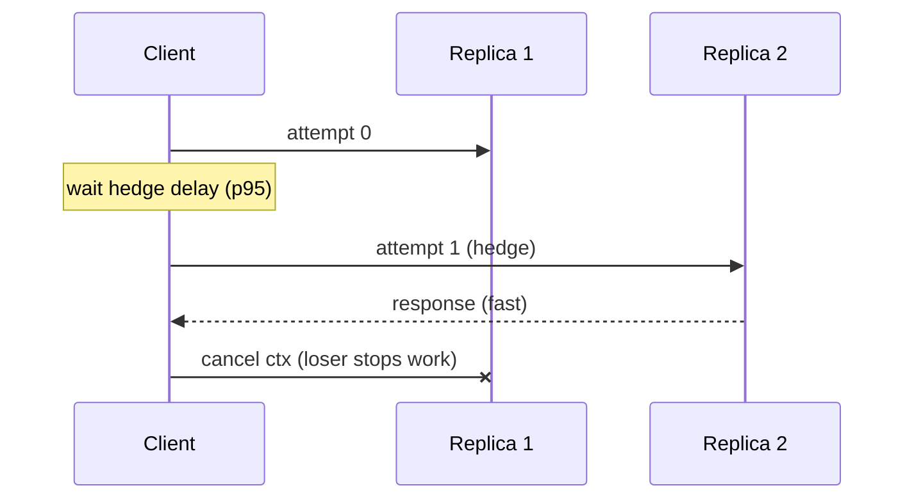

# Hedged Requests

## Problem

In a large system, the occasional slow response is a certainty: GC pauses,
cold caches, noisy neighbours, a disk compaction. If a single replica is slow
1% of the time, a page that fans out to 100 backends is slow most of the time.
Tail latency (p99, p999) dominates user experience, and retrying *after* a
timeout is far too late to help.

## Solution

Send the request to one replica. If no answer has arrived after a short delay,
typically the **p95 latency**, send the same request to a different replica
and take whichever answers first, cancelling the other. Only the slowest
~5% of requests are hedged, so extra load is around 5%, while the tail
collapses from "slow path" latency to roughly "p95 + normal latency".

## Diagram



## How this implementation works

- `Do(ctx, cfg, fn)` launches attempt 0, then another attempt each time
  `cfg.Delay` elapses without a success, up to `MaxAttempts`. An attempt that
  **fails** triggers the next one immediately instead of waiting out the delay.
- `fn` receives the attempt number, so it can pick a different replica, plus a
  context that is cancelled as soon as a winner is found. Losers stop work
  instead of wasting capacity.
- Results go into a channel buffered to `MaxAttempts`, so a losing goroutine
  never blocks on send and always exits once `fn` returns: no leaks.
- `Delay <= 0` degenerates to "send to N, take the fastest".
- `LatencyTracker` keeps a ring buffer of recent latencies; feed it
  `Quantile(0.95, fallback)` so the hedge delay follows reality instead of a
  constant guessed months ago.
- `After` is injectable, so tests can fire the hedge timer deterministically.

## Trade-offs

- **Extra load.** It stays small only if the delay sits at a high percentile.
  During an overload, when everything is slow, hedging can double load. Cap
  hedges with a budget (for example, at most 5% of requests) or disable them
  when the [load shedder](../load-shedding) or a
  [circuit breaker](../circuit-breaker) reports trouble.
- **Only for idempotent operations**: reads, or writes protected by an
  [idempotency key](../idempotency-key). Two replicas may both execute the
  request.
- Hedging helps with *independent* slowness (one replica). It does nothing
  when the slowness is shared, such as a hot key or a slow common dependency.
- Cancellation must propagate to the server, or losers keep consuming
  resources there.

## When to use / when not to

Use for latency-critical reads against replicated stateless services or
storage: key-value lookups, search leaves, DNS. Do not use for
non-idempotent writes, for expensive requests where doubling cost matters,
or against a single non-replicated backend.

## Real-world examples

- Dean and Barroso's "The Tail at Scale" (Communications of the ACM, 2013)
  describes hedged and tied requests used at Google, including deferring the
  hedge until the 95th-percentile latency.
- gRPC supports a hedging policy (`hedgingPolicy` with `hedgingDelay` and
  `maxAttempts`) in its service config.
- Apache Cassandra's "speculative retry" sends a read to another replica when
  the first exceeds a percentile threshold.

## Run it

```sh
go run ./patterns/reliability/hedged-requests/example
go test ./patterns/reliability/hedged-requests/
```

## Related patterns

- [Retry with backoff](../retry-backoff): reactive retries after failure; hedging is proactive, aimed at latency.
- [Timeout](../timeout): the hedge must fit inside the request's deadline.
- [Idempotency key](../idempotency-key): makes hedged writes safe.
- [Scatter-gather](../../architecture/scatter-gather): fan-out queries benefit most from hedging at the leaves.
- [Read replicas](../../data/read-replicas): hedges need more than one replica to go to.
- [Quorum](../../distributed/quorum): quorum reads already wait only for the fastest R of N.
