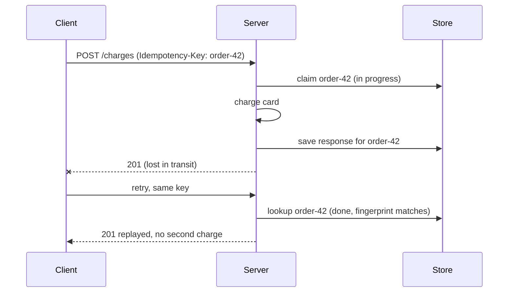

# Idempotency Key

## Problem

A client sends `POST /charges`. The server charges the card, but the response
is lost to a timeout, a dropped connection, or a crashed load balancer. The
client cannot tell "never happened" from "happened, but I did not hear back".
If it retries, the customer may be charged twice; if it does not, the order
may never be paid. Retries, [hedging](../hedged-requests) and at-least-once
message delivery all create this ambiguity.

## Solution

The client generates a unique **idempotency key** per logical operation (a
UUID, or a natural key such as `order-42`) and sends the same key with every
attempt. The server:

1. **Claims** the key atomically before doing any work.
2. Executes the operation and **stores the response** under the key.
3. **Replays** the stored response for any later request with that key.
4. Rejects a concurrent duplicate (`409 Conflict`) and rejects a key reused
   with a *different* request body (`422`), which signals a client bug.

## Diagram



## How this implementation works

- `Store.Do(ctx, key, fingerprint, fn)` holds the core logic. Under one mutex
  it either finds a live record (replay, `ErrInProgress`, or `ErrMismatch`) or
  inserts an in-progress record that claims the key. `fn` then runs outside
  the lock.
- If `fn` returns a `Response`, whatever its status (a declined card's 402
  included), it is stored and replayed. If `fn` returns an **error**, the key
  is released so the client can retry. Return an error only when nothing
  durable happened.
- Stored and replayed bodies are copied, so callers cannot corrupt the record.
- `Fingerprint(parts...)` is a length-prefixed SHA-256 over method, path and
  body (add the caller's identity in multi-tenant APIs), so a key cannot be
  replayed against a different request.
- Records expire after a TTL (24h by default); `Sweep()` removes expired
  finished records but never in-progress ones.
- `Middleware` wraps any `http.Handler`: it ignores safe methods, caps the
  body size, maps errors to 409, 422 or 413, and marks replays with
  `Idempotent-Replayed: true`.

## Trade-offs

- **The record and the side effect must commit together.** If the server
  crashes after charging but before saving the record, the retry charges again.
  Production systems save the idempotency record in the *same database
  transaction* as the business write, or make the downstream call itself
  idempotent by passing the key through.
- This in-memory store works for one process only; replicas need a shared
  store (an SQL table with a unique key, or Redis `SET NX`).
- An in-progress record left by a crashed server blocks the key until the TTL
  expires; real systems add a shorter lock timeout and recovery points.
- Storing responses costs space for the TTL window.

## When to use / when not to

Use for any non-idempotent write that clients may retry: payments, order
creation, sending messages, provisioning. It is not needed for naturally
idempotent operations (`PUT` of a full resource, `DELETE` by ID, "set X to
5"). For message consumers, the same idea appears as deduplication by message
ID.

## Real-world examples

- Stripe's API accepts an `Idempotency-Key` header on POST requests, stores
  the first response (including errors) for 24 hours, and errors when a key is
  reused with different parameters.
- The IETF HTTPAPI working group's draft "The Idempotency-Key HTTP Header
  Field" standardises the header.
- The AWS EC2 API's `ClientToken` parameter makes instance launches
  idempotent.

## Run it

```sh
go run ./patterns/reliability/idempotency-key/example
go test ./patterns/reliability/idempotency-key/
```

## Related patterns

- [Retry with backoff](../retry-backoff): idempotency is what makes retrying writes safe.
- [Hedged requests](../hedged-requests): duplicates by design, so they need it too.
- [Transactional outbox](../../distributed/transactional-outbox): commit the side effect and its record atomically.
- [Competing consumers](../../distributed/competing-consumers): at-least-once delivery requires idempotent handlers.
- [Webhook delivery](../../architecture/webhook-delivery): receivers dedupe by event ID.
- [Saga orchestration](../../distributed/saga-orchestration): each saga step and compensation must be idempotent.
