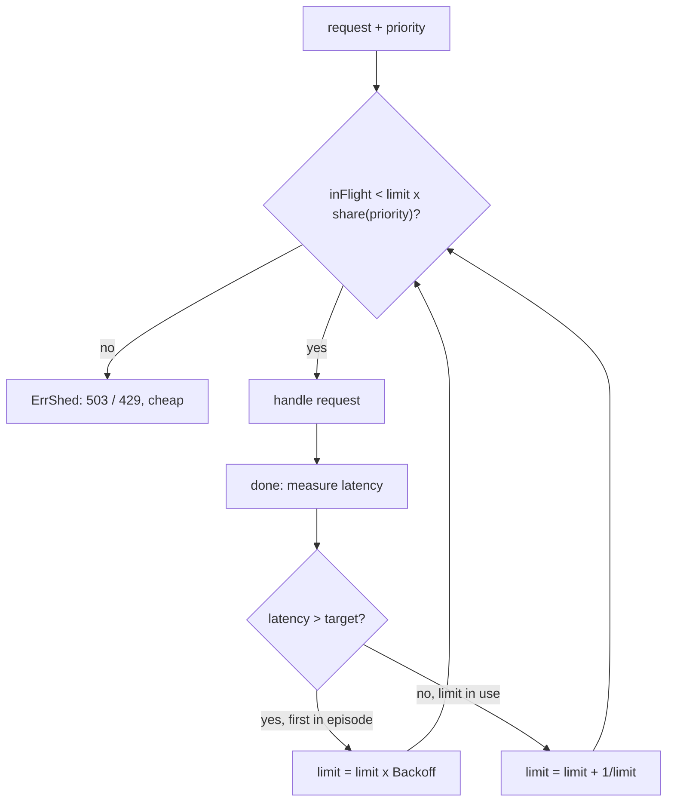

# Load Shedding

## Problem

Every server has a capacity. Past it, queues grow, latency climbs for
*everyone*, requests time out after consuming CPU and memory, clients retry,
and goodput (useful work completed) collapses even though the server is busy
at 100%. Rate limits do not help here: they cap clients against fixed numbers
and know nothing about how the server is actually coping right now.

## Solution

Reject surplus work **at the door**, cheaply, before it consumes resources, so
that the requests you do accept finish fast. Three refinements make this
practical:

1. **Queue-depth (concurrency) limit**: admit at most `Limit` in-flight
   requests. By Little's law, capping concurrency caps queueing delay.
2. **Adaptive limit**: discover `Limit` from latency instead of hand-tuning it.
   AIMD (additive increase, multiplicative decrease, as in TCP congestion
   control) grows the limit slowly while latency is under target and cuts it
   by `Backoff` when it is not.
3. **Priority shedding**: each priority may fill only a share of the limit
   (`Critical` 100%, `Normal` 80%, `Sheddable` 50%), so prefetches and batch
   work are dropped first and critical paths keep headroom.

## Diagram



## How this implementation works

- `Acquire(priority)` checks `inFlight` against `capacityFor(priority)` under a
  mutex and returns `ErrShed` or a `done` callback. `done` is idempotent.
- `release(start)` applies AIMD:
  - **Decrease** at most once per congestion episode: slow responses from
    requests admitted *before* the last cut are ignored, as TCP does, so one
    slow batch of 40 requests does not cut the limit 40 times.
  - **Increase** by `1/limit` per fast completion (about +1 per round trip),
    and only when at least half the limit is in use, so an idle server does not
    inflate its limit without evidence that it can cope.
- The limit is clamped to `[MinLimit, MaxLimit]`; bad config such as a
  negative limit, `Backoff` outside (0,1), or shares outside [0,1] is
  sanitised, not trusted.
- `Stats()` exposes the limit, in-flight count and shed counts per priority.

## Trade-offs

- Shedding turns overload into explicit errors. Clients must treat them as
  retryable *with backoff*, or shedding just generates retry load.
- Latency-based adaptation needs a meaningful target. Mixed workloads, with
  cheap and expensive endpoints, may need separate shedders per endpoint class.
- Priorities have to be assigned honestly: if everything is `Critical`, nothing
  is.
- In-process shedding still pays for accepting the connection and parsing the
  request; shedding at the load balancer is cheaper but has less context.

## When to use / when not to

Use in any service that can be overloaded by traffic spikes, retry storms or
slow dependencies, which in practice means most online services. It is less
relevant for offline batch systems, where queueing is fine and
[backpressure](../../distributed/backpressure) on producers is the better tool.

## Real-world examples

- Netflix's `concurrency-limits` library adapts concurrency limits from
  latency (Vegas and gradient algorithms) and has described prioritised load
  shedding at the API gateway.
- Google's SRE book (chapters on handling overload and addressing cascading
  failures) describes per-request criticality and client-side throttling.
- AWS's Builders' Library article "Using load shedding to avoid overload"
  covers shedding before goodput collapses.

## Run it

```sh
go run ./patterns/reliability/load-shedding/example
go test ./patterns/reliability/load-shedding/
```

## Related patterns

- [Bulkhead](../bulkhead): static limits per dependency rather than adaptive limits per server.
- [Token bucket rate limiter](../rate-limiter-token-bucket): fairness between clients, not capacity protection.
- [Timeout](../timeout): drop work whose deadline has already passed.
- [Retry with backoff](../retry-backoff): how clients should respond to shed requests.
- [Backpressure](../../distributed/backpressure): push the slowdown upstream instead of dropping.
- [Load balancing](../../architecture/load-balancing): spread load before any one node has to shed.
