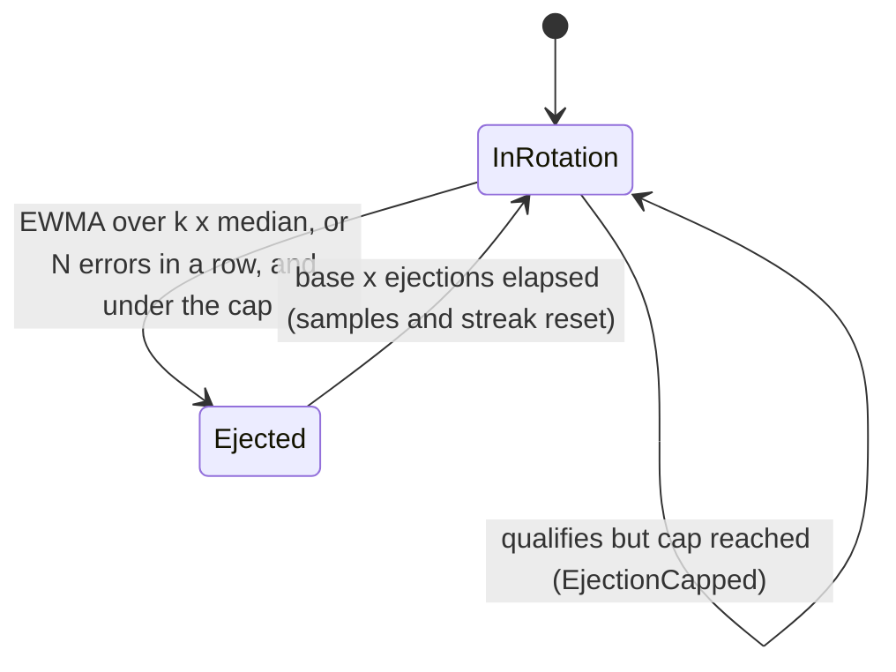
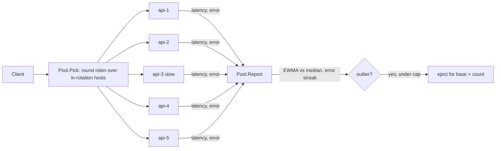

# Outlier Detection (Passive Ejection)

## Problem

Some failures make a host slow without making it dead: a JVM or Go process
thrashing in garbage collection, a noisy neighbour on the same machine, a disk
that has started retrying reads, a host with a bad NIC. The process is up, so
`/healthz` returns 200 and the host stays in the load balancer's rotation.

- With round robin across five hosts, one host at 800 ms instead of 20 ms
  makes every fifth request slow. That is 20% of traffic, so p99 (and even
  p90) jumps to 800 ms while p50 looks perfect.
- Active health checks don't catch it. They test "can you answer?", not "are
  you as fast as your peers?", and a cheap probe endpoint often doesn't touch
  the slow path at all.
- A [circuit breaker](../circuit-breaker) per dependency doesn't help either.
  The *service* is fine, one *host* isn't, and tripping the breaker would
  throw away the four healthy hosts along with the bad one.

## Solution

Let the client's load balancer judge each host by the real traffic it sends
it, and temporarily **eject** hosts that are much worse than their peers:

1. **Track each host passively.** Keep an exponentially weighted moving
   average (EWMA) of successful latencies and a count of consecutive errors.
   No extra probe traffic is needed.
2. **Eject outliers.** A host is ejected when its EWMA is more than *k* times
   the median EWMA of the pool (it's slow *compared with its peers*), or when
   it fails *N* requests in a row.
3. **Grow the ejection time.** Each ejection lasts `base × ejections`, up to a
   maximum, so a host that keeps coming back bad spends longer and longer out.
   Healthy time decays the multiplier again.
4. **Cap ejection.** At most `max_ejection_percent` of the hosts may be out at
   once. If the whole pool is failing, the problem isn't one host, and
   ejecting everything would just turn a slowdown into a total outage.
5. **Re-admit and re-prove.** When the ejection expires the host rejoins
   rotation with a clean slate and is judged again on live traffic.

## Diagram





## How this implementation works

- `New(hosts, opts...)` returns a `*Pool`. `Pick()` returns the next host in
  round-robin order, skipping ejected ones; `Report(host, latency, err)` feeds
  the outcome back. Everything is under one mutex, so it is safe for
  concurrent use.
- Only **successful** requests update the EWMA, so a host that fails fast
  can't look fast; failures go to the consecutive-error counter, which a
  success resets.
- Latency ejection needs `WithMinRequests` samples from the host since its
  (re)admission and at least `WithMinHosts` in-rotation hosts with enough
  samples to form a median. `WithMinLatency` adds an absolute floor so a 3 ms
  host isn't ejected from a 1 ms pool.
- Ejection lasts `min(base × ejections, max)` (`WithEjectionTime`). The
  multiplier drops by one for every `base` of time the host has stayed in
  rotation since its last re-admission, so an ejection last week doesn't make
  today's ejection longer.
- `WithMaxEjectionPercent(p)` allows `max(1, hosts × p / 100)` hosts out at
  once, like Envoy, which always allows at least one. A host that qualifies
  while the cap is reached produces one `EjectionCapped` event and stays in.
- Re-admission is lazy: every call checks the injected clock and returns
  expired hosts to rotation with zero samples and no error streak. Nothing
  runs in the background.
- `WithOnEvent` receives `Ejected`, `Readmitted` and `EjectionCapped` events
  (outside the lock); `Hosts()` and `Ejected()` give snapshots.

**Simplification.** Production detectors differ in a few ways. Envoy
evaluates success-rate and failure-percentage ejection on a periodic sweep
(`interval`), not on every response, and computes a mean/stddev outlier
rather than "k × median". This pool reacts on each `Report`, which is easy to
follow and deterministic. There is also no "panic mode": if you allow 100%
ejection and every host is ejected, `Pick` returns `ErrAllEjected` instead of
falling back to the full pool. The example reports each response at the
moment it is sent instead of `latency` later, so detection happens a little
sooner than it would in real time.

## Trade-offs

| Pro | Con |
| --- | --- |
| Catches slow-but-alive hosts that health checks pass | Needs traffic: a host gets about `MinRequests` bad requests before ejection, after every re-admission too |
| Relative to peers, so it adapts to the service's normal latency | A pool-wide slowdown raises the median too, so nobody is a latency outlier; that's a job for timeouts and circuit breakers |
| No probe traffic; judges the real request path | Each client decides alone: with few requests per client, detection is slow and noisy |
| Growing ejection keeps flapping hosts out; the cap protects capacity | Ejecting moves load to the remaining hosts; a cap set too high can overload them |
| Recovered hosts come back automatically | A host that is slow only for some request types may be ejected for all of them |

## When to use / when not to

**Use it** in client-side or proxy load balancing over a pool of
interchangeable hosts: service-to-service RPC through a mesh or gRPC client,
API gateways in front of stateless backends, database read replicas, cache
nodes behind a consistent-hash ring (with care, since ejecting a cache node
moves keys).

**Don't rely on it** when hosts are not interchangeable (a sharded database
primary can't be routed around), when each client sends too few requests to
form an opinion (prefer server-side or aggregated health data), or as a
replacement for active health checks: an ejected host gets no traffic, so
passive detection alone can't tell when a host that was hard-down comes back,
which is why it re-admits on a timer and lets live traffic test it.

## Real-world examples

- **Envoy** outlier detection: `consecutive_5xx`, `consecutive_gateway_failure`,
  `success_rate` and `failure_percentage` ejection, `base_ejection_time`
  multiplied by the ejection count, `max_ejection_time`, and
  `max_ejection_percent` (default 10%, at least one host).
- **Istio** exposes the same thing as `outlierDetection` in a
  `DestinationRule` (`consecutive5xxErrors`, `baseEjectionTime`,
  `maxEjectionPercent`).
- **Finagle** (Twitter) has *failure accrual*: a client marks a host dead
  after consecutive failures or a low success rate and probes it again later.
- **Netflix Ribbon** (the Hystrix-era client load balancer) tracked per-server
  failure counts and skipped "circuit-tripped" servers for a growing period.
- **NGINX** passive health checks: `max_fails` failures within `fail_timeout`
  mark an upstream server unavailable for `fail_timeout`.
- **Linkerd** and Finagle also use latency-aware balancing (peak-EWMA with
  power-of-two choices) for the same problem, steering traffic away from slow hosts instead of
  ejecting them outright.

## Run it

```sh
go run ./patterns/reliability/outlier-detection/example
go test ./patterns/reliability/outlier-detection/
```

The example sends 100 requests a second round robin to five hosts for 80
simulated seconds. `api-3` is at ~800 ms from 0 to 25 s while the others are
at ~20 ms; from 60 to 65 s every host stalls past the 1 s client timeout. The
same traffic runs three times:

| Phase | A) no detection p50 / p99 | B) detection, 40% cap | C) detection, 100% cap |
| --- | --- | --- | --- |
| 0-1 s (detection) | 21 ms / 826 ms | 20 ms / 796 ms (5 slow requests) | same as B |
| 1-25 s (api-3 slow) | 21 ms / 846 ms (480 slow) | 20 ms / 25 ms (5 slow) | same as B |
| 25-60 s (recovered) | 20 ms / 25 ms | 20 ms / 25 ms | 20 ms / 25 ms |
| 60-65 s (pool stall) | 500/500 failed | 500/500 failed | 500/500 failed |
| 65-80 s (after stall) | 0 failed | 0 failed | **520/1500 failed** |

- Without detection, 20% of requests go to the slow host and p99 is ~840 ms
  for as long as it stays slow.
- With detection, `api-3` is ejected 0.22 s in (EWMA 780 ms vs a 21 ms
  median) after 5 slow requests, for 10 s. Re-admitted at 10.2 s it is still
  slow, so 5 more slow requests later it is ejected for 20 s. Re-admitted at
  30.4 s it has recovered and stays. In the first second, 5 slow requests out
  of 100 still put p99 at ~800 ms: that is the cost of detection.
- During the pool-wide stall every request fails in all three runs: outlier
  detection can't fix a problem that isn't one host. The difference is what
  happens afterwards. With a 40% cap only two hosts are ejected and the other
  three log `EjectionCapped` and stay in, so traffic recovers the moment the
  stall ends. With no effective cap all five are ejected for 10 s, and the
  client keeps failing for 5 s *after* the backends have recovered. That
  stall also shows the multiplier decay: `api-3`, ejected twice earlier, gets
  only 10 s because it had been healthy for about 30 s.

The tests cover the k × median threshold (just above, just below, under the
absolute floor), the sample and host minimums, consecutive-error ejection and
reset, the max-ejection cap at several percentages, re-admission timing to
the nanosecond, the growing and capped ejection duration, multiplier decay, a
re-admitted host having to prove itself again, validation, and concurrent
use under `-race`.

## Related patterns

- [Health check](../health-check): *active* probing (is it up?); outlier detection is the *passive* half (is it as good as its peers?). Use both.
- [Circuit breaker](../circuit-breaker): the per-dependency version; trips when the whole service is failing, which outlier detection deliberately refuses to handle (the cap).
- [Hedged requests](../hedged-requests): hides a slow host request by request; outlier detection stops sending it traffic at all.
- [Load balancing](../../architecture/load-balancing): the strategies this sits inside; least-connections and P2C also drift away from slow hosts, but don't remove them.
- [Bulkhead](../bulkhead): limits how much a slow host can tie up while it is being detected.
- [Timeout](../timeout): turns a hung host into errors the consecutive-error detector can count.

## Further reading

- Arvind Kumar, [One Microservice Failure Takes Down Entire Platform](https://codefarm0.medium.com/one-microservice-failure-takes-down-entire-platform-system-design-deep-dive-on-circuit-breakers-71159bd0276a), on how one failing component cascades and how circuit breakers contain it
- Khyati Jha, [System Design Interview Prep: High-Level Design Day-4 (Load Balancers)](https://medium.com/high-level-system-desgin-interview-prep/system-design-interview-prep-high-level-design-day-4-load-balancers-b9a35cae1991), on load-balancing strategies and dealing with slow-but-alive backends
