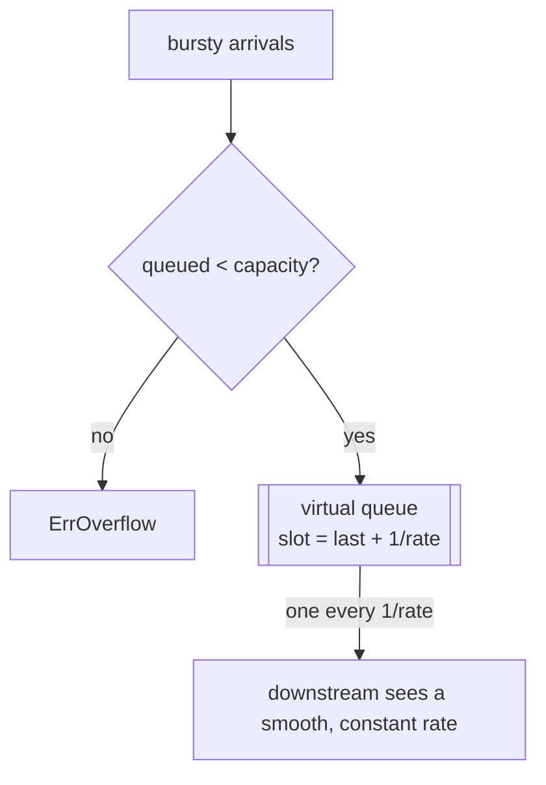

# Rate Limiter: Leaky Bucket

## Problem

Some downstreams cannot handle bursts at all. An SMS or payment provider
limited to "4 requests per second, strictly", a database that degrades if
writes arrive in clumps, or a network link with a fixed bandwidth needs input
that is **smoothed**, not just capped on average. A token bucket would still
let 10 requests out in the same millisecond.

## Solution

Requests pour into a bucket (a bounded FIFO queue) and leak out of a hole in
the bottom at a constant rate. Output is evenly spaced at `1/rate`. When the
bucket is full, new requests overflow and are rejected.

This implementation keeps the queue **virtual**: each admitted request is told
*when* it may proceed (`last release + interval`). Spacing is identical to a
real queue drained by a ticker, but no goroutine, channel or ticker is
involved.

## Diagram



## How this implementation works

- `New(rate, capacity, now)` validates `rate > 0` (returning an error, not
  panicking) and computes the fixed `interval`.
- `Reserve()` computes `next = max(now, last+interval)`. If the request would
  have to wait and `queued(now) >= capacity`, it returns `ErrOverflow`;
  otherwise it records `next` as the new tail and returns the delay.
- `queued(now)` derives the queue length from how far the tail lies in the
  future: `ceil((last - now) / interval)`.
- `Allow()` admits only when the request can go *right now*, which is pure
  pacing with no queue. `Wait(ctx)` sleeps until the slot, or fails fast if
  `ctx`'s deadline lands first.
- An idle bucket does not bank credit: after an hour of silence the next two
  requests are still spaced one interval apart. This is the key behavioural
  difference from a token bucket.

## Trade-offs

- **Smooth but adds latency**: queued requests wait up to
  `capacity * interval`. Keep `capacity` small for interactive traffic.
- No bursts, even when the downstream is idle and could take them.
- Abandoned reservations (a caller whose context ends) still consume their
  slot. That is conservative: the downstream never sees more than `rate`.
- Per-process only, like any in-memory limiter.

## When to use / when not to

Use to pace outbound calls to strict third-party limits, to shape traffic or
writes, or to meter work into a fragile system. Prefer a
[token bucket](../rate-limiter-token-bucket) for user-facing API quotas, where
bursts are normal and latency matters more than smoothness.

## Real-world examples

- NGINX's `limit_req` module is documented as using the leaky bucket method:
  `burst` sets the queue size, and `nodelay` turns queuing off.
- Traffic shaping in network equipment, and Linux `tc` qdiscs, classically use
  leaky-bucket shaping to emit packets at a constant rate.
- The Generic Cell Rate Algorithm (GCRA) from ATM networks is a leaky-bucket
  variant, and is what libraries such as `redis-cell` implement.

## Run it

```sh
go run ./patterns/reliability/rate-limiter-leaky-bucket/example
go test ./patterns/reliability/rate-limiter-leaky-bucket/
```

## Related patterns

- [Token bucket](../rate-limiter-token-bucket): same long-run rate, but allows bursts.
- [Sliding window rate limiter](../sliding-window-rate-limiter): quota-style limits.
- [Load shedding](../load-shedding): bounded queues plus rejection, driven by load.
- [Backpressure](../../distributed/backpressure): the queue-full signal is backpressure.
- [Competing consumers](../../distributed/competing-consumers): workers draining a queue at their own pace.
- [Webhook delivery](../../architecture/webhook-delivery): pace deliveries to each receiver.
