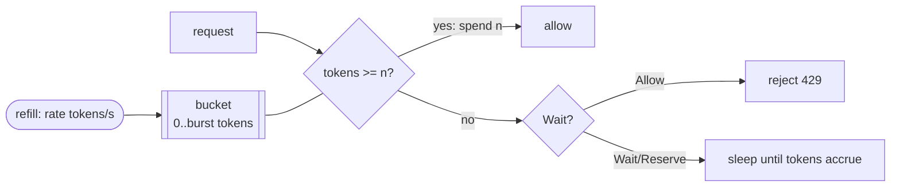

# Rate Limiter: Token Bucket

## Problem

A single client, a buggy script, or a sudden traffic spike can send more
requests than a service, or a paid upstream API, can absorb. You need to cap
the sustained request rate per client or per service while still tolerating
the natural burstiness of real traffic (a page load that fires 8 API calls at
once).

## Solution

Picture a bucket that holds at most `burst` tokens and refills continuously at
`rate` tokens per second. Each request takes a token; with no token left, the
request is rejected (HTTP 429) or waits. An idle client builds up a full
bucket and can burst; a busy client is held to `rate` on average.

## Diagram



## How this implementation works

- **Lazy refill**: `refill(now)` adds `elapsed * rate` tokens, capped at
  `burst`, only when the limiter is used. There is no ticker goroutine, so
  millions of idle buckets cost nothing but memory.
- `AllowN(n)` is all-or-nothing: it never partially spends a bucket.
- `Reserve(n)` lets the balance go negative and returns the delay until the
  debt is repaid, plus a `cancel` that refunds the tokens. `Wait(ctx, n)` builds
  on it, and returns immediately when `ctx`'s deadline is sooner than the
  required wait, since sleeping would be pointless.
- `Keyed` keeps one bucket per client key. `Sweep(idle)` evicts idle buckets to
  bound memory; an evicted bucket would have refilled anyway.
- The clock is injected (`now func() time.Time`), so tests and the example run
  on simulated time.

## Trade-offs

- Allows bursts of up to `burst` requests; downstreams that need a perfectly
  smooth rate should use a [leaky bucket](../rate-limiter-leaky-bucket).
- In-memory limits are per process. N replicas each allowing `rate` means
  `N*rate` overall. Distributed limits need shared state (Redis, or a
  dedicated rate-limit service) or a per-replica share of the global limit.
- Two parameters (`rate`, `burst`) are easy to reason about, but picking
  `burst` too large weakens protection.

## When to use / when not to

Use for API quotas per user, key or IP, for protecting downstreams, and for
client-side throttling to respect a vendor's limit. Do not use it as the only
overload defence: a rate limit does not know whether the server is actually
struggling; [load shedding](../load-shedding) does.

## Real-world examples

- Go's `golang.org/x/time/rate` package is a token bucket with `Allow`,
  `Reserve` and `Wait`, the API this one mirrors.
- AWS API Gateway throttling is configured as a steady-state rate plus a burst,
  using the token bucket algorithm.
- Envoy's local rate limit filter uses a token bucket.

## Run it

```sh
go run ./patterns/reliability/rate-limiter-token-bucket/example
go test ./patterns/reliability/rate-limiter-token-bucket/
```

## Related patterns

- [Leaky bucket](../rate-limiter-leaky-bucket): smooths output to a constant rate, no bursts.
- [Sliding window rate limiter](../sliding-window-rate-limiter): "N requests per window" quotas.
- [Load shedding](../load-shedding): reacts to actual server load rather than a fixed rate.
- [Retry with backoff](../retry-backoff): how well-behaved clients react to a 429.
- [API gateway](../../architecture/api-gateway): the usual home for per-client limits.
- [Backpressure](../../distributed/backpressure): a rate limit is a coarse form of backpressure.
