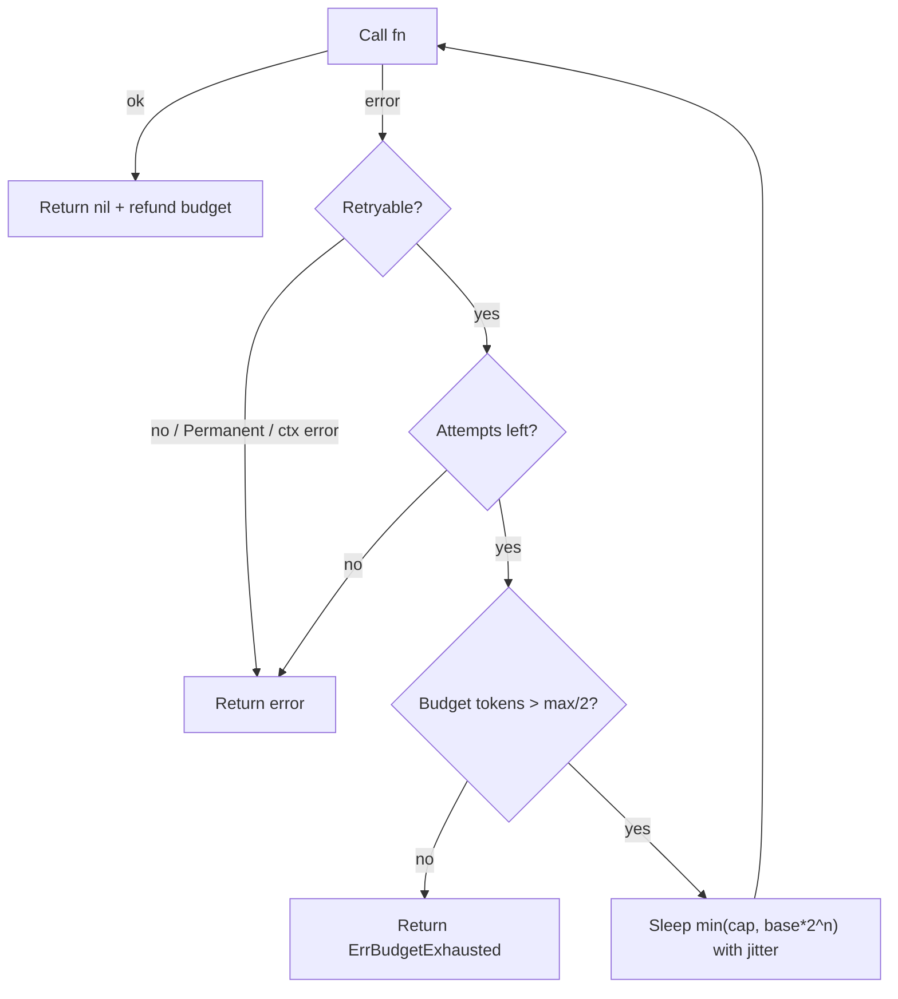

# Retry with Exponential Backoff and Jitter

## Problem

Networks drop packets, leaders fail over, and pods restart. Many failures are
transient: the same request would succeed a moment later. Retrying immediately,
though, hammers a dependency that is already struggling, and when thousands of
clients retry in lockstep they produce synchronized waves of load (the
"thundering herd") that can keep a recovering service down.

## Solution

Retry only errors that are plausibly transient, wait longer after each failure
(exponential backoff), cap the wait, and add randomness (jitter) so clients
spread out. Put a **retry budget** in front of it all: when most calls are
failing, retries stop, so a fleet of clients cannot multiply load on a dead
dependency.

- **Full jitter**: `sleep = rand(0, min(cap, base*2^n))`. Best at de-correlating clients.
- **Equal jitter**: `sleep = b/2 + rand(0, b/2)`. Guarantees a minimum wait.

## Diagram



## How this implementation works

- `Policy.Backoff(retry)` doubles `BaseDelay` until it reaches `MaxDelay`
  (looping instead of shifting, so huge retry counts cannot overflow), then
  applies `NoJitter`, `FullJitter`, or `EqualJitter`.
- `Policy.Do(ctx, fn)` runs the loop. It never retries `Permanent(err)`,
  `context.Canceled`, or `context.DeadlineExceeded`, and consults the optional
  `Retryable` predicate for everything else. Sleeping honours `ctx`.
- `Budget` is a gRPC-style retry throttle: each failure costs 1 token, each
  success refunds `ratio` tokens, and retries are allowed only while
  `tokens > max/2`. Share one `Budget` across all calls to the same dependency.
- `Rand` and `Sleep` are injectable, so tests and the example are deterministic
  and run instantly.

## Trade-offs

- Retries add latency to the failure path and can blow a caller's deadline;
  always combine with a [timeout](../timeout).
- Retrying non-idempotent operations can duplicate side effects; pair with an
  [idempotency key](../idempotency-key).
- Retries at every layer multiply: 3 retries at each of 3 hops is 27x load.
  Retry at one layer, ideally the one closest to the user.
- Jitter makes individual latencies less predictable in exchange for a much
  smoother aggregate load.

## When to use / when not to

Use for idempotent calls that fail transiently: timeouts, 503s, connection
resets, throttling responses. Do not retry validation errors (4xx), auth
failures, or errors from a dependency you already know is down (let a
[circuit breaker](../circuit-breaker) short-circuit instead).

## Real-world examples

- The AWS SDKs retry throttled and 5xx calls with exponential backoff and
  jitter; the AWS Architecture Blog post "Exponential Backoff And Jitter" is the
  classic analysis of full vs equal jitter.
- gRPC's retry policy supports exponential backoff plus retry throttling based
  on a token bucket, which `Budget` mirrors.
- Google's SRE book recommends per-client retry budgets to prevent retry
  amplification during overload.

## Run it

```sh
go run ./patterns/reliability/retry-backoff/example
go test ./patterns/reliability/retry-backoff/
```

## Related patterns

- [Circuit breaker](../circuit-breaker): stop calling a dependency that keeps failing.
- [Timeout](../timeout): bound how long each attempt and the whole retry loop may take.
- [Idempotency key](../idempotency-key): make retried writes safe.
- [Hedged requests](../hedged-requests): retry proactively for latency, not errors.
- [Backpressure](../../distributed/backpressure): signal upstream to slow down instead of retrying.
- [Webhook delivery](../../architecture/webhook-delivery): retries with backoff are the core of reliable delivery.
