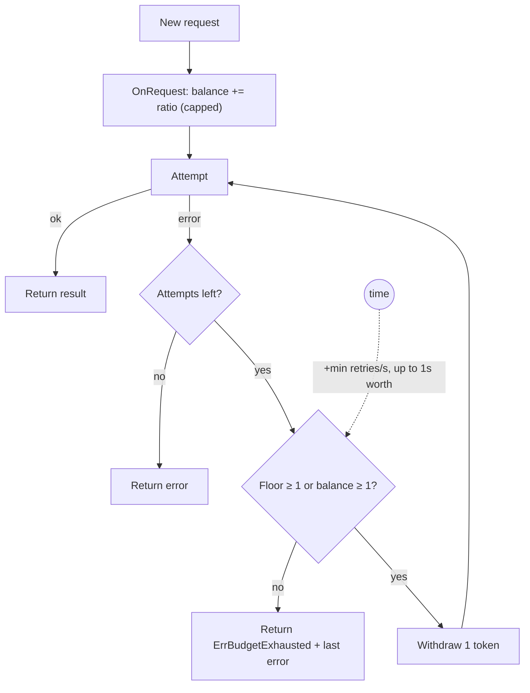

# Retry Budget

## Problem

A retry limit like "up to 3 attempts" applies to each request, so it does nothing to limit the client as a whole. It is fine while failures are rare, but when a dependency gets sick it turns against you:

- **Retry storms.** If an SMS provider fails 50% of calls, every request uses 1.75 attempts on average; at 90% failure it is 2.71, and at 100% exactly 3. The provider gets almost three times its normal traffic at the moment it is weakest, and the extra load can stop it from recovering.
- **Multiplication across layers.** If a gateway, a service and a client library each make 3 attempts, one user request can turn into 3 × 3 × 3 = 27 calls to the bottom dependency.
- **Wasted work.** Most of those retries fail as well. In an OTP flow they also cost money (some providers bill per attempt) and can send several codes to the same phone once the provider recovers.

## Solution

Give each client (or each client-to-destination pair) a **retry budget**: retries are allowed only up to a fixed fraction of recent first attempts, for example 10%.

- A shared token account. Each **first attempt deposits** `ratio` tokens (0.1) and each **retry withdraws** one token. Over time, retries ≤ ratio × requests, however badly the dependency fails.
- A **cap** on the balance, so a long healthy period cannot bank thousands of retries to spend all at once when an outage starts.
- A small **minimum-retries-per-second floor**, so a client sending one request a minute can still retry when it needs to.
- Keep the per-request **attempt limit** too. The budget limits the client as a whole, the attempt limit limits each request, and you want both.

In healthy periods the account is full and sporadic failures are retried as usual. In an outage it drains in seconds, and the client falls back to roughly one attempt per request plus 10%.

## Diagram



## How this implementation works

- `New(ratio, opts...)` returns a `*Budget`. Options: `WithMaxBalance(n)` (cap on deposited tokens, default 10), `WithMinRetriesPerSecond(n)` (the floor, default 0) and `WithClock(now)`. Invalid values return errors, and so does a budget with ratio 0 and no floor, since it could never allow a retry.
- `OnRequest()` deposits `ratio` tokens. Call it once per logical request, never per retry: retries must not earn more retries.
- `Allow() bool` withdraws one token if it can. The floor is spent first, because it refills with time whether it is used or not, and deposits are kept for bursts. The floor accrues at `n` per second up to one second's worth (at least one token), and a clock that goes backwards never refills it.
- `Do(ctx, maxAttempts, fn)` combines both. It calls `OnRequest`, then asks `Allow` before each retry, stops on success, on context errors and when attempts run out, and returns `ErrBudgetExhausted` joined with the last error when the budget refuses.
- `Balance()` and `Stats()` (requests, retries allowed, retries denied) are there for metrics. A rising `Denied` count means the dependency is failing more often than the budget allows.
- A small epsilon absorbs floating-point drift, so ten deposits of 0.1 add up to one token.

**Simplification.** Finagle expires deposits after a time window (10 seconds by default), so the budget tracks *recent* traffic. Here a balance cap does the same job more crudely: old deposits never expire, they just can't pile up beyond the cap. `Do` doesn't sleep between attempts; in production put [backoff and jitter](../retry-backoff) and a per-attempt [timeout](../timeout) around each call. Every error except a context error is treated as retryable; classify errors (don't retry 4xx) as `retry-backoff` does.

**The gRPC-style variant.** gRPC's retry throttling (and `retrybackoff.Budget` in [retry-backoff](../retry-backoff)) uses outcomes rather than requests: each *failure* takes 1 token, each *success* adds `tokenRatio` (e.g. 0.1), the bucket holds `maxTokens`, and retries are allowed only while it is more than half full. The effect is similar: when failures outnumber successes by more than 10 to 1 the bucket drains and retries stop. It reacts to the dependency's health; the Finagle style used here guarantees a fixed ratio of retries to requests. Envoy's budget is a third flavour: active retries may not exceed `budget_percent` of active requests, with a floor of `min_retry_concurrency`.

## Trade-offs

| Pro | Con |
| --- | --- |
| Load on a failing dependency is bounded to about (1 + ratio)× whatever the failure rate | In a partial outage fewer requests succeed: retries that would have worked are refused (56% vs 88% OTPs sent at 50% failure in the example) |
| Sporadic failures in healthy periods are still retried | One more piece of shared mutable state per destination, and one more number to tune |
| Layered retries compound to 1.1ⁿ instead of 3ⁿ | Per-client budgets only bound each client; a million clients at 1.1× is still a lot, so the server also needs [load shedding](../load-shedding) |
| Cheap: a mutex and two floats, no timers or goroutines | Low-traffic clients barely earn tokens and rely on the floor, which you must size |
| `Denied` is a clear signal that a dependency is failing more than you can afford to retry | Doesn't stop first attempts to a dead dependency; that's the [circuit breaker](../circuit-breaker)'s job |

## When to use / when not to

**Use it** wherever a client retries automatically: RPC and HTTP clients, SDKs, service meshes, queue consumers, and especially at every layer of a deep call chain. Pay particular attention to calls to paid or rate-limited third parties (SMS, email, payment providers), where a retry storm costs money or gets you throttled.

**Don't rely on it alone** when the dependency is fully down: a circuit breaker stops the first attempts as well. Don't size a budget so small that it starves retries in healthy periods (keep the ratio well above your normal error rate), and don't use it as admission control for the server; that is load shedding or rate limiting.

## Real-world examples

- **Finagle** (Twitter's RPC library) has `RetryBudget`: deposits per request within a TTL window, 20% by default, plus a minimum of 10 retries per second. This package follows its design.
- **gRPC** retry throttling is configured per service with `maxTokens` and `tokenRatio` in the service config, as described above.
- **Envoy** retry budgets (`retry_budget` with `budget_percent` and `min_retry_concurrency`) limit retries to a share of active requests for each upstream cluster.
- **The Google SRE book** (chapter "Handling Overload") recommends a per-request limit of 3 attempts *and* a per-client limit where retries stay under 10% of requests, and retrying at a single layer.
- **AWS SDKs** have a client-wide retry quota (a token bucket): failed calls take tokens to retry, successes return them, and when it is empty retries stop.

## Run it

```sh
go run ./patterns/reliability/retry-budget/example
go test ./patterns/reliability/retry-budget/
```

The example has 1000 clients, each with its own budget (10%, cap 2, floor 0.01 retries/s), sending one OTP request per second through 4 one-minute phases:

| Phase | Failure rate | Plain 3 attempts: load / OTPs sent | With 10% budget: load / OTPs sent |
| --- | --- | --- | --- |
| healthy | 2% | 1.02× / 100.0% | 1.02× / 99.9% |
| degraded | 50% | 1.75× / 87.6% | 1.13× / 56.4% |
| outage | 90% | 2.71× / 27.1% | 1.11× / 11.2% |
| recovered | 2% | 1.02× / 100.0% | 1.02× / 99.9% |

The budget phases sit a little above 1.10×: the cap and the floor allow a few retries beyond 10%, and each client spends its banked tokens at the start of the degraded phase. In the healthy phases a few dozen retries out of about 1200 are refused (32 and 75). Each client earns only 0.1 tokens a second, so a client that fails twice within a few seconds, or that is still refilling after the outage, has to wait. A budget shared by the whole process (one per destination rather than per client) would smooth that out. The success-rate column is the honest cost: during a partial outage, plain retries send more OTPs, at the price of 1.75× load on the provider.

With three layers and the provider down, 1000 user requests produce 27,000 provider calls with plain retries and 1,331 (1.1³ per request) with a budget at each layer.

## Related patterns

- [Retry with backoff](../retry-backoff): when and how long to wait between attempts; it includes a gRPC-style budget. The two go together.
- [Circuit breaker](../circuit-breaker): stops all calls, first attempts too, once a dependency is clearly down.
- [Load shedding](../load-shedding): the server-side defence when clients don't limit themselves.
- [Rate limiter (token bucket)](../rate-limiter-token-bucket): the same token mechanism, used to limit requests instead of retries.
- [Timeout](../timeout): bound each attempt so retries don't blow the caller's deadline.

## Further reading

- Arvind Kumar, [OTP Service Fails During Peak Traffic](https://codefarm0.medium.com/otp-service-fails-during-peak-traffic-system-design-deep-dive-on-rate-limiting-retry-storms-7c2677aded90), on retry storms against an SMS provider, rate limiting and provider failover
- Google SRE book, chapter "Handling Overload", on per-request and per-client retry limits and why to retry at only one layer
