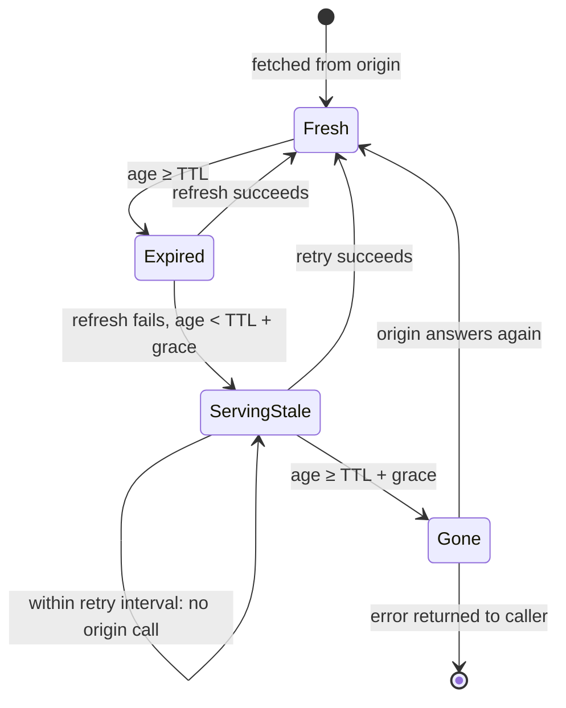

# Serve-Stale (stale-if-error)

## Problem

A cache in front of an origin hides most of the origin's latency, but not its outages. When the origin goes down:

- Every cached entry that expires during the outage turns into an error. A TTL that was meant to bound *staleness* ends up bounding *availability*: the service lasts only one TTL longer than its origin.
- The value that just expired was perfectly good a millisecond ago, and for most content (product pages, articles, profiles, configuration, video manifests) a few minutes old beats an error page.
- Every request for an expired key retries the failing origin, adding load to a system that is already struggling to recover.

## Solution

Keep expired entries for an extra **stale-if-error** grace period, and only use them when the origin fails:

1. **Fresh** (age < TTL): serve from cache.
2. **Expired**: ask the origin. On success, store and serve the new value.
3. **Expired, origin failed, age < TTL + grace**: serve the old value, flagged as stale so callers can show a banner, add a header or log it.
4. **Beyond the grace period**, or nothing cached: return the origin's error.

To protect the struggling origin, a failed refresh also starts a short **retry interval** for that key: requests during it get the stale value without asking the origin again. Recovery is automatic, since the first successful refresh replaces the stale value.

## Diagram



## How this implementation works

- `New(loader, ttl, staleIfError, opts...)` returns a `Cache[K, V]`. `WithRetryInterval(d)` and `WithClock` are the options.
- `Get` returns a `Result[V]`: the `Value`, whether it is `Stale`, its `Age` since the last successful fetch, and the `Cause` (the origin error) when stale. A stale answer comes with a nil error: the request succeeded, degraded.
- Each entry records when it was fetched, the last origin error, and `retryAt`. While `now < retryAt`, an expired entry is served stale without calling the origin.
- The lock is released while the loader runs, so a slow origin doesn't block reads of fresh keys. Entries past their grace period are deleted when they fail.
- `Stats` counts fresh hits, successful refreshes, stale answers, errors and origin calls. The example uses origin calls to show what the retry interval saves.

**Simplification.** Concurrent requests for the same expired key can each call the origin once before the first failure sets the retry interval. Combine with request coalescing (as in [cache-aside](../../data/cache-aside)) to make it exactly one.

## Trade-offs

| Pro | Con |
| --- | --- |
| An origin outage shorter than the grace period is invisible to readers | Users can see data up to TTL + grace old, possibly wrong prices or stock |
| Fewer calls to a failing origin, helping it recover | Memory: expired entries are kept for the grace period instead of freed |
| Graceful by default and needs no fallback content | Hides failures: without alerting on the stale count, an outage can go unnoticed |
| Callers get `Stale` and `Age`, so the UI or API can be honest about it | Not every error should be masked: a 404 or "deleted" must not serve the old copy |

## When to use / when not to

**Use it** for read-mostly content where availability matters more than the last few minutes of freshness: catalogues, articles, user profiles, search results, recommendations, feature flags and configuration, CDN-served pages and media manifests.

**Don't use it** where a stale answer is worse than an error: account balances, payment status, stock at checkout, permissions and revocations. Also don't treat "not found" or "forbidden" from the origin as failures. Only serve stale on errors that mean "can't answer right now" (timeouts, 5xx, connection refused).

## Real-world examples

- **HTTP** standardises it as `Cache-Control: stale-if-error=<seconds>` (RFC 5861), alongside `stale-while-revalidate`.
- **CDNs** expose it directly: Fastly calls it *serve stale* with a "grace" period, Varnish has `beresp.grace`, Nginx has `proxy_cache_use_stale error timeout http_5xx`, and CloudFront serves stale objects when the origin returns errors.
- **DNS resolvers** can serve expired records when authoritative servers are unreachable (RFC 8767, "serve-stale"), which kept many sites resolvable through major DNS-provider outages.

## Run it

```sh
go run ./patterns/reliability/serve-stale/example
go test ./patterns/reliability/serve-stale/
```

## Related patterns

- [Fallback](../fallback): serve something else when a dependency fails; serve-stale is a fallback whose "something else" is the last good value
- [Circuit breaker](../circuit-breaker): stops calling the origin for *every* key once it is clearly down; the retry interval here is the per-key version
- [Refresh-ahead](../../data/refresh-ahead): refreshes before expiry so the outage window has less to break
- [Tiered cache](../../architecture/tiered-cache): CDN edges and shields, where stale-if-error is used most

## Further reading

- Khyati Jha, [High Level System Design Day-12: CDN (Part 3)](https://medium.com/high-level-system-desgin-interview-prep/high-level-system-design-day-12-cdn-part-3-82c1c6eeac3f), on what a CDN does when the origin is down
