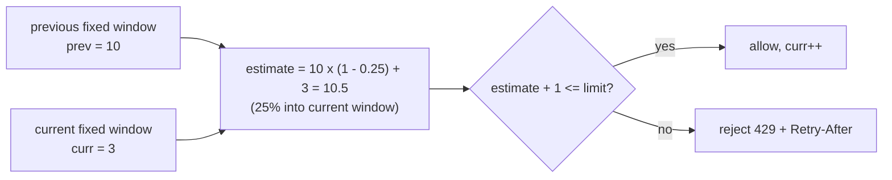

# Sliding Window Rate Limiter

## Problem

Quotas are usually phrased as "N requests per window": 100 per minute per API
key, or 5 login attempts per 15 minutes. The obvious implementation, a counter
that resets at the top of every minute (a *fixed window*), has a hole: a
client can send N requests at 12:00:59 and N more at 12:01:00, which is 2N in
one second, and still be within quota.

## Solution

Count over a window that **slides** with the current time, so any interval of
length `Window` contains at most `Limit` accepted requests. There are two
standard ways:

- **Sliding log**: remember the timestamp of every accepted request, drop the
  ones older than `Window`, and allow while fewer than `Limit` remain. Exact,
  but memory grows with `Limit`.
- **Sliding window counter**: keep only the counts for the current and the
  previous fixed window, and estimate
  `prev * (1 - elapsed/window) + curr`. O(1) memory with a small, bounded
  error, which is why it is popular in large-scale and Redis-backed limiters.

## Diagram



## How this implementation works

- `Log.Allow()` calls `evict(now)` to drop timestamps at or before
  `now - window` (they are stored oldest first, so this is a prefix trim),
  then appends if there is room. Its memory is bounded by `Limit` entries.
- `Log.RetryAfter()` finds the oldest timestamp that must expire before a new
  request fits, and returns the value for a `Retry-After` header.
- `Counter.roll(now)` shifts `curr` into `prev` when exactly one window has
  passed, and zeroes both after a longer silence. `estimate(now)` applies the
  overlap weight.
- Both take an injected clock, treat `limit <= 0` as "deny everything", and
  default `window <= 0` to 1s rather than panicking.

## Trade-offs

| | Sliding log | Sliding counter |
|---|---|---|
| Accuracy | exact | approximate: assumes the previous window's requests were evenly spread |
| Memory per key | O(Limit) timestamps | 2 integers + 1 timestamp |
| Retry-After | exact | estimated |

- Both are stricter than a [token bucket](../rate-limiter-token-bucket) for
  quota semantics, but neither smooths traffic the way a
  [leaky bucket](../rate-limiter-leaky-bucket) does.
- Distributed enforcement needs shared state. The counter variant maps cleanly
  onto two Redis `INCR` keys with TTLs; the log maps onto a sorted set.

## When to use / when not to

Use for user-visible quotas ("1000 calls per hour"), abuse prevention such as
login attempts and OTP sends, and billing tiers. For protecting your own
capacity under load, prefer [load shedding](../load-shedding); for smoothing
traffic, use a leaky bucket.

## Real-world examples

- Cloudflare's engineering blog describes counting requests at scale with the
  sliding window counter approximation, two counters weighted by overlap.
- Redis-based limiters commonly implement the sliding log with sorted sets
  (`ZADD`, `ZREMRANGEBYSCORE`, `ZCARD`) and the counter with `INCR` plus
  `EXPIRE`.

## Run it

```sh
go run ./patterns/reliability/sliding-window-rate-limiter/example
go test ./patterns/reliability/sliding-window-rate-limiter/
```

## Related patterns

- [Token bucket](../rate-limiter-token-bucket): rate plus burst instead of a hard quota.
- [Leaky bucket](../rate-limiter-leaky-bucket): constant-rate output.
- [Load shedding](../load-shedding): capacity protection rather than fairness.
- [API gateway](../../architecture/api-gateway): where quotas are typically enforced.
- [Sharded counters](../../architecture/sharded-counters): scaling hot counters for limits.
- [Consistent hashing](../../data/consistent-hashing): routing a key's limiter state to one node.
